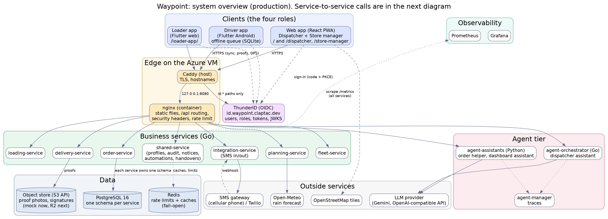
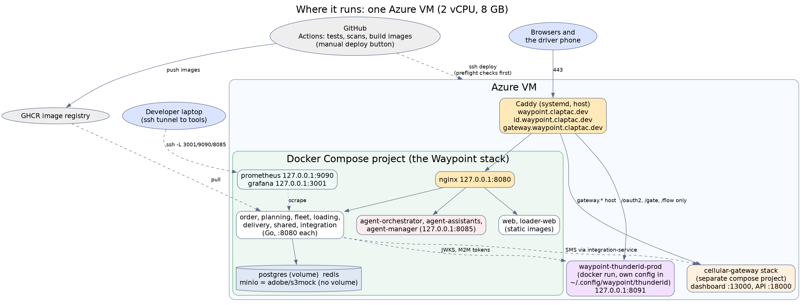
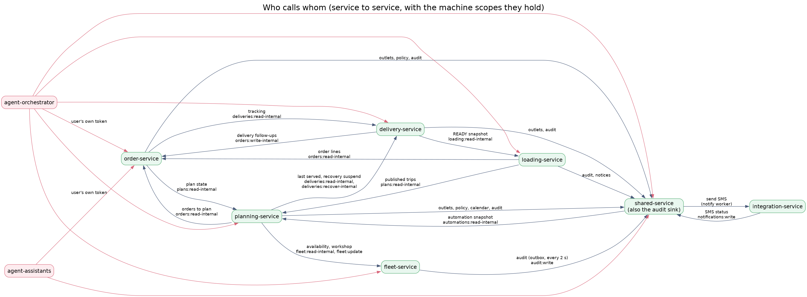
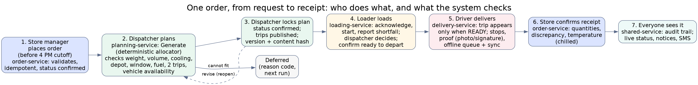
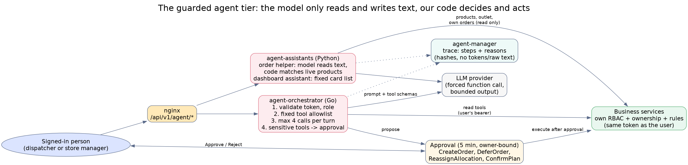
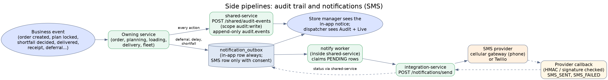

# Waypoint Architecture Guide

How the system is built, what each part does, and how the parts talk to each other. It is written from the code and the running production system (21 to 30 October 2026). The diagrams are in `docs/architecture-guide/` (Graphviz sources next to each image, so they can be edited and re-rendered).

**Read this first.** Waypoint plans and tracks deliveries for four people: the **store manager** (orders), the **dispatcher** (plans and allocates vehicles), the **loader** (loads the vehicle) and the **driver** (delivers). Everything below exists to move one order safely through those four hands, with every step checked by rules and written to an audit trail.

> **Release note.** The 30 October merges (store order panel and product search, vehicle search, server-time cutoff notice, disruption recovery with migrations 0079 to 0081, shift handover, priority task queues and the weather map) are on `main` but take effect on the production VM only when the next deploy runs.

## 1. The big picture

Five ideas explain most of the design:

1. **Each service owns its own data.** One PostgreSQL server, but one schema per service, and a service never reads another service's tables. It asks the owning service over HTTP.
2. **Rules are code, not AI.** Planning, constraints, cutoffs and receipts are deterministic. The AI only reads and writes text, and it can't act without a person's approval.
3. **Every layer checks permission again.** The edge, the token, the role, the resource owner and the business rule are separate checks. The AI tier forwards the user's own token, so it can never do more than the user can.
4. **Cache and helpers fail open; records never do.** If Redis is down, requests are slower but still work. Audit records and SMS go through outboxes so they are retried instead of lost.
5. **Offline is normal for the driver.** The driver app keeps its own queue and syncs with idempotency keys, so repeating a message is safe.

## 2. The components

### 2.1 Clients

| Client | Built with | Who uses it | Notes |
|---|---|---|---|
| **Web app** | React + Vite, installable PWA (service worker), English / Sinhala / Tamil, Leaflet maps with OpenStreetMap tiles | Dispatcher, store manager | Served at `/`; workspaces at `/dispatcher` and `/store-manager`. Signs in with OIDC (authorization code + PKCE). The page polls the API for live data. It also builds the priority task queues and the weather and disruption map from the services' existing data. |
| **Loader app** | Flutter web | Loader | Served at `/loader-app/`. Online only; refreshes about every 45 seconds; shared-tablet timeout of 15 minutes. |
| **Driver app** | Flutter, Android | Driver | Offline-first: actions go to a local SQLite queue and sync later. Takes photos and signatures, reports GPS, and signs in through the system browser (AppAuth). Tokens are kept in the Android Keystore. The trip date is the Colombo business day, worked out from UTC. |

None of the clients ever talks to the database. All of them reach the system through one hostname, `waypoint.claptac.dev`.

### 2.2 The edge: Caddy and nginx

- **Caddy** runs on the VM itself. It owns the public ports 80 and 443, gets and renews the HTTPS certificates, and routes by hostname:
  - `waypoint.claptac.dev` goes to nginx (`127.0.0.1:8080`);
  - `id.waypoint.claptac.dev` goes to the identity server, but only the sign-in paths (`/.well-known`, `/oauth2`, `/gate`, `/flow`); every other path gets 404, so the admin console is not public;
  - `gateway.waypoint.claptac.dev` goes to the SMS gateway's dashboard and API.
- **nginx** runs in the Compose stack. It serves the static web and loader apps and the driver APK, and routes `/api/v1/<domain>` to the right service. It adds the security headers (content security policy, no framing, no sniffing), limits requests to 50 per second per visitor with a burst of 200, and keeps the real visitor address from Caddy.

| Path | Goes to |
|---|---|
| `/api/v1/orders` | order-service |
| `/api/v1/planning` | planning-service |
| `/api/v1/fleet` | fleet-service |
| `/api/v1/loading` | loading-service |
| `/api/v1/delivery` | delivery-service |
| `/api/v1/shared` | shared-service |
| `/api/v1/integrations` | integration-service |
| `/api/v1/agent/order-assistant`, `/dashboard-assistant`, `/assistants` | agent-assistants |
| `/api/v1/agent` (everything else) | agent-orchestrator |

### 2.3 Identity: ThunderID

ThunderID is the OpenID Connect provider. In production it is a **separate container** (`waypoint-thunderid-prod`) with its own configuration folder on the VM; it is not part of the Compose stack. It holds three kinds of client:

- **People's apps:** `waypoint-web`, `waypoint-loader` (browser) and `waypoint-driver` (phone). They use the authorization code flow with PKCE.
- **Services:** one machine client per service (`waypoint-planning-service` and so on). They use the client-credentials flow and receive only the scopes their role grants.
- **The API resource** ("Waypoint API"): the list of scopes such as `plans:read-internal`, `audit:write` and `deliveries:recover-internal`. A service that asks for an undefined scope is refused a token, so the deploy preflight checks the list before a release.

A person's **role is not read from the token.** The token proves who they are (`sub`). Each service looks up the role and the outlet or vehicle they belong to in the database (`shared-service`, `GET /shared/profiles/me`, cached for 30 seconds in Redis).

### 2.4 The business services

All are Go programs built on the same shared library (`pkg/`), each listening on port 8080 inside the stack. Every request goes through the same layers: validate the token (RS256, expiry, issuer, audience), look up the profile, check the permission, check ownership of the resource, then apply the business rule.

| Service | Owns (schema) | What it does | Background work |
|---|---|---|---|
| **order-service** | `orders` | Creates orders (idempotent), applies the 4 PM cutoff and the operating calendar, tracks an order across planning, loading and delivery, takes receipts and discrepancies, forecasts demand, imports and exports. Reports the server time so screens do not trust the laptop clock. | None |
| **planning-service** | `planning` | Creates one plan per delivery date. The **deterministic allocator** assigns orders to vehicles and trips and records the reason when it can't. Locks (confirms) plans, revises them, tracks field acknowledgements and reminders, handles breakdown rescue and disruption recovery, and reads rain forecasts from Open-Meteo. | None |
| **fleet-service** | `fleet` | Vehicles, availability per date (default available), incidents, fuel ledger and weekly quota. | Audit outbox publisher, every 2 seconds |
| **loading-service** | `loading` | Loading sessions per trip, shortfall and damage issues, the dispatcher's decision, and the **READY snapshot** the driver is allowed to start from. | None |
| **delivery-service** | `delivery` | Delivery runs and stops, proofs (photo or signature, uploaded as files), idempotent offline sync and conflict handling, GPS reports, trip messages, arrival estimates. | Proof retention worker (off by default) |
| **shared-service** | `shared`, `audit` | Users, roles and profiles; outlets, products, calendar, policy; **audit log** (append-only); notification outbox and preferences; dashboards; personal automations and the habit helper; shift handovers. | Notify worker (sends queued SMS); automation runner, every 15 seconds |
| **integration-service** | none | The edge to outside messaging: sends SMS through the provider, and receives the provider's callbacks. | None |

### 2.5 The agent tier

| Part | Language | Job |
|---|---|---|
| **agent-orchestrator** | Go | The dispatcher's "Waypoint assistant". A fixed allowlist of tools, argument schemas, at most four calls per turn, and approvals for any action that changes data. Also drafts personal workflows. |
| **agent-assistants** | Python (FastAPI, LangGraph) | The **order helper** (reads a typed order, matches it to the live product list) and the **dashboard assistant** (chooses from a fixed set of cards). |
| **agent-manager** | Go | Records what each agent did and why, as steps with reasons. Holds no tokens, no raw text, no business data. Viewer on `127.0.0.1:8085`. |

Neither the orchestrator nor the assistants has a database connection; a CI check fails if they import a database driver. See section 4.5.

### 2.6 Data stores

| Store | Holds | Notes |
|---|---|---|
| **PostgreSQL 16** | All business data and the audit log | Schemas: `orders`, `planning`, `fleet`, `loading`, `delivery`, `shared`, `audit`. Each service has its own database login that can touch only its own schema. Migrations are numbered SQL files in `database/migrations`. |
| **Redis 7** | Per-user rate limits, profile cache (30 s), live run position (20 s) | Optional. Every call treats a Redis problem as a cache miss. |
| **Object store (S3 API)** | Proof photos and signatures | `delivery-service` writes and `loading-service` reads. Today a test mock (`adobe/s3mock`, no persistent volume); Cloudflare R2 is prepared. |

### 2.7 Outside services

| Service | Used for | By |
|---|---|---|
| LLM provider (Gemini, OpenAI-compatible API) | Reading and writing text | orchestrator, assistants |
| Open-Meteo | Rain forecasts for disruption risk | planning-service |
| OpenStreetMap tiles | Map background | web app (browser) |
| SMS gateway (a phone running the gateway app) or Twilio | Sending text messages | integration-service |

Travel times between depots and outlets come from a stored table in `shared-service`, not from a live routing service.

### 2.8 Observability and delivery tooling

- **Prometheus** scrapes `/metrics` on every service every 15 seconds and evaluates the alert rules. **Grafana** draws four dashboards from it. Logs are JSON on each container's output, with a correlation id on every request. OpenTelemetry tracing is built in but switched off.
- **GitHub Actions** runs tests and security scans, builds images into GHCR, and on a manual trigger deploys to the VM over ssh after preflight checks.

## 3. Where it runs

- **One Azure VM** (2 vCPU, 8 GB) runs everything. The Waypoint stack is one Docker Compose project. Caddy and the identity server run beside it, and the SMS gateway is a separate Compose project on the same machine.
- **Operations tools are not public.** Prometheus, Grafana and the agent manager listen on `127.0.0.1` and are reached through an ssh tunnel.
- **Images** are built by CI, tagged with the full commit, and pulled onto the VM. Secrets live in the VM's `.env` and in the identity server's own folder; none are in the repository.
- **Not provided:** high availability. There is one VM, one database server and one object store.

## 4. How the parts communicate

### 4.1 Three kinds of caller, three kinds of token

| Caller | How it proves itself | What the service checks |
|---|---|---|
| **A person** (browser or phone) | Bearer access token from ThunderID | Signature, expiry, issuer, audience; then role and ownership from the database |
| **A service** (machine) | Bearer token from the client-credentials flow, with scopes | The scope for that internal route (for example `plans:read-internal`) |
| **An outside provider** (SMS callback) | A signature on the request (HMAC or Twilio signature), no bearer token | The signature; unsigned or wrong requests are refused |

### 4.2 Service-to-service calls

Rules of thumb:

- **Calls are plain HTTP on the private Compose network**, each with a short timeout and a correlation id.
- **Internal routes** (`/internal/...`) answer only to a service token with the right scope.
- **Audit goes one way:** every service posts its events to `shared-service`. `fleet-service` uses an outbox so a failed post is retried.
- **No shared tables.** If `planning-service` needs an order, it calls `order-service`.

### 4.3 What happens on one API call

1. The browser sends `GET /api/v1/orders` with the bearer token to `waypoint.claptac.dev`.
2. **Caddy** terminates TLS and passes it to **nginx**, which applies the per-visitor limit, adds the headers, and routes `/api/v1/orders` to `order-service:8080`.
3. The service's shared layer validates the token against the identity server's signing keys (cached), applies the per-user limit (Redis), and records the request in the metrics.
4. It resolves the person's profile (role, outlet) from `shared-service`, or from the 30-second cache.
5. The route checks the permission, then ownership (a store manager sees only their own outlet).
6. The service does the work in its own schema, then writes an audit event if something changed.
7. The reply comes back as JSON, or as an RFC 7807 problem document on error. A 500 logs the real cause on the server and shows the client only "unexpected error".

### 4.4 One order from request to receipt

| Step | Who | What the system checks or records |
|---|---|---|
| 1. Order | Store manager | Valid lines, outlet ownership, idempotency key, the cutoff (an order after 4 PM moves to the next operating day), status `confirmed` |
| 2. Plan | Dispatcher | The allocator checks weight and volume, cooling, depot match, delivery window, fuel quota, two trips per vehicle per day and vehicle availability. An order that can't fit gets a **reason code** and becomes a deferral. The dispatcher can also assign by hand; the server re-checks every constraint. |
| 3. Lock | Dispatcher | The plan becomes `confirmed`, trips are published, and the content gets a version and hash. **A later change creates a new version.** "Revise" reopens a plan for changes. |
| 4. Load | Loader | Acknowledge the plan, start loading, report a shortfall or damage. The dispatcher decides (for example accept a partial load) and the driver is told. The loader confirms **ready to depart**, which creates the READY snapshot. |
| 5. Deliver | Driver | The trip appears only once READY. At each stop: arrival, proof (photo or signature is required), outcome (delivered, partial, refused...). Actions queue offline and sync with idempotency keys. |
| 6. Receipt | Store manager | Confirm received quantities, report a discrepancy, record temperature for chilled goods. |
| 7. Trail | Everyone | Audit events for every step; live status; in-app notices and SMS where the outlet consented. |

**Locking is not automatic.** A person presses Generate, and a person presses Lock plan. The system proposes and checks. The only automatic rule is the 4 PM cutoff, which decides which run an order belongs to.

**Fleet.** Vehicles aren't reserved separately. A vehicle is committed by being in the locked plan, and there is one plan per date. Availability per date comes from `fleet-service`; a breakdown moves the trip to another vehicle and puts the broken one in the workshop for that date.

### 4.5 The guarded agent tier

- The model is outside our control, so it is boxed in. It receives a prompt and tool schemas and returns text or a tool request. **Our code** validates the request, calls the business service with the user's own token, and returns the result.
- **Sensitive tools** (`CreateOrder`, `DeferOrder`, `ReassignAllocation`, `ConfirmPlan`) never run directly. The orchestrator creates an approval that only the same person can accept, within five minutes. After approval the business service checks permissions and rules again.
- **The order helper** turns typed text into a draft for the existing order form. The family names come from the live product list, and anything it can't match becomes a question. It never submits.
- **If the model is down**, the screens say so and the person fills in the form by hand. Everything else keeps working.
- Each agent request leaves a trace in the agent manager: ordered steps, each with a reason.

### 4.6 Audit and notifications

- **Audit:** every service posts an event to `shared-service` using the `audit:write` scope. Events are append-only and searchable from the dispatcher's Audit page. They hold hashes of agent inputs, never raw text or tokens.
- **Notifications:** an event such as a deferral or loading shortfall writes a row to the notification outbox. An in-app notice is always created. An SMS row is created only if the outlet has consent. A worker in `shared-service` claims pending rows and asks `integration-service` to send them.
- **The cellular gateway** reports only "sent" or "failed", never "delivered", so a gateway text is final at "sent". Phone numbers and message bodies are erased seven days after the last attempt.

### 4.7 The driver's offline path

1. The driver acts in the app. The action goes into the local queue with an idempotency key and the time it happened.
2. With a connection, the app calls `POST /delivery/sync`. Proof files travel separately, as uploads, and the sync message never carries file bytes.
3. The server applies each operation once. A repeat gets the same answer. An operation that can no longer apply is stored as a **sync conflict**, which a dispatcher sees and settles.
4. If a stop was handed over during a breakdown rescue, a database guard refuses a late completion on the old vehicle.

## 5. Cross-cutting design

| Concern | How it is handled |
|---|---|
| **Authentication** | OIDC code + PKCE for people, client credentials for services, signed callbacks for providers. The driver's tokens sit in the Android Keystore; the web app keeps its tokens in the browser session (PR #180 stops it keeping the refresh token; until that is merged and deployed the refresh token is stored too). |
| **Authorization** | Role and permission, then ownership of the resource, then the business rule, in every service. The role comes from the database. |
| **Integrity** | Idempotency keys, strict JSON, size and file-type limits on uploads, content-hashed plan versions, an append-only audit table with SQL tests. |
| **Resilience** | Redis is fail-open; audit and SMS use outboxes; the driver app is offline-first; sync is idempotent; a failed SMS provider doesn't block the workflow. |
| **Privacy** | Latest GPS point only; SMS data erased after 7 days; proof retention worker (off until a period is approved); metrics use route templates, so no ids or personal data. |
| **Change safety** | CI runs the tests and scans; images are tagged by commit; the deploy preflight refuses development credentials, wrong identity settings and undefined scopes before touching anything. |
| **Observability** | Metrics, alerts and dashboards; JSON logs with a correlation id; agent traces. |

## 6. Known limits (honest list)

- **One VM**, no failover, no tested restore.
- **Proof storage** is a mock without a persistent volume until the move to R2 is done.
- **No image viewer** for proofs yet. The screens show the proof count, time and receiver name; the image sits in the object store.
- **Web tokens** are in the browser session. A cross-site scripting bug could expose the access token (one hour). The stronger fix is a backend-for-frontend that keeps tokens server-side; it is not built.
- **"Revise published plan"** has no confirmation step.
- **Orders can't be cancelled**; the dispatcher defers them.
- **Tracing** (OpenTelemetry) is built but off.
- **SOC 2:** a readiness assessment exists; the product is not certified.

## 7. Where to find things in the repository

| You want | Look in |
|---|---|
| A service's code | `services/<name>/cmd/server` (start-up) and `internal/` (handler, service, store, domain) |
| Shared Go code | `pkg/` (auth, authorization, cache, httpx, logging, telemetry, objectstore, audit, oauth) |
| The web app | `apps/web/src` (dispatcher, store-manager, auth, api) |
| The loader and driver apps | `apps/loader-web`, `apps/driver-mobile` |
| Database | `database/migrations`, `database/roles.sh` |
| API contracts | `contracts/openapi` |
| nginx, Prometheus, Grafana | `infrastructure/nginx`, `infrastructure/observability` |
| Agents | `services/agent-orchestrator`, `services/agent-assistants`, `infrastructure/agent-manager` |
| Release process | `.github/workflows/ci-cd.yml`, `docs/ci-cd.md` |
| More detail | `docs/architecture/` (agent plane, security, offline sync, observability), `docs/TEST_AND_PERFORMANCE_REPORT.md`, `docs/SOC2_READINESS_ASSESSMENT.md` |

## 8. Glossary

- **PKCE**: a way for a browser or phone app to sign in safely without a stored secret.
- **Scope**: a named permission a machine token carries, for example `audit:write`.
- **Idempotency key**: a unique id on a request so that repeating it has no extra effect.
- **Outbox**: a database table of messages waiting to be sent, so a failure is retried instead of lost.
- **READY snapshot**: the loader's confirmed record of a loaded trip; the only thing a driver can start from.
- **Deferral**: an order the plan can't carry, with a reason code and a next-run date.
- **BFF (backend-for-frontend)**: a server that holds tokens for a web app so the browser never sees them. Not built here.
