# Waypoint — Complete Project Documentation

> **Team ClapTac · Tech-Triathlon 2026**
> Delivery planning and operations, from order to confirmed receipt.

| | |
|---|---|
| **Baseline documented** | The `bug-fixes` branch, treated as if it were `main`. It is `origin/bug-fixes` at the merge of PR #114 plus the live-map change from PR #115 (`0328ff0`). The working tree was compared with `origin/bug-fixes` and has no differences. |
| **How this was written** | Every statement was checked against the source code, SQL migrations, Compose/NGINX/Kubernetes files and CI workflow in this checkout. Where an older document in `docs/` disagrees with the code, the code is followed and the disagreement is listed in [Chapter 14](#14-documentation-drift-and-known-limitations). |
| **Audience** | New engineers, reviewers, operators, and anyone who needs to understand the whole system without reading the whole repository. |

---

## Table of contents

1. [What Waypoint is](#1-what-waypoint-is)
2. [Repository map and technology stack](#2-repository-map-and-technology-stack)
3. [System architecture](#3-system-architecture)
4. [Cross-cutting design](#4-cross-cutting-design) (identity, authorization, errors, audit, telemetry)
5. [Backend services in depth](#5-backend-services-in-depth)
6. [Use cases, workflows and state machines](#6-use-cases-workflows-and-state-machines)
7. [Data model and database](#7-data-model-and-database)
8. [API reference](#8-api-reference)
9. [Client applications](#9-client-applications)
10. [Infrastructure, deployment and CI/CD](#10-infrastructure-deployment-and-cicd)
11. [Operations](#11-operations) (observability, backup, retention, runbooks)
12. [Security and privacy](#12-security-and-privacy)
13. [Testing and quality](#13-testing-and-quality)
14. [Documentation drift and known limitations](#14-documentation-drift-and-known-limitations)
15. [Things we avoid (design rules and anti-patterns)](#15-things-we-avoid)
16. [Appendices](#16-appendices)

---

## 1. What Waypoint is

Waypoint is a delivery planning and operations platform for a retail group with three brands — **Fresh** (groceries, including chilled goods), **Style** (apparel) and **Tech** (electronics, including serial-numbered high-value items). Stores order goods; a central dispatcher decides which truck carries which order; depot loaders load the trucks; drivers deliver with proof; stores confirm what actually arrived. Every step is recorded so the chain from order to receipt can be explained afterwards.

It was built for the Tech-Triathlon 2026 hackathon (the *Hackathon* track — the platform) and sits alongside a separate *Datathon* track (forecasting and allocation analytics, in `datathon/`). The operating context is Sri Lanka: all business time is **Asia/Colombo (UTC+05:30)**, the interface is available in **English, Sinhala and Tamil**, and the supplied dataset has 120 outlets served from two depots.

### 1.1 The four people it serves

| Role | Who they are | What they do in Waypoint | Where they work |
|---|---|---|---|
| **Store Manager** | Runs one outlet (for example `OUT034`) | Places orders, tracks them, reads deferral notices, confirms receipt, reports discrepancies, manages the outlet's notification settings, builds personal dashboards and automations | Web app `/store-manager` |
| **Dispatcher** | Central planner | Reviews the order queue, generates and adjusts the daily plan, defers what cannot be served, publishes the plan, watches live trips, manages fleet and master data, reads the audit log | Web app `/dispatcher` |
| **Loader** | Depot staff (`DEPOT_NORTH` Peliyagoda, `DEPOT_SOUTH` Kandy) | Loads trucks against the published plan, reports missing/damaged/wrong items with photos, records the chilled-zone reading and door seal, declares the trip ready | Flutter web app `/loader-app/` on a shared dock tablet |
| **Driver** | Drives one vehicle (for example `VEH001`) | Confirms the load, drives the route, records arrival and outcome per stop with photo/signature proof, works offline, shares live location | Flutter Android app (APK) |

A fifth actor, **Dispatcher-as-auditor**, reads the append-only audit log. Optional **AI assistants** help store managers and dispatchers but never act on their own authority (see [5.9](#59-agent-orchestrator-the-guarded-assistant) and [5.10](#510-agent-assistants-a1-order-helper-and-a2-dashboard-helper)).

### 1.2 The end-to-end story in one paragraph

A store manager places an order before the **16:00 cut-off** (Colombo time). The order service moves the delivery date forward if the cut-off has passed or the day is not an operating day. The dispatcher opens a plan for the delivery date and asks the **deterministic planner** to allocate orders to vehicles; the planner checks eight hard constraints (availability, refrigeration, van-only access, depot, weight, volume, delivery window, weekly fuel quota) and explains every order it cannot place. The dispatcher may adjust, defer with a reason and a next-run date, and finally **publishes** a versioned plan. Loaders and drivers **acknowledge** the published version. The loader loads each order, reports shortfalls (the dispatcher decides *partial load / hold / move to next run*), and marks the trip **ready**. The driver does a **truck check-out**, starts the run, and records each stop (arrived → proof → outcome) even without signal; the phone replays its queue later. The store confirms the **receipt** (or reports a discrepancy). Stores are told about deferrals and arrival changes in-app, and by SMS if they consented. All of it lands in an append-only audit trail.

```mermaid
flowchart LR
    A["Store places order"] --> B["Cut-off and calendar<br/>adjust delivery date"]
    B --> C["Dispatcher generates plan<br/>(deterministic allocator)"]
    C --> D{"All orders<br/>resolved?"}
    D -- "Allocated" --> E["Publish plan v1"]
    D -- "Cannot place" --> F["Defer with reason<br/>and next-run date"]
    F --> E
    E --> G["Loader and driver<br/>acknowledge version"]
    G --> H["Loader loads, reports shortfalls,<br/>records seal and temperature"]
    H --> I{"Shortfall<br/>decided?"}
    I -- "No" --> J["Dispatcher: partial load,<br/>hold or next run"]
    J --> H
    I -- "Yes" --> K["Trip READY"]
    K --> L["Driver truck check-out<br/>and start"]
    L --> M["Per stop: arrive, proof, outcome<br/>(offline-capable)"]
    M --> N["Store confirms receipt<br/>or reports discrepancy"]
    N --> O["Audit trail and metrics"]
```

### 1.3 Headline numbers (from the checkout)

| Item | Value |
|---|---|
| Deployable backend processes | 9 (8 Go services + 1 Python service) plus 1 optional Go trace collector |
| Go services | `order`, `planning`, `fleet`, `loading`, `delivery`, `shared`, `integration`, `agent-orchestrator` |
| PostgreSQL schemas | 9: `shared`, `audit`, `orders`, `planning`, `fleet`, `loading`, `delivery`, `inventory`, `ai` |
| SQL migrations | 65 files, `0001`–`0077` (numbering has gaps, and three files share the prefix `0040`) |
| Client applications | 3: React web (store manager + dispatcher), Flutter web (loader), Flutter Android (driver) |
| Seed reference data | 120 outlets, 60 vehicles, 910 calendar dates, 34 directed travel rows, 2 service allowances, 24 product categories, 114 products |
| Automated test files | ~100 Go `_test.go`, 69 web `.test.mjs`, 48 Dart tests, 5 Python test modules |
| Languages in the UI | English, Sinhala, Tamil (web app and SMS bodies) |

---

## 2. Repository map and technology stack

### 2.1 Directory layout

```text
ClapTac-tech-triathlon/
├── apps/
│   ├── web/                 React 18 + TypeScript + Vite PWA: Store Manager and Dispatcher workspaces,
│   │                        sign-in, automations, notifications. Driver and loader routes only redirect.
│   ├── loader-web/          Flutter WEB app (served at /loader-app/): the loader's dock workspace, always online.
│   └── driver-mobile/       Flutter ANDROID app: the driver's offline-first route workspace.
├── services/
│   ├── order-service/       Orders, cut-off, receipts, custody, forecast, import/export, item suggestions
│   ├── planning-service/    Plans, deterministic allocator, constraints, deferrals, publication, breakdown recovery
│   ├── fleet-service/       Vehicles, daily availability, incidents, fuel ledger, master data
│   ├── loading-service/     Loading sessions, shortfalls, dock alerts, ready checks
│   ├── delivery-service/    Runs, stops, proofs, outcomes, offline sync, live location, arrival predictions
│   ├── shared-service/      Profiles, outlets, calendar, policy, catalog, notifications, audit, dashboards, automations
│   ├── integration-service/ SMS (Twilio or cellular gateway), routing and storage placeholders
│   ├── agent-orchestrator/  Guarded LLM assistant with an allow-listed tool set and human approvals
│   └── agent-assistants/    Python: A1 order helper and A2 dashboard helper (FastAPI + LangGraph)
├── pkg/                     Shared Go libraries (auth, authorization, httpx, audit, telemetry, objectstore, ...)
├── contracts/
│   ├── openapi/             10 OpenAPI 3.1 contracts (one per service plus automations and assistants)
│   └── events/              JSON Schemas for sync and audit events
├── database/
│   ├── migrations/          Ordered, additive SQL migrations applied by apply.sh
│   ├── seeds/               Reference data (CSV/SQL) converted from the official dataset
│   ├── tests/               SQL tests (append-only guarantees)
│   └── apply.sh seed.sh import.sh
├── infrastructure/
│   ├── nginx/               Edge reverse proxy, security headers, rate limit
│   ├── kubernetes/          Kustomize base + dev/staging/production overlays, network policies
│   ├── kgateway/            Gateway notes for the Kubernetes path
│   ├── observability/       OTel collector, Prometheus rules, Grafana dashboard
│   ├── agent-manager/       Small Go service that stores and shows agent traces
│   └── minio/ postgres/ redis/ thunder/ opensearch/   Operator notes
├── tools/
│   ├── dev-oidc/            Local OIDC provider (ThunderID-compatible) used by Docker Compose
│   └── playwright-mcp/      Browser-driven workflow test harness (for the /e2e skill)
├── scripts/                 Bootstrap, dataset conversion/validation, backup/restore, demos, load test, APK build
├── datathon/                Separate Datathon work (Task 2B solver and output)
├── Tech-Triathlon 2026 - Datasets/   The official competition release (read-only, must stay byte-identical)
├── docs/                    Existing runbooks, ADRs, architecture notes, screenshots
├── downloads/               Where the signed driver APK and its metadata are placed for NGINX to serve
├── .github/workflows/       ci-cd.yml (checks, image publish, production deploy)
├── docker-compose.yml       The runnable local stack (plus profiles)
├── docker-compose.api-docs.yml   Optional Swagger UI viewer
├── Dockerfile               One parameterised image build for every Go service
├── Makefile                 build, test, verify, lint, backup, observability, seed targets
└── go.mod                   Single Go module: github.com/HasinduNimesh/ClapTac-tech-triathlon
```

Untracked local tooling you may see in a working copy (`.claude/`, `.codex/`, `.mcp.json`, `.playwright-mcp/`, `Claude outputs/`, and loose `loader-*.png` screenshots) is developer tooling and screenshots, not part of the product.

### 2.2 Technology stack

| Layer | Technology | Notes |
|---|---|---|
| Backend language | **Go 1.26** (single module) | `chi` router, `pgx/v5` PostgreSQL driver, `golang-jwt/v5`, Prometheus client, OpenTelemetry (OTLP/HTTP), Twilio SDK, Testcontainers for DB tests |
| Assistants | **Python 3.12** | FastAPI, LangGraph, httpx, PyJWT, prometheus-client |
| Database | **PostgreSQL 16** | One instance, nine schemas, additive SQL migrations |
| Object storage | **S3-compatible** | Local: Adobe S3Mock (service is named `minio`). Own minimal SigV4 client in `pkg/objectstore` |
| Cache | **Redis 7** | Optional, fail-open (`pkg/cache`): per-user rate limits, remembered user profiles (30 s) and the latest position of each active run (20 s). PostgreSQL remains the source of truth |
| Identity | **ThunderID** (production) / `tools/dev-oidc` (local) | OIDC authorization code + PKCE for people, client credentials for services |
| Edge | **NGINX 1.27** | Routing, CSP and security headers, 50 req/s per-visitor API rate limit |
| Web | **React 18, TypeScript 5, Vite 5, react-router 6, oidc-client-ts, Dexie, Leaflet** | PWA via `vite-plugin-pwa`; map tiles from OpenStreetMap |
| Loader app | **Flutter (web)** | Pinned SDK image `ghcr.io/cirruslabs/flutter:3.41.2`; served by NGINX under `/loader-app/` |
| Driver app | **Flutter (Android)** | `flutter_appauth`, `sqflite`, `geolocator`, `image_picker`, secure storage, `connectivity_plus` |
| Observability | Prometheus, Grafana 11, OpenTelemetry Collector | Optional Compose profile |
| Delivery | Docker, Docker Compose, GitHub Actions, GHCR, Azure VM | Kubernetes manifests exist as a target, not as the live path |
| AI provider | Any OpenAI-compatible Chat Completions endpoint | Optional; everything works without it |

### 2.3 Build model

All eight Go services are built by the same two-stage `Dockerfile` using a build argument:

```text
docker build --build-arg SERVICE=order-service .
  stage 1: golang:1.26-alpine  → go build ./services/${SERVICE}/cmd/server  → /out/server
  stage 2: alpine:3.20 + ca-certificates → copies /out/server → USER nobody → EXPOSE 8080
```

The web image is `node:20-alpine` (build) then `nginx:1.27-alpine` (serve static files with `try_files … /index.html`). The Flutter loader image builds with the pinned Flutter SDK and serves with nginx. `agent-assistants` has its own `python:3.12-slim` Dockerfile. In CI each image is tagged with the **full commit SHA** (no `latest`).

---

## 3. System architecture

### 3.1 System context

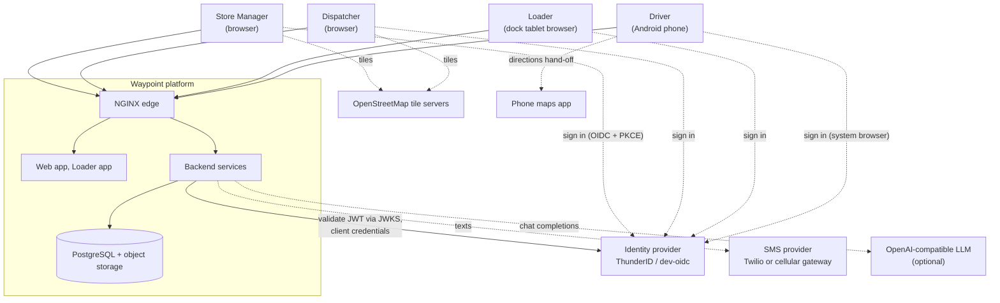

Dashed lines are optional or external. The platform works without the SMS provider, the LLM and (for non-map features) OpenStreetMap.

### 3.2 Container view (what actually runs in Docker Compose)

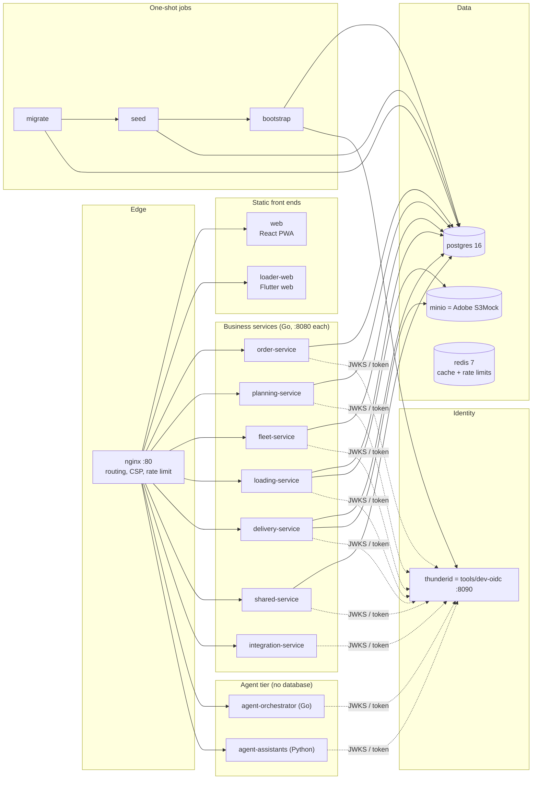

`integration-service`, `agent-orchestrator` and `agent-assistants` are deliberately **not** given database access to the business schemas. `integration-service` holds no schema; the agent tier holds no database driver (enforced by `scripts/check-agent-imports.sh`).

### 3.3 Service-to-service call graph

Services talk **only over HTTP**, using a machine token (client credentials) or, for the agent tier, the **caller's own bearer token**. No service reads another service's schema.

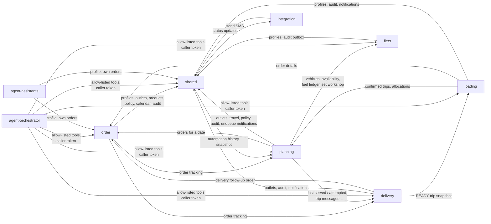

Startup order in Compose follows `depends_on` health: `shared` → (`order`, `fleet`) → `planning` → `loading` → `delivery` → `agent-orchestrator`; `integration` starts before `shared`.

### 3.4 Request path

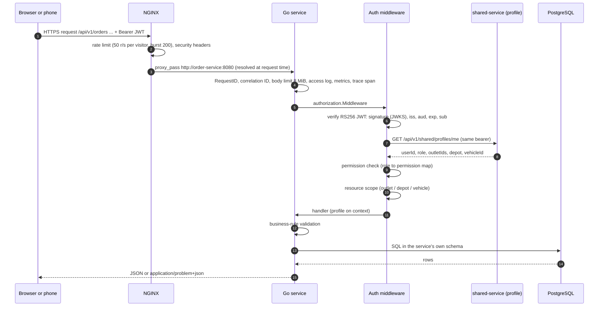

NGINX routing table (`infrastructure/nginx/nginx.conf`):

| Path prefix | Upstream | Notes |
|---|---|---|
| `/api/v1/orders` | `order-service:8080` | |
| `/api/v1/planning` | `planning-service:8080` | |
| `/api/v1/fleet` | `fleet-service:8080` | |
| `/api/v1/loading` | `loading-service:8080` | |
| `/api/v1/delivery` | `delivery-service:8080` | `client_max_body_size 8m` (proof uploads) |
| `/api/v1/shared` | `shared-service:8080` | |
| `/api/v1/integrations` | `integration-service:8080` | Includes provider callbacks |
| `/api/v1/agent/order-assistant/`, `/dashboard-assistant/`, `/assistants/` | `agent-assistants:8080` | 45 s read timeout for the two assistant calls |
| `/api/v1/agent` (everything else) | `agent-orchestrator:8080` | Longest prefix wins |
| `/loader-app/` | `loader-web:80` | Own CSP allowing `wasm-unsafe-eval` for Flutter CanvasKit; microphone off |
| `/downloads/` | static directory `/srv/downloads` | Driver APK and its JSON metadata; `Cache-Control: no-cache`, `default-src 'none'` |
| `/health/live` | NGINX itself | Returns `{"status":"live","edge":"nginx"}` |
| `/` | `web:80` | The React PWA |

Edge headers: `X-Content-Type-Options: nosniff`, `X-Frame-Options: DENY`, `Referrer-Policy: same-origin`, a Content-Security-Policy (`default-src 'self'`, images allowed from `data:`, `blob:` and `https://tile.openstreetmap.org`, `connect-src 'self' https: http://localhost:8090`), and `Permissions-Policy: camera=(self), geolocation=(), microphone=(self)` for the web app (the microphone is for spoken orders). The rate limit counts only `/api/` requests per visitor address; the visitor address comes from `X-Forwarded-For` set by the trusted TLS front (Caddy on the VM).

### 3.5 Internal structure of a Go service

Every Go service follows the same layering and the same bootstrap, which is why they are easy to navigate:

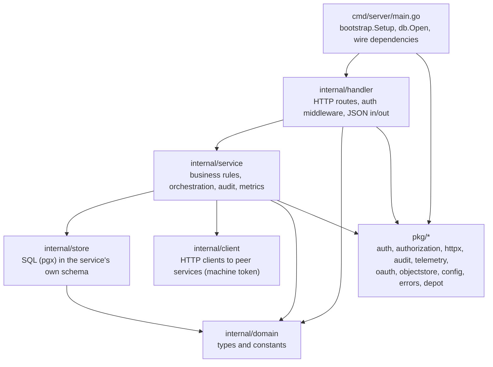

`pkg/bootstrap.Setup` loads config, refuses to start with `AUTH_DISABLED=true` unless `ENVIRONMENT=local`, builds either a JWT authenticator (JWKS) or the local-only disabled authenticator, and creates a JSON `slog` logger. `App.Run` initialises OpenTelemetry (a no-op without an endpoint), builds the chi router from `pkg/httpx` (request ID → correlation ID → real IP → panic recovery → 8 MiB body limit → security headers → access log → metrics → tracing, plus `/health/live`, `/health/ready` and `/metrics`), registers routes, and serves with timeouts (read-header 5 s, read/write 30 s, idle 60 s) and a 10 s graceful shutdown on SIGINT/SIGTERM.

`pkg/db.Open` opens a `pgx` pool whose connections set `search_path` to the service's schema, so unqualified table names in a service's SQL always resolve inside its own schema. (`shared-service` also writes to the `audit` schema with a qualified name, and `order-service` reads a few `shared`, `fleet` and `delivery` tables the same way.) `database/roles.sh` can create one least-privilege login per service that matches exactly this access; it is optional and off by default (see 12.2).

### 3.6 Deployment topologies

Waypoint has three deployment shapes. Only the first two are exercised.

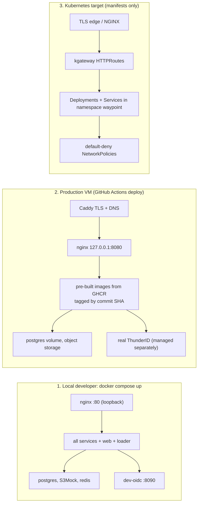

* **Local**: `docker compose up -d --build`. Published ports are bound to loopback (`127.0.0.1:80`, `5432`, `6379`, `8090`, `9000`).
* **Production VM**: an Azure VM runs the same `docker-compose.yml` with `WAYPOINT_IMAGE_PREFIX` and `WAYPOINT_TAG` pointing at images built by CI; Caddy terminates TLS in front of NGINX on `127.0.0.1:8080`. See [Chapter 10](#10-infrastructure-deployment-and-cicd).
* **Kubernetes**: a Kustomize base (namespace, service accounts, config maps, services, deployments, default-deny network policies, Gateway API routes) with `dev`, `staging` and `production` overlays. It is a deployment *input*, not a running environment: images, identity configuration, secrets, durable storage, DNS and TLS must be supplied by the operator.

### 3.7 Architecture decisions on record

| ADR | Decision | Consequence |
|---|---|---|
| **ADR-001 Service boundaries** | Services communicate only through versioned HTTP APIs; each owns one or more schemas and never queries another; shared libraries live in `pkg/`, shared *product capabilities* live in `shared-service`; the agent calls services through tools and a credential provider and never imports a DB driver; authorization is enforced in every service. | `Agent → Tool → Service → Authorization → Validation → Database` is the only path. `Agent → Database` and `delivery-service → SELECT * FROM orders.orders` are forbidden. |
| **ADR-002 Audit delivery** | Order persistence is the source of truth. If audit ingest fails after the order commits, the client still gets `201`, the failure is logged with the correlation and order ID, and ingest is retried a few times in-process. A transactional outbox is the intended later hardening. | Audit can lag or, rarely, miss an event; `waypoint_audit_publish_failures_total` counts it. Fleet already uses an outbox (`fleet.audit_outbox`). |

---

## 4. Cross-cutting design

### 4.1 Identity: how a person or a service proves who it is

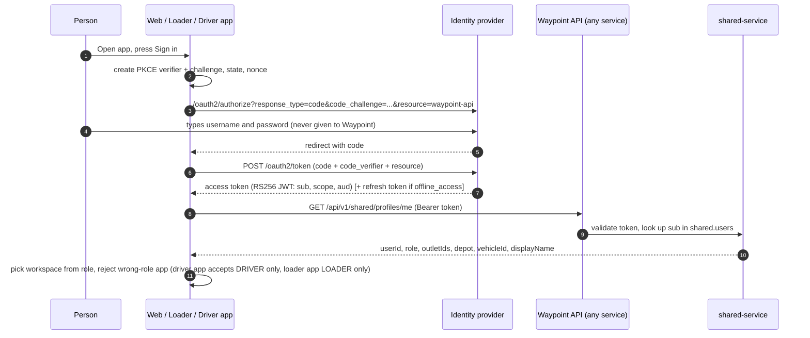

Key points:

* **People never give Waypoint a password.** All three clients use the OIDC *authorization code* flow with *PKCE (S256)*. The web app uses `oidc-client-ts` with state kept in `sessionStorage`; the loader app implements the flow in Dart for the browser; the driver app uses AppAuth through the system browser.
* **The token proves only `sub`.** Roles in the JWT are *not* used for authorization. The application role and the mutable assignments (outlet, depot, vehicle) are looked up from `shared.users` and its profile tables on every request ("*Application DB role is authoritative*" — `pkg/authorization`).
* **Token validation** (`pkg/auth`): algorithm must be `RS256`, the token must carry a `kid`, an expiry (`exp` required), the configured issuer (`OIDC_ISSUER`) and audience (`OIDC_AUDIENCE`, default `waypoint-api`) and a `sub`. Keys come from the JWKS URL, are cached, are refetched when a `kid` is unknown or the cache has expired, and the JWKS document is capped at 1 MiB. Only RSA keys with `use` of `sig` and `alg` of `RS256` (or unset) are accepted.
* **Audience/resource.** Real ThunderID issues a token for the API only if the client asks for it with the RFC 8707 `resource` parameter. The web app (`VITE_OIDC_AUDIENCE`), driver app (`OIDC_RESOURCE`) and loader app (`OIDC_RESOURCE`) all send it, and the loader checks the returned token's `aud` so it can say "Signed in, but not for the Waypoint API" instead of failing on every call. Production audience is the URL `https://waypoint.claptac.dev/api/v1`, and the deploy refuses to proceed if the built images and the VM's `OIDC_AUDIENCE` disagree.
* **Session length.** The local identity provider issues one-hour access tokens (`ACCESS_TOKEN_TTL_SECONDS` can shorten them for testing). The web app warns five minutes before expiry, says clearly when the session has ended, can renew silently if the sign-in was granted `offline_access` (`VITE_OIDC_SCOPE`), and returns the person to the page they were on after signing in again. A 401 from any API call is checked once against `/shared/profiles/me` before the session is declared over, so one misbehaving endpoint cannot sign people out.
* **Machine identity.** Each service has its own OAuth client (`waypoint-<service>-service`) and uses the **client-credentials** grant (`pkg/oauth.TokenSource`): tokens are cached and renewed 30 seconds before expiry, and a refusal is logged with the client ID, scope and resource but never the secret. Each client requests only the scopes it needs (below). Machine tokens in the local provider live one hour.

| Service client | Scopes requested |
|---|---|
| order-service | `plans:read-internal deliveries:read-internal outlets:read-internal audit:write policy:read-internal` |
| planning-service | `orders:read-internal fleet:read-internal fleet:update outlets:read-internal deliveries:read-internal audit:write policy:read-internal` |
| fleet-service | `audit:write` |
| loading-service | `plans:read-internal orders:read-internal audit:write` |
| delivery-service | `loading:read-internal outlets:read-internal audit:write orders:write-internal` |
| shared-service | `notifications:send` (to integration) and `automations:read-internal` (to planning) |
| integration-service | `notifications:write` (status callbacks into shared) |
| agent-orchestrator | none of its own — it forwards the **human's** bearer token |

Scopes are matched against *permission strings*: `authorization.Middleware` grants access when either the profile's role has the permission **or** the token carries a scope with exactly that string. That is how `orders:read-internal` lets planning read orders, and how `audit:write` lets any service post an audit event.

### 4.2 Authorization: four layers, in order

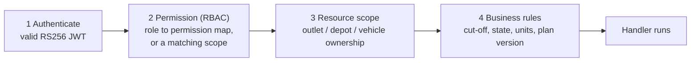

1. **Authenticate** — or return `401` (`Unauthorized`).
2. **Permission** — `403` with `missing permission <name>` if neither the role nor a scope has it. A caller with no application role and no scopes is refused with "no application role for subject".
3. **Resource scope** — three scopers:
   * `OutletScoped`: a store manager may touch only an outlet in their profile (dispatchers with `order:view-all` bypass).
   * `DepotScoped`: a loader may touch only trips of their depot (`loading:view-all` bypasses).
   * `DriverScoped`: a driver may touch only the vehicle in their profile (`delivery:view-all` bypasses).
   Depots are compared through `pkg/depot`, because the dataset spells depots `Peliyagoda`/`Kandy` while profiles use `DEPOT_NORTH`/`DEPOT_SOUTH`; comparing raw strings would make a loader's own trips look foreign.
4. **Business rules** — enforced inside the service (for example "receipt only after a DELIVERED or PARTIAL outcome").

Front-end role checks (`RoleGate`) are user experience only; every service re-checks.

#### Role → permission matrix

| Permission | Store Manager | Dispatcher | Loader | Driver |
|---|:-:|:-:|:-:|:-:|
| `order:create`, `order:view-own`, `receipt:confirm`, `delivery:issue-create` | ✔ | | | |
| `order:view-all`, `order:defer` | | ✔ | | |
| `plan:create`, `plan:view`, `plan:update`, `allocation:create`, `allocation:update` | | ✔ | | |
| `plan:acknowledge` | | | ✔ | ✔ |
| `fleet:view`, `fleet:update` | | ✔ | | |
| `masterdata:update`, `audit:read` | | ✔ | | |
| `delivery:view-all`, `loading:view-all`, `loading:decide` | | ✔ | | |
| `loading:view`, `loading:update`, `loading:issue`, `loading:ready` | | | ✔ | |
| `trip:view-assigned`, `delivery:view-assigned`, `delivery:view`, `delivery:start`, `delivery:update`, `delivery:proof`, `delivery:complete`, `delivery:sync`, `proof:create` | | | | ✔ |
| `dashboard:manage-own` | ✔ | ✔ | | |

Automations (`/shared/automations`) are limited in code to store managers and dispatchers that have exactly one role. Internal-only permissions (`orders:read-internal`, `fleet:read-internal`, `outlets:read-internal`, `loading:read-internal`, `plans:read-internal`, `deliveries:read-internal`, `policy:read-internal`, `audit:write`) are scopes carried by service tokens, not by any human role.

### 4.3 Profile resolution

`shared.users` holds one row per person (`id`, `identity_subject`, `role`, `display_name`). The role-specific mapping lives in profile tables joined at request time:

| Role | Profile table | Mapping |
|---|---|---|
| Store Manager | `shared.store_manager_profiles` | `user_id → outlet_id` (exactly one outlet) |
| Loader | `shared.loader_profiles` | `user_id → depot` |
| Dispatcher | `shared.dispatcher_profiles` | `user_id → depot` (optional home depot) |
| Driver | `shared.driver_profiles` | `user_id → vehicle_id` |

`scripts/thunder-bootstrap.sh` fills these tables at start-up by reading `GET /admin/users.tsv` from the local identity provider (`user_id, subject, role, outlet, depot, vehicle`), so subjects are never hand-copied into SQL. In production the same rows are created by `scripts/production/seed_accounts.py` against the real identity subjects. Every service except `shared-service` resolves a profile by calling `shared-service /api/v1/shared/profiles/me` with the caller's bearer (`client.Profiles` / `client.Resolver`).

### 4.4 Errors

All services return **RFC 7807 problem details** (`Content-Type: application/problem+json`) with `type: about:blank`, `title`, `status`, optional `detail`, and an optional machine-readable `code`. The helpers in `pkg/errors` cover 400, 401, 403, 404, 409, 413, 500, 501 and 502.

Service methods return plain Go errors whose *message prefix* is mapped by each handler: `invalid…` → 400, `not found…` → 404, `forbidden…` → 403, `rejected…` → 400, `conflict…` → 409, anything else → 500 with the generic text "unexpected error" (internal text is not leaked). Three conflicts carry structure the clients rely on:

| Error | Raised by | Carries |
|---|---|---|
| `delivery_incomplete` (409) | delivery complete | `pendingStopIds` — stops without a terminal outcome |
| `loading_incomplete` (409) | loading ready | pending order IDs |
| `dispatcher_decision_required` (409) | loading ready | order IDs still undecided/on hold, and which are "move to next run, not yet published" |

### 4.5 Idempotency, versions and concurrency

Because phones go offline and requests are retried, almost every write is safe to repeat:

| Mechanism | Where | Behaviour |
|---|---|---|
| `Idempotency-Key` header / `operationId` | delivery start, arrive, outcome, proofs, `/sync`; loading issues, dock alerts; fleet fuel entries; order receipt issues and custody | The same key returns the original result (`DUPLICATE` in sync) and never applies twice. Reusing a key for a *different* operation or trip is a `409`. |
| `UNIQUE (source_system, external_order_id)` | order import and delivery follow-up orders | Replays are reported as duplicates; changed data under the same key is a `409` and rolls back the batch. |
| `event_key UNIQUE` | notification outbox | One notice per business event (for example `deferral:<plan>:<order>`). |
| `If-Match: <planVersion>` | loading start and plan-version sync | A loader cannot start or sync against a plan version the server no longer holds. |
| Optimistic `version` column | outlets, calendar, vehicles, notification preferences, policy, receipts, stops, runs, dashboards | Updates carry the expected version; a stale one is refused. |
| Plan `content_hash` | planning publications | SHA-256 over the canonical JSON of allocations and deferrals; proves what version 1/2/3 said. |
| Generation claim | planning `ClaimGeneration` | A plan is generated once; a second attempt says "generate already applied; reset first". |

### 4.6 Audit trail

Every significant action emits an **audit event** to `shared-service` (`POST /api/v1/shared/audit-events`, scope `audit:write`), stored in `audit.events` (append-only: update and delete are rejected by a trigger).

| Field | Meaning |
|---|---|
| `event_id` | Unique id (UUID) |
| `correlation_id` | The request's `X-Correlation-ID` (propagated across services) |
| `actor_id`, `actor_type` | Who acted (`human`, `agent`, `system`, `workflow`) |
| `action` | Uppercase verb, for example `PLAN_CONFIRMED`, `LOADING_SHORTFALL_DECIDED` |
| `resource_type`, `resource_id` | What it acted on (`PLAN`, `ORDER`, `TRIP`, `STOP`, `SYNC`, `AUTOMATION`, …) |
| `previous_state`, `new_state`, `reason` | Optional JSON before/after and free-text reason |
| `timestamp`, `source` | Server time and emitting service |

The dispatcher can search (`GET /audit/events`), export CSV (`/audit/export.csv`) and read KPIs (`/audit/kpis`) with the `audit:read` permission. Representative action groups (full list in [Appendix D](#appendix-d--audit-action-catalog)): order created/deferred/allocated/reallocated, plan created/generated/confirmed, loading started/loaded/shortfall recorded-updated-removed-decided/ready, delivery run prepared/started/stop arrived/outcome recorded/proof captured/sync applied-conflict/temperature/incident/run completed, receipt confirmed, agent chat/tool proposed-invoked-failed/approval created-approved-rejected, and automation activity. Audit payloads omit phone numbers, message bodies, tokens and provider keys.

### 4.7 Telemetry

* **Metrics** (`/metrics`, Prometheus): per-request counters, error counters and duration histograms labelled by `service`, `method`, **route template** (never the raw path, to avoid per-ID label explosion) and status; plus business counters — orders created/deferred, plans created/generated, orders allocated, constraint failures by reason, allocation duration, loading sessions/orders/shortfalls/trips-ready/duration, delivery runs/stops/outcomes/proofs/sync operations/conflicts/run duration, driver offline-queue buckets, receipt confirmations/issues/delay, fleet audit-outbox pending, SMS outbox pending/oldest/awaiting-status, and agent tool calls/failures/authorization denials. Counters live in process memory and **reset when a service restarts**.
* **Logs**: JSON via `slog`, one `http_request` line per request with correlation ID, route template, status, bytes and duration. Tokens and bodies are not logged.
* **Traces**: OpenTelemetry spans per HTTP request, exported over OTLP/HTTP when `OTEL_EXPORTER_OTLP_ENDPOINT` is set (no-op otherwise). Separately, **agent traces** record *what an agent did and why* and are pushed best-effort to `agent-manager` ([5.11](#511-agent-manager-agent-traces)).
* **Health**: `/health/live` and `/health/ready` on every service (NGINX answers its own `/health/live`).

### 4.8 Configuration model

`pkg/config` reads: `ENVIRONMENT` (default `local`), `HTTP_ADDR` (`:8080`), `AUTH_DISABLED`, `OIDC_ISSUER`, `OIDC_JWKS_URL`, `OIDC_AUDIENCE`, `DATABASE_URL`, `DATABASE_SCHEMA`, `REDIS_URL`, `OTEL_EXPORTER_OTLP_ENDPOINT`, `LOG_LEVEL`. Service-specific peers (`*_SERVICE_URL`), machine-client settings (`OIDC_TOKEN_URL`, `M2M_CLIENT_ID`, `M2M_CLIENT_SECRET`), object-store settings (`MINIO_ENDPOINT`, `MINIO_BUCKET`, `MINIO_ACCESS_KEY`, `MINIO_SECRET_KEY`, `MINIO_REGION`) and feature flags are read in each `main.go`. [Appendix A](#appendix-a--configuration-reference) lists them all.

**Important rule:** `docker-compose.yml` decides which values reach which container. Putting a variable in `.env` does not override a value that Compose hardcodes (for example the migrate/seed/bootstrap jobs hardcode the local DB URL, and the bundled identity container hardcodes its issuer/audience).

---

## 5. Backend services in depth

For each service: what it owns, the rules it enforces, how it talks to others, and anything unusual. Endpoint tables are in [Chapter 8](#8-api-reference); table definitions are in [Chapter 7](#7-data-model-and-database).

### 5.1 order-service

**Owns** schema `orders`: `orders`, `order_lines`, `receipts`, `receipt_lines`, `receipt_issues`, `tech_custody_events`.

**Responsibilities**

1. **Order intake** (`POST /api/v1/orders/`, Store Manager). The order's outlet comes from the caller's profile, never from the request body; the brand comes from `shared-service`'s outlet record. A request carries either totals (`orderUnits`, `orderWeightKg`, `orderVolumeM3`, `temperatureRequirement`) or **item lines** (`productId`, `packQty`). With lines, names, pack sizes, weights and volumes are **always taken from the catalog**, never from the client, and the totals are the sum of the lines. Orders are created with status `confirmed`.
2. **Cut-off and calendar.** `deliveryDate()` moves the requested date forward when the daily cut-off has passed and the requested date is today or earlier, then to the next *operating* day. The cut-off time comes from the current planning policy (default **16:00 Asia/Colombo**); operating days come from `shared-service`'s calendar (fallback: the CSV loaded at start-up from `CALENDAR_PATH`; if neither is available only the cut-off shift is applied). Elsewhere, for receipt deadlines and cover-day counting, a date missing from the calendar is treated as an operating day Monday–Friday.
3. **Item suggestions** (`GET /orders/suggestion`). A deterministic, explainable proposal for the next order (see below). It never places an order.
4. **Receipts.** Only after the driver recorded `DELIVERED` or `PARTIAL` can the store confirm receipt. `receivedUnits` must be between 1 and the expected units. If it is lower than expected, or differs from the driver's `deliveredUnits`, an **issue is mandatory** (type `MISSING`, `DAMAGED`, `QUANTITY_MISMATCH` or `OTHER`, with affected units). An optional manual `receivedTemperatureC` (−40 to 60 °C) is validated against the order's temperature requirement. Confirming twice with the same quantity returns the original receipt; with a different quantity it is a `409`. A store has **two working days** after delivery to report (`ReceiptReportWorkingDays = 2`); the tracking view shows `open`, `due_tomorrow`, `due_today` or `overdue`.
5. **Tech custody ledger.** For Tech-brand orders, append-only `LOADED → DISPATCHED → DELIVERED → RECEIVED` events record seal ID, serial numbers, condition, receiver name and evidence reference. Idempotent by key; repeating the same event with different serials is rejected.
6. **Tracking** (`GET /orders/{id}/tracking`). Builds the order's story by asking planning (`ByOrder`) and delivery (`ByOrder`): stage is `CONFIRMED` → planning state (allocated/deferred…) → `READY_FOR_DEPARTURE` → `OUT_FOR_DELIVERY` → the outcome (`DELIVERED`, `PARTIAL`, `NOT_DELIVERED`, …) → `RECEIPT_CONFIRMED` or `RECEIPT_CONFIRMED_WITH_ISSUE`. If either peer fails with anything other than "not found", tracking fails loudly rather than showing a guess.
7. **Import/export.** CSV and JSON adapters (`/import.csv`, `/import`, `/export.csv`, `/export`; dispatcher-only, version `1`, ≤ 500 rows, ≤ 2 MiB, whole file validated before anything is written, idempotent on `(sourceSystem, externalOrderId)`).
8. **Delivery follow-up orders** (`POST /orders/internal/delivery-followups`, scope `orders:write-internal`). When a driver records a **REFUSED** delivery with returned goods, the delivery service asks order-service to create a follow-up order for the returned units (weight and volume scaled by `units / originalUnits`) on the next operating day (never earlier than tomorrow). Source system is `delivery-reattempt` (re-attempt next run) or `delivery-deferral-request` (the driver asks the dispatcher to defer; the planner then *holds* such orders for the dispatcher instead of auto-allocating them). The stop ID is the external ID, so a retry cannot create a second order.
9. **Forecast** (`GET /orders/forecast`, dispatcher). `confirmed_order_mean_v2`: the mean confirmed-order volume over the previous four complete weeks, held flat across the next ten weeks (no trend or seasonality), per depot and brand, with a likely range that widens from 10 % by 2 points per week. It also reports **input drift** (`weekly_order_shift_v1`: `STABLE`, `SHIFTED` at ≥ 50 % change, `NEW_DEMAND`, `INSUFFICIENT_HISTORY`), a backtest error, a service-time evaluation (configured minutes vs observed minutes) and **capacity pressure** per depot. Everything is labelled as an estimate.

**How item suggestions work** (`internal/suggest`)

* Window: the last 8 weeks of the outlet's orders of the same goods type. With **≥ 3** orders that have item lines, quantities come from history; otherwise from the store's usual daily sales (`avg_daily_sales_each / units_per_pack`) and the response says so (`limitedHistory`).
* History weighting: an order is divided by the days it had to last, orders on the same weekday count double, and a product must appear in at least half of the weighted orders to be suggested (no one-off repeats).
* **Cover days:** the delivery must last the day itself plus every following non-operating day (cap 7), so an order before a long weekend is larger.
* **Seasons:** a small visible table (Avurudu food +30 % 1–13 Apr; Avurudu clothing +40 % 25 Mar–12 Apr; Christmas food +20 % 15–24 Dec; festive clothing +30 % 1–24 Dec). The largest applicable uplift wins; they do not stack; every applied uplift is shown with its reason. Moveable holidays are covered by the calendar instead.
* Each line carries a ready sentence ("About 3.2 per day from your last orders, for 3 days, +30 %: …"), minimum 1 pack, maximum 999.

**Calls out to:** shared (profiles, outlets, products, policy, calendar, audit), planning and delivery (tracking). **Metrics:** orders created/deferred, receipt confirmations, issues, confirmation delay.

### 5.2 planning-service

**Owns** schema `planning`: `plans`, `trips`, `allocations`, `deferrals`, `unallocated_reasons`, `plan_publications`, `plan_acknowledgements`, `plan_ack_reminders`, `disruption_risks`, `disruption_risk_overrides`, and the automation history tables.

This is the heart of the product. A **plan** is one per delivery date (`UNIQUE delivery_date`); it has up to two **trips** per vehicle (`trip_number` 1 or 2) and each trip has ordered **allocations** (stops).

#### Plan lifecycle

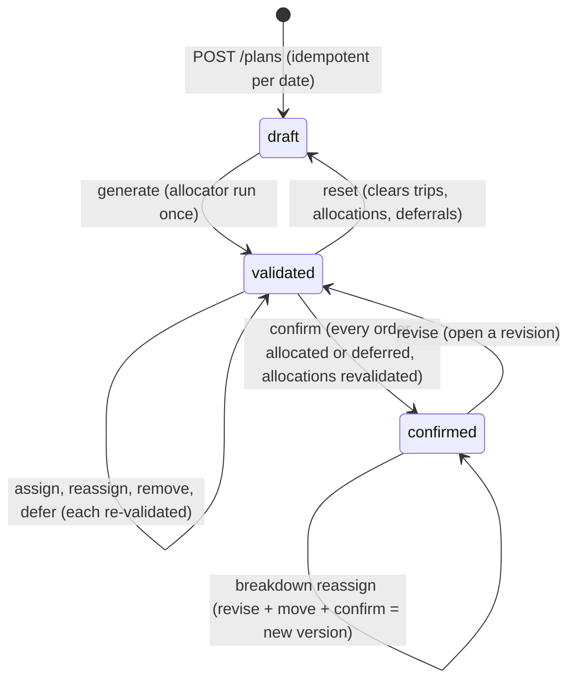

Rules worth knowing:

* **Generate is once-only.** `ClaimGeneration` reserves the run; a second call returns `conflict: generate already applied; reset first`. A failed run before any row is written releases the reservation. `Simulate` runs the very same allocator without persisting anything (used by the dispatcher UI and the agent's `SimulatePlan` tool).
* **Confirm** requires that every order for the date is either allocated or deferred ("unresolved orders" is a `409`), and that all allocations still pass all hard constraints ("allocation_invalid"). It then **publishes version N+1** with a SHA-256 content hash over the canonical JSON of `{deliveryDate, allocations, deferrals}`.
* A confirmed plan is **read-only** until `revise`; assign/reassign/remove/defer/generate/reset all refuse with `plan confirmed; open a revision first`.
* Manual changes need a **reason** (length-bounded) and are validated against the same constraints as the allocator; failures return `409 allocation_invalid` with structured results.

#### The deterministic allocator (`internal/allocate`, `constraints`, `schedule`, `travel`)

There is **no AI and no randomness** in feasibility. The algorithm is a greedy, stable-ordered first-fit:

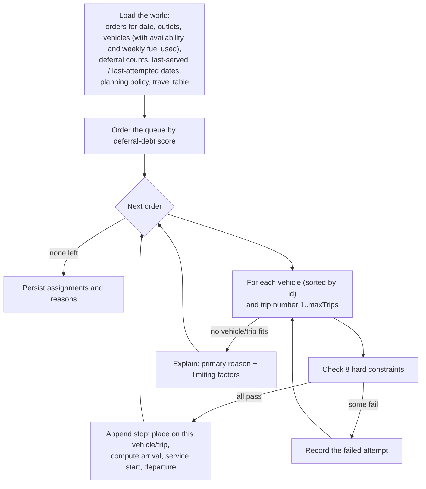

**Queue order ("deferral-debt score")**, highest first:

```
score = deferralWeight × min(priorDeferrals, maxDeferralCount)
      + min(daysSinceLastSuccessfulDelivery, maxUnservedDays)
      + 3  if the order is chilled        (perishability)
      + 2  if the outlet is a Fresh outlet (brand criticality)
```

Policy defaults (version 1): weight **14**, max deferrals **12**, max unserved days **365**, max trips per vehicle **2**, cut-off **16:00**. Ties break by: chilled first, then van-only outlets, then earlier delivery-window close, then order reference. The consequence points (3 and 2) are deliberately small: they only break near-ties and never override a hard constraint. If delivery history is unavailable the plan says so ("priority uses prior deferrals only"). Outlets deferred on two consecutive runs with no delivery attempt in between are flagged `priorityNextPlan` (a flag only; the score is unchanged).

**The eight hard constraints** (any failure rules that vehicle/trip out; reasons are stable codes):

| # | Constraint | Code | Rule |
|---|---|---|---|
| 1 | Vehicle available | `VEHICLE_UNAVAILABLE` | Fleet status for the date must be `available` (no row means available) |
| 2 | Refrigeration | `REFRIGERATION_REQUIRED` | A `chilled` order needs a `reefer` vehicle |
| 3 | Van-only access | `VAN_REQUIRED` | A `van_only` outlet needs a `van` |
| 4 | Depot | `DEPOT_MISMATCH` | Outlet depot must equal the vehicle's home depot |
| 5 | Weight | `WEIGHT_CAPACITY_EXCEEDED` | Sum of stop weights on the trip ≤ vehicle weight cap |
| 6 | Volume | `VOLUME_CAPACITY_EXCEEDED` | Sum of stop volumes ≤ vehicle volume cap |
| 7 | Delivery window | `DELIVERY_WINDOW_CONFLICT` | Service start (wait-then-serve) must not be after the outlet's window close |
| 8 | Weekly fuel quota | `FUEL_QUOTA_EXCEEDED` | Fuel used this week (ledger) + the vehicle's other trip today + this trip's projected litres ≤ weekly quota |

Plus the structural limit `TRIP_LIMIT_REACHED` (at most two trips per vehicle per day) and `NO_ELIGIBLE_VEHICLE` when no vehicle was even evaluated; `MANUAL_DISPATCHER_DEFERRAL` marks orders the dispatcher or a driver asked to defer.

**Time model** (`schedule.AppendStop`): service start = `max(arrival, window_open)` ("wait-then-serve"); departure = service start + service minutes (a *default* and a *mall* allowance, from the `shared.service_allowance` table, fallback 15/20 minutes). **Fresh trips are timed to reach the first store when its window opens but no later than 07:30** (`DepotDeparture` leaves the depot early enough for that); other brands leave to arrive when the first window opens. Travel time and distance come from the directed `district_travel` table; if a pair is missing the estimator falls back to a documented temporary heuristic (same district 8 km / 20 min, otherwise 25 km / 45 min). Fuel litres = km ÷ vehicle km-per-litre, with distance including the depot→first stop and last stop→depot legs.

**Explaining a failure** (`ExplainUnallocated`): for an order no vehicle can take, the *primary reason* comes from the attempt that was closest to feasible (fewest failed rules; ties go to the earliest vehicle/trip); other rules that blocked other vehicles are listed as `otherLimitingFactors` with the number of vehicle-trips each ruled out, plus `vehicleTripsEvaluated`. This is persisted in `planning.unallocated_reasons` so it still explains the order when the dispatcher reopens the plan.

#### Deferrals (rule W3)

A deferral will not save without a **reason code** (one of the constraint codes above or `MANUAL_DISPATCHER_DEFERRAL`), a **decider**, and a **next-run date strictly after the plan date**. An already-allocated order cannot be deferred. On success it increments `waypoint_orders_deferred_total`, emits `ORDER_DEFERRED`, and enqueues a `DEFERRAL` notification for the outlet.

#### Publication, acknowledgement and reminders

* `plan_publications (plan_id, version, content_hash, published_by, published_at)` — immutable history.
* Loaders and drivers **acknowledge** the *current* version for a specific **trip** (`plan_acknowledgements` has trip and vehicle identity since migration 0073; older plan-level rows are shown as plan-level only and never as acknowledging a particular trip). Drivers may acknowledge only their vehicle's trips; loaders only trips whose vehicle's home depot is theirs.
* The dispatcher can **remind** a trip's driver or loader. A repeat for the same trip, audience and version within **5 minutes** is a no-op that reports the earlier reminder; the reminder is also attempted as a trip message to the driver (`tripMessage` says `sent` or why not).

#### Breakdown recovery

When a vehicle breaks down mid-plan: `GET /plans/{id}/breakdowns/proposals?vehicleId=` lists, for each affected trip, candidate replacement vehicles with their pass/fail constraint results (stranded stops are ranked chilled-first, then earliest window close, then soonest planned arrival, then original sequence). `POST …/breakdowns/reassign` then (in order): re-checks feasibility, marks the broken vehicle **in the workshop** in fleet-service (so a retry is safe and a half-applied plan cannot occur — if fleet is unreachable nothing is committed and a `502` with the stable code `workshop_pending` tells the dispatcher to retry the same request), opens a revision, moves the trip's allocations with recomputed times, **confirms a new plan version**, writes `BREAKDOWN_RECOVERY_CONFIRMED`, and texts every store whose arrival slipped **30 minutes or more** (`MAJOR_DELAY`, subject to consent).

#### Disruption risks

Dispatchers record weather/road risks for a date (`scope` DEPOT, DISTRICT or ROUTE; `risk_type` HEAVY_RAIN, FLOODING, LANDSLIDE, ROAD_CLOSURE, ROAD_DAMAGE, OTHER; severity, source, confidence 0–1). They are **append-only**; an *override* (ACKNOWLEDGED, OVERRIDE with a new severity, or DISMISSED, reason 8–500 chars) is also append-only, and the latest override wins. Risks inform the dispatcher; they do not change the allocator.

#### Internal APIs for peers

`/internal/trips`, `/internal/trips/{tripId}`, `/internal/orders/{orderId}` serve the loading and order services (scope `plans:read-internal`); `/internal/automation-snapshot` serves shared-service's automation engine.

### 5.3 fleet-service

**Owns** schema `fleet`: `vehicles`, `vehicle_availability`, `vehicle_incidents`, `fuel_entries` (append-only), `audit_outbox`.

* **Vehicles** (60 in the seed): type (`van`, truck…), temperature capability (`reefer` etc.), weight and volume capacity, fuel type, km/l, weekly fuel quota, home depot, optimistic `version`. `PUT /vehicles/{id}/master-data` updates them under a version check and queues an audit event.
* **Availability** is per vehicle per date: `available`, `unavailable`, `in_workshop`. **No row means available.** The planner reads it; the breakdown flow writes `in_workshop`.
* **Incidents**: `breakdown`, `accident`, `temperature_failure`, `other`, with affected stops and open/resolved status.
* **Fuel ledger**: `POST /fuel/entries` requires an `Idempotency-Key` (≤ 200 chars), a vehicle, a date that is **not in the future**, litres in (0, 10 000], and a receipt reference *or* a note. Entries are append-only (a trigger rejects update/delete). `GET /fuel/ledger?weekOf=` returns the ISO week (Monday–Sunday, Colombo) with quota vs actual per vehicle; the planner uses it for the weekly fuel constraint.
* **Audit outbox**: master-data audit events are written in the same transaction into `fleet.audit_outbox`, and a goroutine delivers them to shared-service every 2 seconds with retry/back-off, exporting `waypoint_fleet_audit_outbox_pending` and oldest-age metrics. This is the one place the "transactional outbox" hardening of ADR-002 is already in place.

### 5.4 loading-service

**Owns** schema `loading`: `sessions`, `order_loads`, `issues`, `dock_alerts`.

A **loading session** is one trip's dock work, created when a loader starts a trip that is on a **confirmed** plan (`conflict: trip is not on a confirmed plan` otherwise). `If-Match: <planVersion>` guards against starting on a stale version.

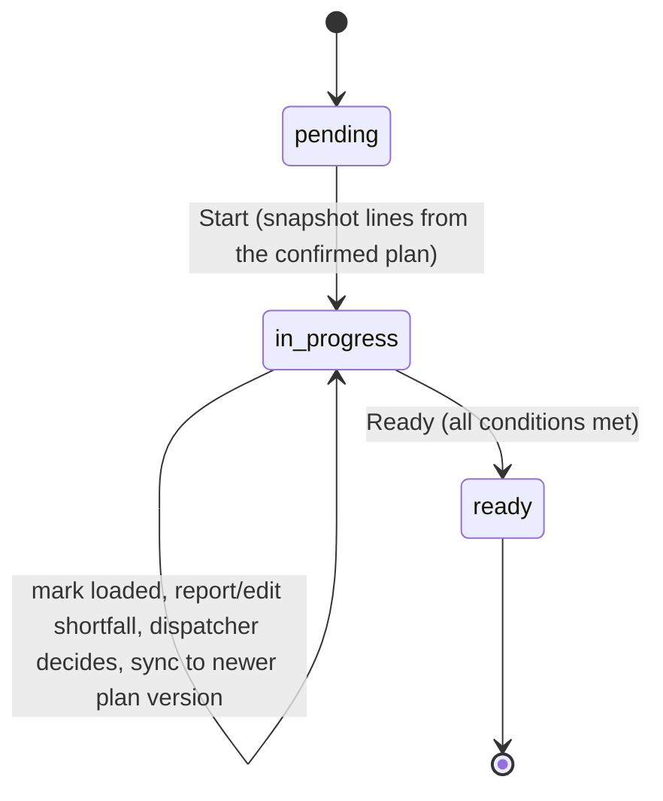

* **Lines.** One `order_load` per planned stop with `expected_units`, `stop_sequence` and a **suggested load sequence** from the `ReverseLastOut` policy (last delivery is loaded first — guidance, not a hard rule). Status: `pending`, `loaded`, `shortfall`.
* **Marking loaded** records how: `SCAN` or `MANUAL` (typed). `MANUAL` requires a reason (`DAMAGED_LABEL`, `UNREADABLE`, `NO_CAMERA`, `OTHER`) and an optional note ≤ 200 chars. A line with an open issue cannot be marked loaded (`ACTIVE_LOADING_ISSUE`). Repeating on a loaded line changes nothing.
* **Shortfall issues** (`MISSING`, `DAMAGED`, `WRONG_ITEM`): affected units, note, idempotency key, optional photo (PNG/JPEG ≤ 4 MiB, stored in object storage). Reporting one flips the line to `shortfall`. A dispatcher marks it **seen**, then **decides**:

  | Decision | Meaning | Lets the trip leave? |
  |---|---|---|
  | `PARTIAL_LOAD` | Go with what is loaded | Yes |
  | `HOLD` | Do not depart yet | No |
  | `MOVE_TO_NEXT_RUN` | Take the short line off this trip | Only once planning has published a plan version without that order (until then the line is "move not yet published") |

  The decision also notifies the store (`LOAD_SHORTFALL`, in-app and, with consent, SMS). The order quantity is never edited by loading; moving to the next run is done in planning, which publishes a new version.
* **Plan version changes.** If the dispatcher publishes a newer version, the loader acknowledges it and calls `sync`: added orders become pending lines, removed orders disappear, moved lines are re-sequenced, and a moved line that was already loaded goes back to pending with a note ("Moved from Stop 4", "Added in v3") so it is re-checked.
* **Ready checks.** `POST /trips/{id}/ready` requires: the plan version unchanged and **acknowledged by this loader**; no `pending` lines (`loading_incomplete`); no undecided/on-hold shortfalls (`dispatcher_decision_required`); and for a **refrigerated vehicle** a **chilled-zone reading of 2–4 °C** and a **door seal number** (≤ 40 chars). The readings are validated even for non-refrigerated vehicles when given. The result is `TRIP_READY_FOR_DEPARTURE` in the audit log and the session becomes `ready` — the only state delivery will accept.
* **Dock alerts** (`WRONG_VEHICLE`): a loader who finds goods staged at the wrong truck raises an alert for the dispatcher (naming the vehicle the goods belong to); the dispatcher resolves it.
* **Fresh trip budget:** the UI warns when a Fresh trip exceeds the **270-minute** window (03:30–08:00).

### 5.5 delivery-service

**Owns** schema `delivery`: `runs`, `stops`, `proofs`, `sync_operations`, `sync_conflicts`, `run_checkouts`, `trip_messages`, `trip_message_events`, `temperature_readings`, `driver_incidents`, `returned_goods`, `arrival_predictions`, `run_locations`, `proof_retention_events`.

#### Run and stop lifecycle

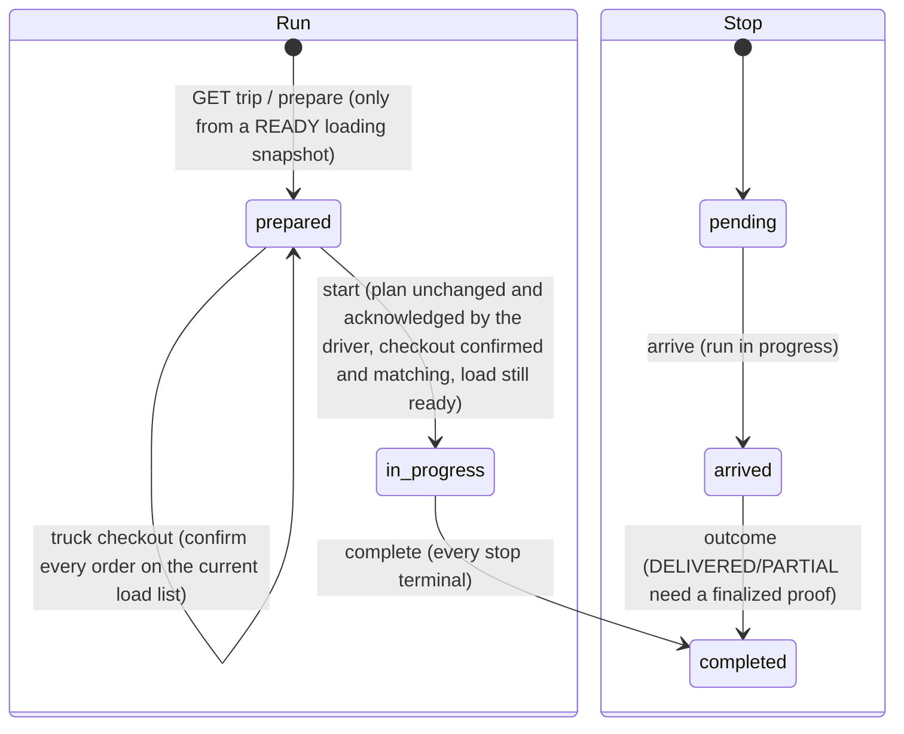

* **Prepare.** A run is created from the loading service's READY snapshot (`prepare` is also triggered by `GET /trips/{id}` for a driver). Stops copy order, outlet, access instructions, chilled-temperature limits and planned window so a stop works even if master data changes later; coordinates are read live from the outlet so corrections reach already-prepared trips.
* **Truck check-out** (`POST /trips/{id}/checkout`). The driver confirms each order physically on the truck. The service compares with the *current* load list: a mismatch records a `blocked` checkout listing `missingOrderIds`; a full match records `confirmed`. `start` insists on a `confirmed` checkout for the same plan version, a still-ready load, and a still-matching list.
* **Start** (`POST /trips/{id}/start`, `Idempotency-Key` required): refuses if the plan version changed since preparation, if the driver has not acknowledged the **current** version, if checkout is missing/stale, or if the load is no longer ready. Same key + same trip is replayed safely.
* **Arrive** needs the run in progress. **Outcome** codes: `DELIVERED`, `PARTIAL`, `NOT_DELIVERED`, plus legacy `FAILED`, `REFUSED`.
  * `deliveredUnits`, when sent, must equal the expected units for `DELIVERED`, be strictly between 0 and expected for `PARTIAL`, and be 0 otherwise.
  * `NOT_DELIVERED`/`FAILED`/`REFUSED` need a reason: `OUTLET_CLOSED`, `ACCESS_BLOCKED`, `RECEIVER_UNAVAILABLE`, `GOODS_REJECTED`, `VEHICLE_ISSUE`, `OTHER`.
  * `DELIVERED`/`PARTIAL` are **rejected until a finalized proof exists** (`proof required before outcome`).
  * `REFUSED` additionally needs returned goods (description, positive units ≤ the planned units, and a follow-up choice `NEXT_RUN` or `REQUEST_DEFERRAL`); this creates the follow-up order, a message for the dispatcher on the trip, and a best-effort `DELIVERY_REJECTED` notice to the store (a notice that cannot be queued never turns the driver's recorded take-back into an error).
  * An outcome already recorded with the same values is accepted idempotently; a different value for a completed stop is a `CONFLICT`.
* **Proofs** (`multipart`): `SIGNATURE` (≤ 512 KiB) or `PHOTO` (≤ 4 MiB), PNG/JPEG with matching file signatures; optional receiver name. Stored in object storage under a generated key; row keeps type, MIME, SHA-256, timestamps, creator, idempotency key. **Proof bytes never travel through `/sync`.**
* **Complete** needs every stop terminal; otherwise `409 delivery_incomplete` with the pending stop IDs.
* **Temperature readings** at stops (manual, 2-decimal °C) are evaluated against the stop's chilled limits: `IN_RANGE`, `OUT_OF_RANGE`, `LIMITS_UNCONFIGURED`, producing `DELIVERY_TEMPERATURE_EXCEPTION` when out of range.
* **Driver incidents** (`VEHICLE`, `ROAD`, `OUTLET`, `GOODS`, `SAFETY`, `OTHER`) with optional stop.
* **Trip messages.** Dispatcher → driver messages (≤ 1000 chars, optionally about one stop); the driver acknowledges; both events are append-only.

#### Offline sync (`POST /api/v1/delivery/sync`)

The endpoint takes a batch of operations, each with a client-generated **`operationId`** and a type: `ARRIVED`, `STOP_OUTCOME`, `TEMPERATURE_READING`, `INCIDENT_REPORT`, `ROUTE_COMPLETED` (and `START` via its own endpoint). For each:

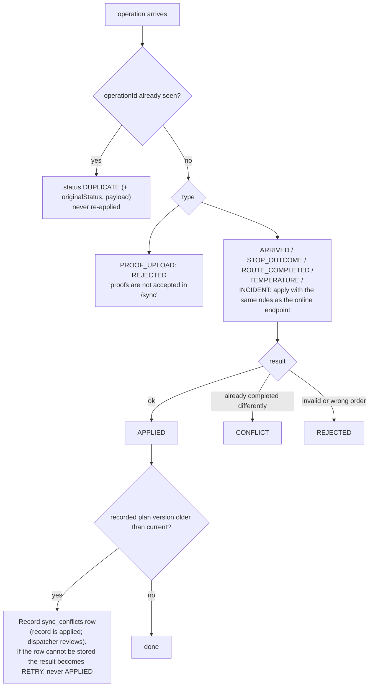

Conflicts are **informational for the dispatcher**: the driver's record is kept, a `sync_conflicts` row is created, and the dispatcher settles it from the Notifications page (`/sync-conflicts`, `/sync-conflicts/{id}/settle`). `dependsOnOperationId` lets an outcome wait for its proof; a dependent operation whose dependency is missing is rejected rather than half-applied.

#### Live location and distance driven

While a run is **in progress** the driver phone posts its position (`POST /trips/{id}/location`). Validation: coordinates in range and finite; the timestamp not older than **5 minutes** nor more than 2 minutes in the future; the caller must be the driver of that vehicle. The service keeps **only the latest point per run** (`run_locations`) plus a running **distance driven** (metres) and fix count (`distance_m`, `fixes`, migration 0077), which stay available after the run ends. Dispatchers read `GET /trips/{id}/location` and `/distance`. Location is *not* used by the planner or the ETA estimate.

#### Arrival predictions and lateness

* **Event-based ETA** (`event_delay_propagation_v2`, identical to the dispatcher web app's rule): the delay observed at the previous reported stop (its outcome time, or its arrival plus the service allowance, against its planned departure) is carried forward onto the next planned arrival. The risk label is `Window missed`, `Window at risk`, `ETA passed`, `Watch window` (≤ 15 min of slack) or `On track`.
* Each driver **arrival or outcome** (online or via sync) refreshes the predictions of the remaining stops **in the background** (own 30 s context, panic-safe, failure never affects the driver's request). When a stop's ETA differs from what the store was last told by **30 minutes or more**, an `ARRIVAL_CHANGE` notice is queued (idempotent per event key). Location pings do *not* trigger this.
* **Lateness probability** (`depot_brand_temperature_90d_late_rate_laplace_v2`): per depot/brand/temperature segment over 90 days, `(late + 1) / (samples + 2)`, shown only with ≥ 10 samples, with a Brier-score calibration check and a calibrated 10–90 % **arrival range** that is published only when coverage on a holdout is between 70 % and 90 % (otherwise status `POOR_COVERAGE`/`INSUFFICIENT_*`).

#### Proof retention

An opt-in daily worker (`DELIVERY_PROOF_RETENTION_ENABLED`, default off; `…_DAYS` 1–3650, draft 180) erases the object, then the proof row, and writes a minimal append-only `proof_retention_events` record, up to 1000 per sweep, skipping proofs with a `retention_hold` (reason required). See [11.4](#114-proof-retention).

### 5.6 shared-service

**Owns** schemas `shared` and `audit`. It is the system's reference-data, identity-mapping, notification and audit hub.

| Area | What it does |
|---|---|
| **Profiles** | `GET /profiles/me` (the lookup every service uses); `PUT /profiles/me/display-name` |
| **Outlets** | List/get; dispatcher master-data update with optimistic version, **exact coordinates** or approximate-from-district (`district_locations`) with validation; access instructions with who/when updated and a store-manager **confirmation**; chilled-temperature limits |
| **Calendar** | Operating days (`is_operating`, versioned); `PUT /calendar/{date}` |
| **Planning policy** | Immutable, versioned (`planning_policy_versions` with a `planning_policy_current` pointer): cut-off, deferral weight (1–60), max deferral count (1–30), max unserved days (30–730), max trips per vehicle (1–2). `POST /policies/preview` explains the effect before `PUT /policies/current` creates the next version (expected-version check) |
| **Travel and service allowance** | `district_travel`, `service_allowance` for the planner |
| **Product catalog** | `GET /products?ids=&outlet_id=&brand=`: products, pack sizes, units, weights/volumes, temperature, aliases, prices, outlet ranges with usual daily sales |
| **Notifications** | Outbox, consent preferences, worker, status callbacks (below) |
| **Audit** | Ingest (`audit:write`), search/export/KPIs (`audit:read`) |
| **Dashboards** | A store manager's saved dashboards: owner-scoped, versioned, `spec` JSON with `cards: []` (name ≤ 60 chars) |
| **Automations (A3/A4)** | Habit suggestions, workflow drafts, preview, activate/pause/resume/delete, runs, inbox, priority reviews (below) |

#### Notification pipeline

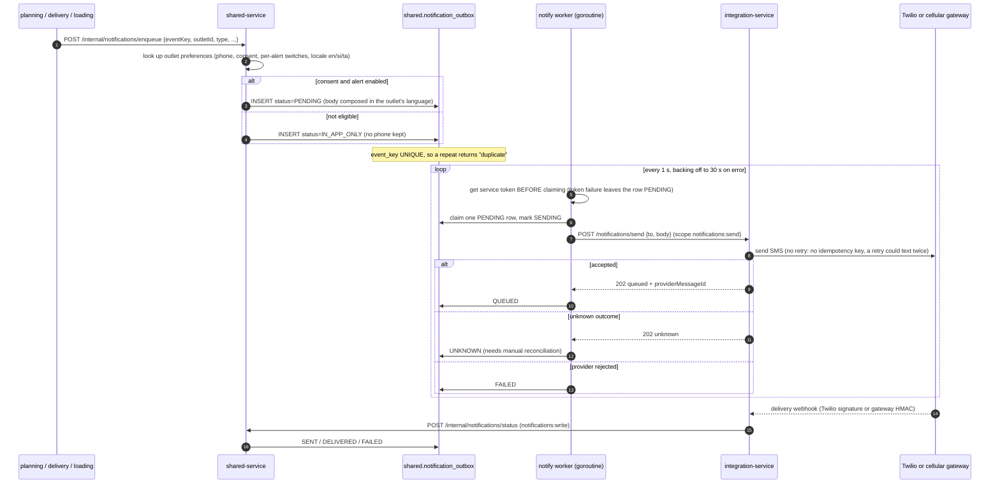

Event types: `DEFERRAL`, `MAJOR_DELAY`, `ARRIVAL_CHANGE`, `DELIVERY_REJECTED`, `LOAD_SHORTFALL`. Statuses: `PENDING`, `SENDING`, `QUEUED`, `SENT`, `DELIVERED`, `FAILED`, `UNKNOWN`, `SUPPRESSED`, `IN_APP_ONLY`. The in-app notice is **always** stored, so a store with no number or without consent still reads it on its Notifications page; only consent plus the matching alert switch makes an SMS eligible. Message bodies are templated in English, Sinhala and Tamil. Terminal payloads (phone and body) are erased **7 days** after the attempt; pending rows are never age-deleted. Stuck `SENDING` rows are recovered on the next pass.

#### Automations (A3 habits and A4 workflows)

* **A3 — habit suggestions** (deterministic, per person): a store manager repeating the *same aggregate order* on the same weekday three times within 28 days; a dispatcher manually flagging the *same repeat-deferred outlets* on three distinct days within 14 days. Answers: **Yes** (do it once: prefill an order draft or set a personal 7-day review flag), **No** (skip; two No answers suppress the pattern), **Don't ask again** (suppress immediately). After the third Yes the helper offers an A4 draft. Feedback persists in `habit_feedback`.
* **A4 — weekly workflows**: a closed vocabulary (`pkg/automation`): `version 1`, name ≤ 120 chars, weekday, `HH:MM`, timezone fixed to `Asia/Colombo`, and exactly one action: `notify_deferrals`, `prefill_order` (store managers only; a validated template of outlet, units, weight, volume, ambient/chilled) or `priority_review` (dispatchers only). **No workflow can submit an order or publish a plan, contain code, a URL or an arbitrary service call.** Flow: draft (natural language parsed by a narrow template parser, optionally an LLM for other phrasings) → editable When/Check/Do → **side-effect-free test** against the previous or next scheduled occurrence → **Turn on** (disabled until the *current* draft has been tested) → scheduled run.
* **Execution**: `RunDue` runs every **15 seconds** in shared-service. Each run re-authorizes the owner, reads a deferral snapshot from planning (`/internal/automation-snapshot`), writes an inbox notification and a run row (`UNIQUE (automation_id, scheduled_at)` so a run cannot double-fire), and audits as `AUTOMATION_RUN` (actor type `workflow`). A permission lost since activation pauses the workflow (`AUTOMATION_PAUSED_PERMISSION`). The LLM is never called at run time.

### 5.7 integration-service

Holds **no database schema**. Routes (`/api/v1/integrations`):

| Route | Status |
|---|---|
| `POST /notifications/send` | Real. Requires scope `notifications:send`. Provider is chosen at start-up: `SMS_PROVIDER=gateway` or `twilio` forces that provider with **no silent fallback**; with it empty, the cellular gateway is used when `GATEWAY_URL`/`GATEWAY_API_KEY` is set, otherwise Twilio. A half-configured provider is logged `sms_provider_unavailable` and nothing is sent. |
| `POST /notifications/status` | Twilio status callback; validated with Twilio's request signature against `TWILIO_STATUS_CALLBACK_URL` and `TWILIO_AUTH_TOKEN`; Message SID must be 34 chars |
| `POST /notifications/gateway` | Cellular-gateway webhook; HMAC-SHA256 in `X-CG-Signature` with `GATEWAY_WEBHOOK_SECRET`; `SMS_SENT`/`SMS_FAILED` are recorded, other events acknowledged and ignored; gateway message IDs are stored as `cg:<requestId>` |
| `POST /routing/directions` | **Not implemented** → `501` "routing provider is not configured" |
| `POST /storage/presign` | **Not implemented** → `501` "external storage signing adapter is not configured" |

The gateway is an Android phone with a SIM driven by an external gateway server; HTTPS is required except for a gateway on the same machine. See `docs/sms-gateway.md`.

### 5.8 Object storage (`pkg/objectstore`)

A small SigV4 client (`S3`) and an in-memory `Memory` store, behind a `Store{Put, Delete}` interface. `delivery-service` and `loading-service` write photos/signatures; `RequireDurable` makes a non-local process **refuse to start** without `MINIO_ENDPOINT`, because the in-memory store would silently lose proof on restart. Local Compose uses Adobe S3Mock (no persistent volume, so proof objects are lost when that container is recreated).

### 5.9 agent-orchestrator: the guarded assistant

A Go service in the **agent tier** (no database driver, no `DATABASE_URL` need). `POST /api/v1/agent/chat` takes a user message and runs a bounded tool-calling loop against an OpenAI-compatible Chat Completions provider (`LLM_BASE_URL`, `LLM_MODEL`, optional `LLM_API_KEY`). Without a provider it answers `agent_unavailable`; nothing else depends on it.

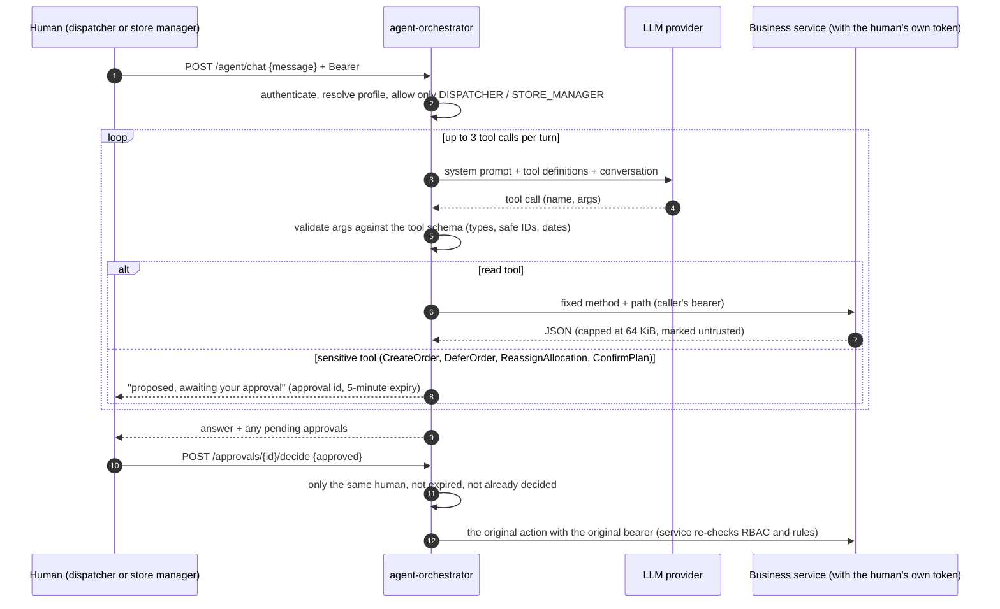

* **Tools** (fixed allowlist — no arbitrary URL, SQL or shell): `GetMyProfile`, `GetOrders`, `GetOrderTracking`, `GetPlan`, `GetConstraintFailures`, `SimulatePlan`, `GetFleetSummary`, `GetLoadingStatus`, `GetDeliveryStatus`, `GetReceiptStatus` (read); `CreateOrder`, `DeferOrder`, `ReassignAllocation`, `ConfirmPlan` (**sensitive**).
* **Guards:** arguments are validated against a closed schema (unexpected keys rejected; IDs must match `^[A-Za-z0-9_-]{1,80}$`; dates `YYYY-MM-DD`); every call carries the *human's* token, so the target service remains authoritative; **approvals** are owner-bound (a different user cannot decide), expire after **5 minutes**, cannot be replayed, and are held in bounded process memory (max 1000, lost on restart); provider output is size-bounded, secrets are never put in prompts or logs, audit events carry the tool name and an **argument hash**, never tokens or keys. A message is capped at 4000 bytes, three tool calls per turn.
* Also `POST /workflows/draft` (turn a sentence into an A4 workflow draft) and `GET /tools`.

### 5.10 agent-assistants: A1 order helper and A2 dashboard helper

A Python 3.12 FastAPI/LangGraph service (no DB, validates the JWT against JWKS, resolves the profile from shared-service, reads business services only with the caller's token). It obeys the same edge contract as the Go services: health, metrics, correlation ID, security headers, problem+json, 32 KiB body limit.

* **A1 order helper** (`/order-assistant/…`, Store Manager): graph `load_context → read_text (one forced LLM function call) → match_products (code) → draft`. The **model only records what was written** (product family, literal size, quantity, unit, "as usual", which earlier order). **Code** maps that to the brand catalog, converts bottles to cases, splits ambient and chilled into separate drafts, resolves "same as last Tuesday" from the outlet's own orders, and turns anything unclear into a question (unknown product, two sizes, missing quantity). The result fills the normal order form; **the manager still presses Submit** (`submitted: false` always).
* **A2 dashboard helper** (`/dashboard-assistant/…`): stateless; the browser sends the current draft each turn. The model may only return a name, an ordered list from the eight fixed card IDs (`deadlines`, `receipts`, `short`, `ontime`, `shortByWeek`, `deferrals`, `chilled`, `arrivals`) and an all/chilled/ambient filter. Saving is a separate human action (`saved: false`). The web app computes every card from the person's own tracking data.
* `GET /api/v1/agent/assistants/status` reports on/off; when off (no `LLM_*`), calls return `503 agent_unavailable` and the web UI hides the helper and falls back to a built-in keyword matcher.

### 5.11 agent-manager (agent traces)

`infrastructure/agent-manager` (Go, port 8085, Compose profile `agent-traces`) stores the newest `AGENT_TRACE_MAX` (default 1000) traces and serves a small viewer. Each trace is an ordered list of steps (`decision`, `llm`, `tool`, `guardrail`, `approval`, `error`) with a *reason* (a rule applied, or the model's stated rationale), outcome and bounded detail. Tracing is **off unless `AGENT_TRACE_URL` is set**, is best-effort (a missing or slow manager never affects an agent request), and holds no tokens, keys, raw request text or tool output (input is a length and hash). Outside local, both ingest and view tokens are required.

### 5.12 dev-oidc (local identity provider)

`tools/dev-oidc` is a single-file Go program standing in for ThunderID in Compose (image service name `thunderid`, port 8090). It generates an RSA key at start-up and serves discovery, JWKS, `authorize` (an HTML login form), `token` (authorization code + PKCE, refresh token with rotation when `offline_access` is requested, client credentials), `revoke` and two admin endpoints (`/admin/users`, `/admin/users.tsv`) used by the bootstrap job. It accepts any client ID and does **not** authenticate client secrets. It is development-only and must never be exposed publicly.

---

## 6. Use cases, workflows and state machines

### 6.1 Use-case diagram

```mermaid
flowchart LR
    SM(["Store Manager"])
    DP(["Dispatcher"])
    LD(["Loader"])
    DR(["Driver"])
    SYS(["Background workers"])

    subgraph ORDERS["Ordering and receipt"]
        U1["Place order (form or item lines)"]
        U2["Get explainable order suggestion"]
        U3["Draft order from text / voice (A1)"]
        U4["Track an order"]
        U5["Confirm receipt / report discrepancy"]
        U6["Read notifications"]
        U7["Build a dashboard (A2)"]
        U8["Habit suggestions and weekly automations (A3, A4)"]
    end
    subgraph PLANNING["Planning and dispatch"]
        P1["Review order queue, import / export CSV"]
        P2["Create, simulate, generate plan"]
        P3["Adjust allocation with a reason"]
        P4["Defer order with reason and next run"]
        P5["Publish and revise plan"]
        P6["Track acknowledgements, send reminders"]
        P7["Recover from vehicle breakdown"]
        P8["Record disruption risk and overrides"]
        P9["Review forecast and deferral history"]
    end
    subgraph LOADING["Loading"]
        L1["Acknowledge plan version"]
        L2["Load orders (scan or typed)"]
        L3["Report missing / damaged / wrong item with photo"]
        L4["Decide a shortfall"]
        L5["Raise or resolve wrong-vehicle alert"]
        L6["Mark trip ready (seal, chilled reading)"]
    end
    subgraph DELIVERY["Delivery"]
        D1["Truck check-out and start"]
        D2["Navigate to stop"]
        D3["Arrive, capture proof, record outcome"]
        D4["Refuse / take goods back"]
        D5["Report incident, record temperature"]
        D6["Work offline and sync"]
        D7["Share live location"]
        D8["Monitor live operations, message driver"]
        D9["Settle sync conflicts"]
    end
    subgraph ADMIN["Administration and assurance"]
        A1["Manage fleet, fuel, availability"]
        A2["Manage master data, policy, calendar"]
        A3["Search and export audit log"]
        A4["Ask the guarded assistant"]
    end
    subgraph AUTO["Automatic"]
        S1["Send in-app and SMS notices"]
        S2["Run due automations"]
        S3["Refresh arrival predictions"]
        S4["Erase expired proofs"]
        S5["Flush audit outbox"]
    end

    SM --- U1 & U2 & U3 & U4 & U5 & U6 & U7 & U8
    DP --- P1 & P2 & P3 & P4 & P5 & P6 & P7 & P8 & P9
    DP --- L4 & L5 & D8 & D9 & A1 & A2 & A3 & A4 & U8
    SM --- A4
    LD --- L1 & L2 & L3 & L5 & L6
    DR --- L1 & D1 & D2 & D3 & D4 & D5 & D6 & D7
    SYS --- S1 & S2 & S3 & S4 & S5
```

### 6.2 Use-case catalogue

#### Store Manager

| ID | Use case | Flow and rules | Result / evidence |
|---|---|---|---|
| **SM-01** | Place an order | Choose delivery date, enter units / kg / m³ and ambient or chilled (or build item lines). The outlet is taken from the profile; totals must be > 0. After 16:00 Colombo (or on a non-operating day) the date is silently moved to the next operating day and the confirmation shows the new date. | `orders.orders` row, status `confirmed`, reference `ORD000001`-style; audit `order.created`; metric `waypoint_orders_created_total` |
| **SM-02** | Order with item lines and a suggestion | The form asks `GET /orders/suggestion?date=&temperature=` and pre-fills catalog products with quantities (history-based, or sales-based when history is thin), each with a one-line reason; the manager edits freely. | `orders.order_lines` (names, pack sizes, weights copied from the catalog); nothing is ordered until Submit |
| **SM-03** | Draft an order by typing, pasting or speaking | The text goes to A1 (`/agent/order-assistant`); the browser's speech recognition can fill the text. The assistant returns a draft or questions (unknown product, two sizes, no quantity). | Fills the form with `linesSource = text_helper`; the manager must still submit |
| **SM-04** | Track an order | Orders list, then timeline/track pages. Stage moves `CONFIRMED → PLANNED (on a published plan) or DEFERRED → READY_FOR_DEPARTURE → OUT_FOR_DELIVERY → DELIVERED/PARTIAL/NOT_DELIVERED/REFUSED → RECEIPT_CONFIRMED(_WITH_ISSUE)`, with planned/predicted arrival, proofs summary, loading shortfall summary, the truck's approximate/live position on a map, and for a deferral the reason and next-run date in plain words. | Read-only, scoped to the manager's outlet |
| **SM-05** | Confirm receipt or report a discrepancy | Possible only after DELIVERED/PARTIAL. Enter received units (and optionally chilled temperature); a shortfall or a count different from the driver's requires an issue. Due within two working days. | `orders.receipts`, `receipt_issues`; audit `RECEIPT_CONFIRMED` / `RECEIPT_ISSUE_REPORTED`; the dispatcher sees issues in the receipt-issue list |
| **SM-06** | Tech custody (receiving stage) | For **Tech**-brand orders only, the custody ledger runs `LOADED` (loader, for an order on a trip of their own depot) → `DISPATCHED` and `DELIVERED` (the assigned driver; `DELIVERED` must cite an uploaded condition photo) → `RECEIVED` (store manager, who must name the receiver). Every stage repeats the same seal and serial numbers (1–100 unique serials); a later stage that disagrees with the loaded record is a `409`. | `orders.tech_custody_events` (append-only, idempotent) |
| **SM-07** | Read notifications | A Notifications page lists deferrals, arrival changes, load shortfalls and rejected-delivery notices **even when SMS is not enabled**; the bell polls once a minute (pausing while the tab is hidden; back-off up to 10 minutes on failure) | `shared.notification_outbox` |
| **SM-08** | Confirm outlet access instructions | The driver-facing entrance/landmark text set by the dispatcher is confirmed by the store | `shared.outlets.access_instructions_confirmed_*` |
| **SM-09** | Build a dashboard (A2) | Describe cards in words or pick from the eight fixed card types; preview; save | `shared.user_dashboards` (owner-scoped, versioned) |
| **SM-10** | Habit suggestion and weekly automation (A3/A4) | See [5.6](#56-shared-service). | `shared.habit_*`, `automations`, `automation_runs`, `automation_inbox` |

#### Dispatcher

| ID | Use case | Flow and rules | Result / evidence |
|---|---|---|---|
| **DP-01** | Review the order queue | Filter by date, depot, brand, status, temperature; see which orders met the 16:00 cut-off, were deferred last run, and their handling needs; export CSV v1; import CSV/JSON from an ERP/WMS | Read; imports are idempotent on `(sourceSystem, externalOrderId)` |
| **DP-02** | Create a plan | `POST /plans {deliveryDate}`; if one exists for the date it is returned (`UNIQUE delivery_date`) | `planning.plans` (draft); audit `PLAN_CREATED` |
| **DP-03** | Simulate then generate | Simulate to preview; Generate allocates all feasible orders and persists the reason for every one it cannot place | Status `validated`; audit `PLAN_GENERATED`; `unallocated_reasons` |
| **DP-04** | Adjust an allocation | Assign an unplaced order, move to another vehicle/trip, or remove — each needs a reason and passes the same eight constraints, or returns `409 allocation_invalid` with the failing rules | audit `ORDER_ALLOCATED` / `ORDER_REALLOCATED` / `ALLOCATION_REMOVED` |
| **DP-05** | Defer an order | Reason code + comment + **next-run date after the plan date**. A pattern warning shows if the outlet was deferred last run or twice in a row. | `planning.deferrals`; `ORDER_DEFERRED`; store notified |
| **DP-06** | Publish / revise a plan | Confirm is blocked while any order is unresolved or any allocation invalid. Publishing creates version N+1 with a content hash. Revising reopens a confirmed plan. | `plan_publications`; audit `PLAN_CONFIRMED` |
| **DP-07** | Track acknowledgements and remind | Per trip: driver and loader acknowledged (version, time) or not (warning after 15 minutes); one-click reminder (de-duplicated for 5 minutes) | `plan_acknowledgements`, `plan_ack_reminders`; audit `PLAN_ACK_REMINDER_SENT` |
| **DP-08** | Monitor live operations | Trip list (needs-action first, completed last, refreshed every 15–20 s), trip detail (30 s while in progress) with stops, proofs, temperatures, incidents, loading shortfalls, event-based ETA and risk, late-probability and calibrated arrival range, a map with the truck's latest position (stale after 5 minutes) and distance driven, and a trip-message thread | Read |
| **DP-09** | Message a driver / draft an outlet notice | Free text ≤ 1000 chars, optionally about one stop; the driver acknowledges. Outlet notices are drafts — "nothing is sent until you confirm". | `delivery.trip_messages` and events |
| **DP-10** | Decide a loader shortfall | Open the report (marks it seen), view the photo, choose PARTIAL_LOAD / HOLD / MOVE_TO_NEXT_RUN with a note | `loading.issues.decision*`; audit `LOADING_SHORTFALL_DECIDED`; store notified |
| **DP-11** | Resolve a dock alert | Acknowledge a wrong-vehicle alert after the goods are corrected | `loading.dock_alerts.resolved_*` |
| **DP-12** | Recover from a breakdown | Find rescue options (feasible replacement vehicles with per-rule results), confirm replacement and publish a new version; affected stores receive delay notices | audit `BREAKDOWN_RECOVERY_CONFIRMED`; vehicle `in_workshop` |
| **DP-13** | Manage the fleet | Availability by date, open incidents, record fuel (idempotent, receipt or note), edit vehicle master data (versioned) | `fleet.*`; fuel ledger append-only |
| **DP-14** | Manage master data and policy | Outlet windows, dock, parking, depot, exact coordinates (OpenStreetMap check), access instructions, chilled limits, notification phone/consent/alerts/locale; operating calendar; planning policy with preview | versioned rows; audit events |
| **DP-15** | Record disruption risk | Scope, type, severity, source, confidence; later acknowledge, override or dismiss with a reason | append-only `disruption_risks` / `…_overrides` |
| **DP-16** | Review forecast | 10-week estimates per depot/brand with widening range, capacity pressure, drift, configured-vs-observed service time | Read; all labelled estimates |
| **DP-17** | Review deferral history | Timeline of the last 14+ days, days since last served, "delivered since deferral", CSV export | Read |
| **DP-18** | Search and export the audit log | Filter by text, action, resource, actor, date; KPIs; CSV | Read |
| **DP-19** | Settle sync conflicts | List open conflicts (record made on an older plan version), review, mark settled | `delivery.sync_conflicts.settled_*`; audit `DELIVERY_SYNC_CONFLICT_SETTLED` |
| **DP-20** | Ask the assistant | Chat; the assistant reads data and may *propose* CreateOrder/DeferOrder/ReassignAllocation/ConfirmPlan which the dispatcher approves within 5 minutes | audit `AGENT_*` |

#### Loader

| ID | Use case | Flow and rules |
|---|---|---|
| **LD-01** | Sign in on a shared tablet | Browser to identity server (`prompt=login`), back to `/loader-app/auth/callback`; only role `LOADER`. **15 min of inactivity** signs out (a "Still there?" prompt appears one minute before). *Switch user* asks before discarding an unsent report. |
| **LD-02** | See the load list | Vehicles and trips for the date (departure time, trip x of y, chilled/ambient, van-only stops, kg and m³ vs capacity, "Changed in vN"), filters All / To load / Ready, summary stats |
| **LD-03** | Acknowledge a plan version | `POST /planning/plans/{id}/acknowledgements` with the trip; required before starting, syncing to a newer version, and marking ready |
| **LD-04** | Load a trip | Start (guarded by `If-Match` version), then mark each stop's order loaded in the suggested **reverse-stop** sequence (scan or typed ID with a reason); Tech orders need a custody record first |
| **LD-05** | Report a shortfall | Missing / Damaged / Wrong item, quantity vs on-hand, note, photo (required for Damaged); then "waiting for dispatcher" until a decision; can withdraw an undecided or held report |
| **LD-06** | Wrong-vehicle check | Type an order number; "Stop… belongs on VEHxx — put back — tell dispatcher" |
| **LD-07** | Mark ready | Checklist: plan acknowledged, all lines loaded, shortfalls decided, chilled zone 2–4 °C, seal number; the reading is mandatory for reefers |

#### Driver

| ID | Use case | Flow and rules |
|---|---|---|
| **DR-01** | Sign in and stay signed in | System-browser OIDC + PKCE; only role `DRIVER` (404 = account not set up in Waypoint; other roles = "This app is for drivers"). Refresh token rotation when granted `offline_access`; sign-out revokes the refresh token (queued if offline). Tokens in Android Keystore. |
| **DR-02** | Open today's route | Loads `GET /delivery/drivers/me/trips?date=` and the first not-completed trip; shown offline from a saved copy only if same driver and same Colombo business day |
| **DR-03** | Load check and start | Confirm the load against the manifest (missing item → problem report or "depart anyway"), then acknowledge the plan version and start the run (needs a connection) |
| **DR-04** | Navigate | "Open in maps" hands an **exact** coordinate to the phone's maps app; for an **approximate** (district-level) position the app opens a *search by name and area* and tells the driver the exact location is not recorded |
| **DR-05** | Safe stop | "I've stopped safely" queues `ARRIVED` |
| **DR-06** | Record a delivery | Quantity (all, or partial strictly between 0 and expected), photo and/or signature, optional receiver name; the outcome waits for its proof |
| **DR-07** | Not delivered / refused | Reason code; for a rejection, the goods returned, units and a follow-up choice; creates a follow-up order and tells dispatch |
| **DR-08** | Report a problem, record temperature | Categorised incident (optionally at a stop), chilled-range reading evaluated against the outlet's limits |
| **DR-09** | Messages from dispatch | Polled every 30 s while signed in; unread first; acknowledge needs a connection |
| **DR-10** | Work offline | Everything above except sign-in, start and message acknowledgement is saved in SQLite and sent later |
| **DR-11** | Share location | After the start, a card asks "Share your location with dispatch?"; choosing *Not now* does not affect the trip |
| **DR-12** | Finish | Completion is sent after everything else; the app looks for another open trip for the vehicle, otherwise signs out |

#### Automatic (system) behaviours

| ID | Behaviour | Frequency / trigger |
|---|---|---|
| **SYS-01** | Notification worker sends eligible SMS | Continuously, 1 s idle poll, back-off to 30 s |
| **SYS-02** | Automation runner executes due workflows | Every 15 s |
| **SYS-03** | Arrival predictions refresh | After each driver arrival or outcome |
| **SYS-04** | Proof retention sweep | Daily, only if enabled |
| **SYS-05** | Fleet audit outbox flush | Every 2 s |
| **SYS-06** | Payload purge for old notifications | Hourly (erases phone and body 7 days after a terminal attempt) |
| **SYS-07** | Notification metrics | Every 30 s |

### 6.3 Key sequence diagrams

#### Placing an order

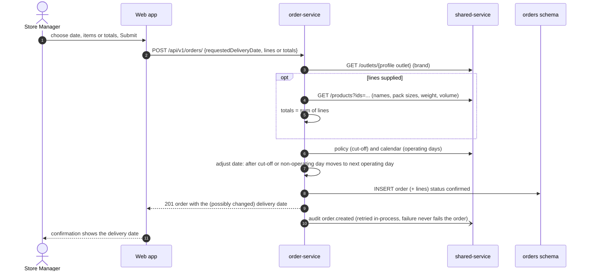

#### Plan, publish, acknowledge

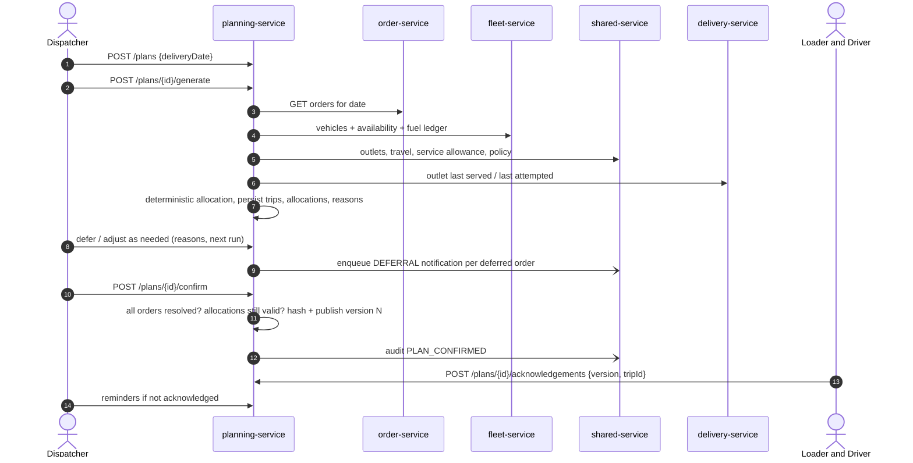

#### Loading to ready

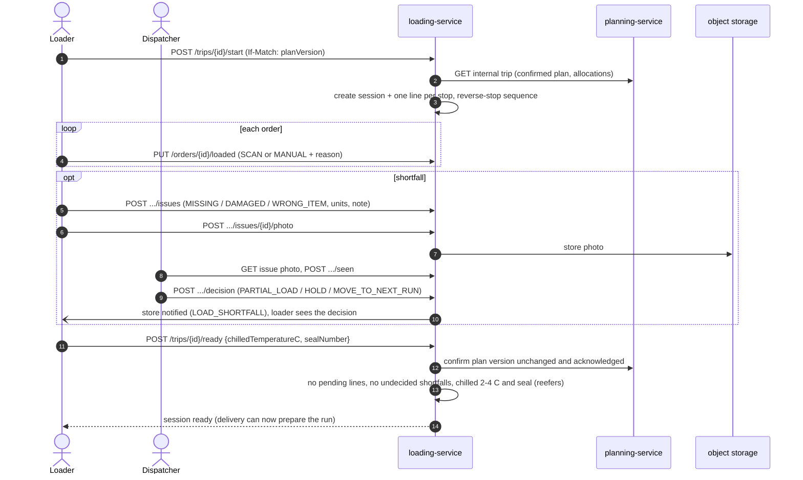

#### Delivery run (online path)

```mermaid
sequenceDiagram
    autonumber
    actor DR as Driver
    participant DV as delivery-service
    participant LS as loading-service
    participant ST as object storage
    participant OR as order-service
    actor SM as Store Manager
    DR->>DV: GET /trips/{id}  (prepare run from READY snapshot)
    DV->>LS: GET internal trip (ready)
    DR->>DV: POST /trips/{id}/checkout {confirmed order ids}
    DR->>DV: POST /trips/{id}/start (Idempotency-Key)
    DV->>LS: re-check version, ack, load still ready, checkout matches
    loop each stop
        DR->>DV: POST /stops/{id}/arrive
        DR->>DV: POST /stops/{id}/proofs (multipart photo or signature)
        DV->>ST: store object
        DR->>DV: POST /stops/{id}/outcome {DELIVERED | PARTIAL | NOT_DELIVERED | REFUSED}
        DV-)DV: refresh predictions of remaining stops (background)
    end
    DR->>DV: POST /trips/{id}/complete
    SM->>OR: GET /orders/{id}/tracking
    OR->>DV: delivery state (internal)
    SM->>OR: POST /orders/{id}/receipt/confirm {receivedUnits, issue?}
```

#### Offline delivery and replay

```mermaid
sequenceDiagram
    autonumber
    actor DR as Driver
    participant APP as Driver app (SQLite queue)
    participant NET as Network
    participant DV as delivery-service
    DR->>APP: "I've stopped safely"  (no signal)
    APP->>APP: enqueue ARRIVED with a random operationId
    DR->>APP: take photo, enter units, Save
    APP->>APP: enqueue PROOF_UPLOAD (file kept on phone), then STOP_OUTCOME dependsOn the proof
    Note over APP: UI shows "Saved on this device"
    NET-->>APP: connectivity returns (or 15 s timer)
    loop one durable item at a time (status updates go ahead of photo uploads that nothing depends on)
        APP->>DV: trip status check (must be in_progress)
        alt PROOF_UPLOAD
            APP->>DV: POST multipart proof (Idempotency-Key = operationId)
        else other
            APP->>DV: POST /delivery/sync {operations:[op]}
        end
        DV-->>APP: APPLIED | DUPLICATE(APPLIED) -> mark synced
        DV-->>APP: CONFLICT or REJECTED -> keep on phone, pause later items, show "needs attention"
        DV-->>APP: RETRY -> keep and send again
    end
    Note over DV: if the record was made on an older plan version, a sync_conflict row is created for the dispatcher, the record is still applied
```

The Android app sends **status first, photos after** (rule DR-6): a pending photo upload gives way to a later arrival or failed/refused outcome unless that update depends on the unsent photo, and finishing the route never overtakes anything; a `blocked` item at the front stops everything behind it.

The browser PWA queue (`apps/web/src/offline`, Dexie/IndexedDB) implements the same idea with a different send order (records, then photos, then outcomes that cite photos, then route completion) and is documented in `docs/architecture/offline-sync.md`; it is retained in source but its driver pages are switched off (see [9.1](#91-web-app-appsweb)).

#### Refused delivery and return

```mermaid
sequenceDiagram
    autonumber
    actor DR as Driver
    participant DV as delivery-service
    participant OR as order-service
    participant SH as shared-service
    actor DP as Dispatcher
    DR->>DV: outcome REFUSED + reason + returnedGoods {goods, units, resolution}
    DV->>DV: validate: goods text, units <= planned units, resolution NEXT_RUN or REQUEST_DEFERRAL
    DV->>OR: POST /orders/internal/delivery-followups (orders:write-internal)
    OR->>OR: create follow-up order on next operating day, units scaled, idempotent on stop id
    DV->>DV: ensure dispatcher trip message
    DV-)SH: DELIVERY_REJECTED notice (best effort)
    Note over DP: sees the take-back and follow-up, REQUEST_DEFERRAL orders are held, not auto-allocated, until the dispatcher decides
```

#### Breakdown recovery

```mermaid
sequenceDiagram
    autonumber
    actor DP as Dispatcher
    participant PL as planning-service
    participant FL as fleet-service
    participant SH as shared-service
    DP->>FL: record incident (breakdown) for vehicle
    DP->>PL: GET /plans/{id}/breakdowns/proposals?vehicleId=
    PL-->>DP: per affected trip: candidate vehicles with pass/fail per constraint
    DP->>PL: POST /plans/{id}/breakdowns/reassign {source, target, tripNumber}
    PL->>PL: re-verify target is feasible
    PL->>FL: set source vehicle in_workshop for the date
    alt fleet unreachable
        PL-->>DP: 502 workshop_pending (nothing changed, retry same request)
    else ok
        PL->>PL: revise, move allocations (recomputed times), confirm new version
        PL-)SH: audit BREAKDOWN_RECOVERY_CONFIRMED + PLAN_CONFIRMED
        PL-)SH: MAJOR_DELAY notice for each store delayed 30 min or more
    end
```

### 6.4 State machines

#### Order, as the store sees it (tracking stage)

```mermaid
stateDiagram-v2
    [*] --> CONFIRMED: order created
    CONFIRMED --> PLANNED: plan containing the order is published
    CONFIRMED --> DEFERRED: dispatcher deferred (reason, next run)
    DEFERRED --> CONFIRMED: re-planned on a later date (a new order or plan)
    PLANNED --> READY_FOR_DEPARTURE: delivery run prepared
    READY_FOR_DEPARTURE --> OUT_FOR_DELIVERY: run started
    OUT_FOR_DELIVERY --> DELIVERED
    OUT_FOR_DELIVERY --> PARTIAL
    OUT_FOR_DELIVERY --> NOT_DELIVERED
    OUT_FOR_DELIVERY --> REFUSED: follow-up order created
    DELIVERED --> RECEIPT_CONFIRMED: store confirms
    PARTIAL --> RECEIPT_CONFIRMED_WITH_ISSUE: shortfall reported
    DELIVERED --> RECEIPT_CONFIRMED_WITH_ISSUE: count differs
```

`orders.orders.status` itself is always `confirmed` (a CHECK constraint); the stages above are computed from planning, delivery and receipt data.

#### Notification outbox

```mermaid
stateDiagram-v2
    [*] --> IN_APP_ONLY: no consent, alert off, or no number
    [*] --> PENDING: eligible for SMS
    PENDING --> SENDING: worker claims
    SENDING --> QUEUED: provider accepted
    SENDING --> UNKNOWN: provider outcome unknown
    SENDING --> FAILED: provider rejected
    QUEUED --> SENT: status callback
    SENT --> DELIVERED: delivery receipt
    QUEUED --> FAILED: callback failure
    SENDING --> PENDING: recovered after crash
```

#### Agent approval

```mermaid
stateDiagram-v2
    [*] --> pending: model proposes a sensitive tool (5-minute expiry)
    pending --> approved: same human approves, then the action runs with their token
    pending --> rejected: same human rejects
    pending --> expired: 5 minutes pass
    approved --> [*]
    rejected --> [*]
    expired --> [*]
```

#### Automation

```mermaid
stateDiagram-v2
    [*] --> draft: describe in words or build
    draft --> tested: test (no side effects)
    tested --> draft: edit definition
    tested --> active: Turn on
    active --> paused: Pause (or owner lost permission)
    paused --> active: Resume
    active --> deleted: Delete (audit and runs retained)
    paused --> deleted
```

#### Driver location sharing (app)

```mermaid
stateDiagram-v2
    [*] --> off: no trip running
    off --> askFirst: trip starts and not yet allowed on this phone
    off --> sharing: trip starts and permission already granted
    askFirst --> sharing: driver allows
    askFirst --> declined: driver says Not now
    askFirst --> blocked: phone permission or location service off
    sharing --> off: trip finished or server says stop
```

Fixes are thinned to protect battery and data: at least 30 s apart and 25 m moved, with a 90 s heartbeat when parked; a fix older than 4 minutes is dropped; nothing is queued (only the newest position is useful, and the server refuses points older than 5 minutes).

#### Driver sync-queue item

```mermaid
stateDiagram-v2
    [*] --> pending: saved on the phone with an operationId
    pending --> sending: worker's turn (trip in progress, signed in)
    sending --> synced: APPLIED or DUPLICATE of APPLIED
    sending --> pending: network failure or RETRY
    sending --> blocked: CONFLICT or REJECTED (stays at the front and stops everything behind it)
    synced --> [*]
```

### 6.5 Business rules at a glance

| # | Rule | Where enforced |
|---|---|---|
| 1 | Orders after **16:00 Colombo** or for non-operating days move to the next operating day | order-service `deliveryDate` |
| 2 | A plan allocates only if all 8 hard constraints pass; every miss is explained | planning `constraints`, `allocate` |
| 3 | Max **2 trips per vehicle per day** | planning policy (≤ 2) and DB `CHECK (trip_number IN (1,2))` |
| 4 | Chilled needs a reefer; van-only outlets need a van; depot must match | planning |
| 5 | A deferral needs reason + decider + next-run date after the plan date | planning (W3) |
| 6 | A plan cannot be confirmed with unresolved orders or invalid allocations | planning |
| 7 | Loaders/drivers must acknowledge the **current** published version | planning, loading, delivery |
| 8 | A trip is ready only when loaded, shortfalls decided, (reefer) chilled 2–4 °C and sealed | loading |
| 9 | A run starts only from READY, after checkout and driver acknowledgement | delivery |
| 10 | DELIVERED/PARTIAL need a finalized proof first | delivery |
| 11 | Receipt only after DELIVERED/PARTIAL; shortfall needs an issue; two working days to report | order |
| 12 | Every write that can be retried is idempotent | all |
| 13 | Audit, fuel, custody, disruption risk, trip-message events and policy versions are append-only | DB triggers |
| 14 | Workflows (A4) can never submit orders or publish plans | `pkg/automation` |
| 15 | Agents never reach a database and every sensitive action needs the same human's approval | agent tier |

---

## 7. Data model and database

### 7.1 Principles

1. **One PostgreSQL instance, nine schemas, one owner per schema.** A service connects with `search_path` set to its schema. Almost all SQL stays inside it; the exceptions are `order-service`, which reads `shared.outlets`, `shared.service_allowance`, `shared.planning_policy_current`, `shared.planning_policy_versions`, `fleet.vehicles`, `delivery.runs` and `delivery.stops` (read-only, for forecasting), and `shared-service`, which reads and appends to `audit.events`. Cross-service references are *opaque text IDs* with **no foreign keys**; the owning service's API resolves them.
2. **Additive migrations.** `database/apply.sh` records each applied filename in `public.schema_migrations` and skips it next time. Migrations are idempotent where possible (`IF NOT EXISTS`, `DROP … IF EXISTS` before re-adding constraints) so re-running is safe. Files run in **filename order** (`ls` glob), which matters for the three files sharing the prefix `0040_` (`automations`, then `delivery_stop_expected_units`, then `shared_user_dashboards`). `0040_delivery_stop_expected_units.sql` is a data back-fill that joins `loading.*` once at migration time — the only place cross-schema SQL appears, and it is not application code.
3. **Evidence is append-only.** Rows that prove what happened cannot be updated or deleted (database triggers reject it).
4. **State snapshots, not live joins.** Loading sessions, delivery runs and stops *copy* the vehicle, outlet, window and plan version they were created from, so history stays true if master data changes.
5. **Time is `timestamptz`; business dates are `date` in Asia/Colombo.**

The `postgres` container mounts only `0001_init.sql` into `docker-entrypoint-initdb.d`; all later migrations run in the one-shot `migrate` container (`apply.sh`), then `seed`, then `bootstrap`.

### 7.2 Schema ownership

| Schema | Owner | Tables |
|---|---|---|
| `shared` | shared-service | 31 tables: identity profiles, outlets, calendar, travel, policy, catalog, notifications, dashboards, automations |
| `audit` | shared-service | `events` |
| `orders` | order-service | `orders`, `order_lines`, `receipts`, `receipt_lines`, `receipt_issues`, `tech_custody_events` |
| `planning` | planning-service | `plans`, `trips`, `allocations`, `deferrals`, `unallocated_reasons`, `plan_publications`, `plan_acknowledgements`, `plan_ack_reminders`, `disruption_risks`, `disruption_risk_overrides`, `automation_history_start`, `automation_order_history` |
| `fleet` | fleet-service | `vehicles`, `vehicle_availability`, `vehicle_incidents`, `fuel_entries`, `audit_outbox` |
| `loading` | loading-service | `sessions`, `order_loads`, `issues`, `dock_alerts` |
| `delivery` | delivery-service | `runs`, `stops`, `proofs`, `sync_operations`, `sync_conflicts`, `run_checkouts`, `trip_messages`, `trip_message_events`, `temperature_readings`, `driver_incidents`, `returned_goods`, `arrival_predictions`, `run_locations`, `proof_retention_events` |
| `inventory` | *planned* inventory-service | `simulation_runs`, `stock_levels`, `stock_batches`, `sales`, `sale_lines`, `stock_movements`, `stock_counts` — **tables and seed data only; no service reads or writes them** |
| `ai` | *planned* insights-service | `agents`, `observations`, `insights`, `suggestions`, `suggestion_responses`, `agent_preferences`, `agent_runs` — **tables and seed data only; no service uses them** (A1/A2 and A3/A4 do not) |

### 7.3 The business chain across schemas (logical, by opaque IDs)

```mermaid
erDiagram
    OUTLET ||--o{ ORDER : "places (outlet_id)"
    ORDER ||--o{ ORDER_LINE : "has items"
    ORDER ||--o| ALLOCATION : "planned as (order_id)"
    ORDER ||--o| DEFERRAL : "or deferred (order_id)"
    PLAN ||--o{ TRIP : "has"
    TRIP ||--o{ ALLOCATION : "stops"
    VEHICLE ||--o{ TRIP : "drives (vehicle_id)"
    TRIP ||--o| LOADING_SESSION : "loaded by (trip_id)"
    LOADING_SESSION ||--o{ ORDER_LOAD : "lines"
    ORDER_LOAD ||--o{ LOADING_ISSUE : "shortfalls"
    TRIP ||--o| DELIVERY_RUN : "driven as (trip_id)"
    DELIVERY_RUN ||--o{ DELIVERY_STOP : "stops"
    DELIVERY_STOP ||--o{ PROOF : "evidence"
    ORDER ||--o| RECEIPT : "confirmed by store"
    RECEIPT ||--o{ RECEIPT_ISSUE : "discrepancies"
    OUTLET ||--o{ NOTIFICATION : "notified (outlet_id)"
```

Every arrow above that crosses a schema boundary (`orders → planning → loading → delivery → receipts`) is an **ID reference resolved over HTTP**, not a database constraint.

### 7.4 Entity-relationship diagrams by schema

#### 7.4.1 `shared` — identity, outlets, reference data

```mermaid
erDiagram
    USERS {
        text id PK
        text identity_subject UK
        text role
        text display_name
        timestamptz created_at
        timestamptz updated_at
    }
    STORE_MANAGER_PROFILES {
        text user_id PK,FK
        text outlet_id FK
    }
    LOADER_PROFILES {
        text user_id PK,FK
        text depot
    }
    DISPATCHER_PROFILES {
        text user_id PK,FK
        text depot
    }
    DRIVER_PROFILES {
        text user_id PK,FK
        text vehicle_id
    }
    OUTLETS {
        text id PK
        text brand
        text name
        text district
        text depot
        text dock_type
        text parking_constraint
        boolean mall_window
        time window_open_time
        time window_close_time
        double latitude
        double longitude
        text access_instructions
        numeric chilled_temperature_min_c
        numeric chilled_temperature_max_c
        int version
    }
    OPERATING_CALENDAR {
        date date PK
        boolean is_operating
        int version
    }
    DISTRICT_TRAVEL {
        text from_district PK
        text to_district PK
        numeric km
        int minutes
    }
    SERVICE_ALLOWANCE {
        text stop_kind PK
        int minutes
    }
    DISTRICT_LOCATIONS {
        text district PK
        double latitude
        double longitude
    }
    PLANNING_POLICY_VERSIONS {
        int version PK
        time cutoff_local_time
        int deferral_weight_points
        int max_deferral_count
        int max_unserved_days
        int max_trips_per_vehicle
        text created_by
    }
    PLANNING_POLICY_CURRENT {
        boolean singleton PK
        int version FK
    }
    USERS ||--o| STORE_MANAGER_PROFILES : "role STORE_MANAGER"
    USERS ||--o| LOADER_PROFILES : "role LOADER"
    USERS ||--o| DISPATCHER_PROFILES : "role DISPATCHER"
    USERS ||--o| DRIVER_PROFILES : "role DRIVER"
    OUTLETS ||--o{ STORE_MANAGER_PROFILES : "manages"
    PLANNING_POLICY_VERSIONS ||--|| PLANNING_POLICY_CURRENT : "points to"
```

`shared.users.role` is the authoritative application role. `STORE_MANAGER_PROFILES.user_id` is the primary key, so one store manager maps to exactly one outlet. `planning_policy_versions` rows are immutable (trigger); a new policy is a new version and the singleton `planning_policy_current` is repointed.

#### 7.4.2 `shared` — product catalog

```mermaid
erDiagram
    PRODUCT_CATEGORIES {
        text id PK
        text parent_id FK
        text brand
        text name
        int sort_order
    }
    PRODUCTS {
        text id PK
        text sku UK
        text gtin UK
        text brand
        text category_id FK
        text family
        text name
        text size
        text pack_name
        int units_per_pack
        numeric pack_weight_kg
        numeric pack_volume_m3
        text temperature
        text status
    }
    PRODUCT_FRESH {
        text product_id PK,FK
        boolean perishable
        int shelf_life_days
        numeric storage_min_c
        numeric storage_max_c
    }
    PRODUCT_STYLE {
        text product_id PK,FK
        text gender
        text size_range
        text colours
        text material
        text season
    }
    PRODUCT_TECH {
        text product_id PK,FK
        boolean requires_serial
        boolean high_value
        boolean seal_required
        int warranty_months
    }
    PRODUCT_ALIASES {
        text product_id PK,FK
        text alias PK
    }
    PRODUCT_PRICES {
        text product_id PK,FK
        text price_list PK
        date effective_from PK
        numeric unit_price
        text currency
    }
    OUTLET_PRODUCTS {
        text outlet_id PK,FK
        text product_id PK,FK
        boolean listed
        numeric avg_daily_sales_each
        int reorder_point_each
        int min_stock_each
        int max_stock_each
    }
    PRODUCT_CATEGORIES ||--o{ PRODUCT_CATEGORIES : "parent"
    PRODUCT_CATEGORIES ||--o{ PRODUCTS : "contains"
    PRODUCTS ||--o| PRODUCT_FRESH : "brand Fresh"
    PRODUCTS ||--o| PRODUCT_STYLE : "brand Style"
    PRODUCTS ||--o| PRODUCT_TECH : "brand Tech"
    PRODUCTS ||--o{ PRODUCT_ALIASES : "everyday names"
    PRODUCTS ||--o{ PRODUCT_PRICES : "effective-dated LKR"
    PRODUCTS ||--o{ OUTLET_PRODUCTS : "range"
```

Product IDs match `^(FR|ST|TC)-[A-Z0-9-]{2,40}$`; GTIN-13 is validated. A *pack* (bag, bale, box, bundle, carton, case, crate, pack, tray) is what moves through ordering, loading and delivery (`orders.order_units`); an *each* is one sellable item in a store; `units_per_pack` converts. `outlet_products` is a store's listed range with its usual daily sales — the input to order suggestions.

#### 7.4.3 `shared` — notifications, dashboards, automations

```mermaid
erDiagram
    OUTLET_NOTIFICATION_PREFERENCES {
        text outlet_id PK,FK
        text phone_e164
        boolean consent_enabled
        boolean deferrals_enabled
        boolean major_delays_enabled
        text locale
        timestamptz consented_at
        int version
    }
    NOTIFICATION_OUTBOX {
        bigint id PK
        text event_key UK
        text outlet_id FK
        text event_type
        text phone_e164
        text body
        text status
        text provider_message_id
        text error_code
        timestamptz payload_expires_at
    }
    USER_DASHBOARDS {
        uuid id PK
        text owner_user_id FK
        text name
        jsonb spec
        int version
    }
    AUTOMATION_PREFERENCES {
        text owner_id PK,FK
        boolean enabled
    }
    HABIT_FEEDBACK {
        text owner_id PK,FK
        text pattern_key PK
        int yes_count
        int no_count
        boolean suppressed
    }
    HABIT_SUGGESTIONS {
        uuid id PK
        text owner_id FK
        text pattern_key
        text occurrence_key
        jsonb payload
        text response
    }
    AUTOMATION_PREVIEWS {
        uuid id PK
        text owner_id FK
        jsonb definition
        jsonb result
    }
    AUTOMATIONS {
        uuid id PK
        text owner_id FK
        jsonb definition
        text status
        timestamptz next_run_at
        uuid activation_key
    }
    AUTOMATION_RUNS {
        uuid id PK
        uuid automation_id FK
        text owner_id FK
        timestamptz scheduled_at
        text status
        jsonb result
    }
    AUTOMATION_INBOX {
        uuid id PK
        text owner_id FK
        text title
        jsonb payload
    }
    PRIORITY_REVIEWS {
        text owner_id PK,FK
        text outlet_id PK,FK
        timestamptz expires_at
    }
    USERS ||--o{ USER_DASHBOARDS : "owns"
    USERS ||--o{ AUTOMATIONS : "owns"
    AUTOMATIONS ||--o{ AUTOMATION_RUNS : "executions"
    USERS ||--o{ AUTOMATION_INBOX : "receives"
    USERS ||--o{ HABIT_FEEDBACK : "answers"
    USERS ||--o{ PRIORITY_REVIEWS : "flags"
    OUTLETS ||--o| OUTLET_NOTIFICATION_PREFERENCES : "SMS consent"
    OUTLETS ||--o{ NOTIFICATION_OUTBOX : "notices"
```

Constraints worth knowing: phone numbers must match `^[+][1-9][0-9]{7,14}$`; `consent_enabled` requires `consented_at`; `locale ∈ {en, si, ta}`; automation runs are unique per `(automation_id, scheduled_at)` and activations unique per `(owner_id, activation_key)`.

#### 7.4.4 `orders`

```mermaid
erDiagram
    ORDERS {
        uuid id PK
        text order_ref UK
        text outlet_id
        text brand
        date requested_delivery_date
        int order_units
        numeric order_weight_kg
        numeric order_volume_m3
        text temperature_requirement
        text status
        text created_by
        text source_system
        text external_order_id
    }
    ORDER_LINES {
        uuid id PK
        uuid order_id FK
        int line_no
        text product_id
        text product_name
        text pack_name
        int units_per_pack
        int pack_qty
        numeric weight_kg
        numeric volume_m3
        text source
    }
    RECEIPTS {
        uuid id PK
        uuid order_id FK,UK
        uuid delivery_run_id
        uuid delivery_stop_id
        text delivery_outcome
        int expected_units
        int received_units
        text status
        text confirmed_by
        numeric received_temperature_c
        int version
    }
    RECEIPT_LINES {
        uuid id PK
        uuid receipt_id FK
        uuid order_line_id FK
        int expected_packs
        int received_packs
        int short_packs
        int damaged_packs
    }
    RECEIPT_ISSUES {
        uuid id PK
        uuid receipt_id FK
        text issue_type
        int affected_units
        text note
        text idempotency_key UK
    }
    TECH_CUSTODY_EVENTS {
        uuid id PK
        uuid order_id FK
        text stage
        text seal_id
        text_array serial_numbers
        text condition
        text evidence_ref
        text receiver_name
        text idempotency_key UK
    }
    ORDERS ||--o{ ORDER_LINES : "items"
    ORDERS ||--o| RECEIPTS : "one receipt"
    RECEIPTS ||--o{ RECEIPT_LINES : "per line"
    ORDER_LINES ||--o{ RECEIPT_LINES : "counted"
    RECEIPTS ||--o{ RECEIPT_ISSUES : "discrepancies"
    ORDERS ||--o{ TECH_CUSTODY_EVENTS : "Tech only"
```

Checks: `status = 'confirmed'` always; units/weight/volume > 0; temperature ∈ {ambient, chilled}; `received_units` between 1 and `expected_units`; receipts exist only for outcome `DELIVERED`/`PARTIAL`; a partial unique index on `(source_system, external_order_id)` makes imports and follow-ups idempotent. Order references look like `ORD000001` (sequence `orders.order_ref_seq`).

#### 7.4.5 `planning`

```mermaid
erDiagram
    PLANS {
        uuid id PK
        text plan_ref UK
        date delivery_date UK
        text status
        timestamptz generated_at
        int current_version
        timestamptz published_at
        text created_by
    }
    TRIPS {
        uuid id PK
        uuid plan_id FK
        text vehicle_id
        int trip_number
        text status
    }
    ALLOCATIONS {
        uuid id PK
        uuid plan_id FK
        text order_id
        uuid trip_id FK
        text vehicle_id
        int sequence
        timestamptz planned_arrival_at
        timestamptz planned_service_start_at
        timestamptz planned_departure_at
    }
    DEFERRALS {
        uuid id PK
        uuid plan_id FK
        text order_id
        text outlet_id
        text reason_code
        jsonb reason_detail
        text comment
        text deferred_by
        date next_run_target
    }
    UNALLOCATED_REASONS {
        uuid plan_id PK,FK
        text order_id PK
        text reason_code
        jsonb details
    }
    PLAN_PUBLICATIONS {
        uuid id PK
        uuid plan_id FK
        int version
        text content_hash
        text published_by
        timestamptz published_at
    }
    PLAN_ACKNOWLEDGEMENTS {
        uuid plan_id FK
        int version FK
        text actor_id
        text actor_role
        uuid trip_id FK
        text vehicle_id
        timestamptz acknowledged_at
    }
    PLAN_ACK_REMINDERS {
        uuid id PK
        uuid plan_id FK
        int version FK
        uuid trip_id FK
        text audience
        text reminded_by
        timestamptz reminded_at
    }
    DISRUPTION_RISKS {
        uuid id PK
        date delivery_date
        text scope
        text scope_key
        text risk_type
        text severity
        numeric confidence
    }
    DISRUPTION_RISK_OVERRIDES {
        uuid id PK
        uuid risk_id FK
        text decision
        text severity_override
        text reason
        text actor_id
    }
    AUTOMATION_ORDER_HISTORY {
        bigint id PK
        uuid plan_id
        text order_id
        text outlet_id
        date delivery_date
        text state
    }
    PLANS ||--o{ TRIPS : "has"
    PLANS ||--o{ ALLOCATIONS : "has"
    TRIPS ||--o{ ALLOCATIONS : "stops"
    PLANS ||--o{ DEFERRALS : "has"
    PLANS ||--o{ UNALLOCATED_REASONS : "explains"
    PLANS ||--o{ PLAN_PUBLICATIONS : "versions"
    PLAN_PUBLICATIONS ||--o{ PLAN_ACKNOWLEDGEMENTS : "acknowledged"
    PLAN_PUBLICATIONS ||--o{ PLAN_ACK_REMINDERS : "reminded"
    TRIPS ||--o{ PLAN_ACKNOWLEDGEMENTS : "for trip"
    DISRUPTION_RISKS ||--o{ DISRUPTION_RISK_OVERRIDES : "decisions"
```

Checks: `status ∈ {draft, validated, confirmed}`; `trip_number ∈ {1, 2}`; `UNIQUE (plan_id, vehicle_id, trip_number)`; `UNIQUE (plan_id, order_id)` on both allocations and deferrals (an order is allocated **or** deferred once per plan); `UNIQUE (plan_id, version)` on publications. Triggers on `allocations` and `deferrals` write `automation_order_history` for the A3/A4 engine. `ON DELETE CASCADE` from plans means *reset* is a clean delete of everything beneath it.

#### 7.4.6 `fleet`

```mermaid
erDiagram
    VEHICLES {
        text vehicle_id PK
        text type
        text temp
        numeric weight_cap_kg
        numeric volume_cap_m3
        text fuel_type
        numeric km_per_l
        numeric weekly_fuel_quota_l
        text home_depot
        int version
    }
    VEHICLE_AVAILABILITY {
        text vehicle_id PK,FK
        date date PK
        text status
        text reason
    }
    VEHICLE_INCIDENTS {
        uuid id PK
        text vehicle_id FK
        date incident_date
        text trip_id
        text incident_type
        text description
        jsonb affected_stops
        text status
    }
    FUEL_ENTRIES {
        uuid id PK
        text vehicle_id FK
        date entry_date
        numeric liters
        text receipt_ref
        text note
        text idempotency_key UK
    }
    AUDIT_OUTBOX {
        text event_id PK
        jsonb payload
        timestamptz delivered_at
        int attempts
        timestamptz next_attempt_at
    }
    VEHICLES ||--o{ VEHICLE_AVAILABILITY : "per day"
    VEHICLES ||--o{ VEHICLE_INCIDENTS : "incidents"
    VEHICLES ||--o{ FUEL_ENTRIES : "ledger (append-only)"
```

Availability `status ∈ {available, unavailable, in_workshop}`; **no row means available**.

#### 7.4.7 `loading`

```mermaid
erDiagram
    SESSIONS {
        uuid id PK
        text trip_id UK
        text plan_id
        text plan_ref
        int plan_version
        date delivery_date
        text vehicle_id
        text depot
        text status
        text started_by
        text ready_by
        timestamptz ready_at
        numeric ready_temperature_c
        text ready_seal
    }
    ORDER_LOADS {
        uuid id PK
        uuid session_id FK
        text allocation_id
        text order_id
        text order_ref
        text outlet_id
        text brand
        int expected_units
        int stop_sequence
        int suggested_load_sequence
        text status
        text entry_method
        text manual_reason
        int changed_in_version
        text change_note
    }
    ISSUES {
        uuid id PK
        uuid order_load_id FK
        text issue_type
        int affected_units
        text note
        text idempotency_key UK
        text decision
        text decided_by
        text photo_object_key
        text photo_mime
        text seen_by
    }
    DOCK_ALERTS {
        uuid id PK
        text session_trip_id
        text depot
        date delivery_date
        text alert_type
        text order_ref
        text belongs_vehicle_id
        text idempotency_key UK
        text resolved_by
    }
    SESSIONS ||--o{ ORDER_LOADS : "lines"
    ORDER_LOADS ||--o{ ISSUES : "shortfalls"
```

Checks: `status ∈ {pending, in_progress, ready}` for sessions; `{pending, loaded, shortfall}` for lines; `issue_type ∈ {MISSING, DAMAGED, WRONG_ITEM}`; decision `∈ {PARTIAL_LOAD, HOLD, MOVE_TO_NEXT_RUN}`; `entry_method ∈ {SCAN, MANUAL}`, and `MANUAL` requires a `manual_reason ∈ {DAMAGED_LABEL, UNREADABLE, NO_CAMERA, OTHER}`; photos limited to `image/jpeg` / `image/png`; seal 1–40 chars; chilled reading −30…30 °C.

#### 7.4.8 `delivery`

```mermaid
erDiagram
    RUNS {
        uuid id PK
        text trip_id UK
        text plan_ref
        int plan_version
        date delivery_date
        text vehicle_id
        text depot
        int trip_number
        text status
        timestamptz started_at
        timestamptz completed_at
        int version
    }
    STOPS {
        uuid id PK
        uuid run_id FK
        text allocation_id
        text order_id
        text order_ref
        text outlet_id
        int stop_sequence
        text status
        timestamptz planned_arrival_at
        timestamptz arrived_at
        text outcome_code
        text outcome_reason
        int expected_units
        int delivered_units
        int shortfall_units
        text access_instructions
        numeric chilled_temperature_min_c
        numeric chilled_temperature_max_c
        int version
    }
    PROOFS {
        uuid id PK
        uuid stop_id FK
        text proof_type
        text object_key
        text mime_type
        text sha256
        text receiver_name
        boolean pending
        text idempotency_key UK
        boolean retention_hold
    }
    SYNC_OPERATIONS {
        text operation_id PK
        text run_id
        text stop_id
        text operation_type
        text result_status
        jsonb result_payload
    }
    SYNC_CONFLICTS {
        uuid id PK
        text run_id
        text stop_id
        text operation_id UK
        int recorded_plan_version
        int current_plan_version
        text settled_by
    }
    RUN_CHECKOUTS {
        uuid run_id PK,FK
        int plan_version
        text status
        text_array confirmed_order_ids
        text_array missing_order_ids
    }
    TRIP_MESSAGES {
        uuid id PK
        uuid run_id FK
        uuid stop_id FK
        text body
        text sent_by
        text acknowledged_by
    }
    TRIP_MESSAGE_EVENTS {
        bigint id PK
        uuid message_id FK
        text event_type
        text actor_id
    }
    TEMPERATURE_READINGS {
        text operation_id PK
        uuid run_id FK
        uuid stop_id FK
        numeric value_c
        text source
        text evaluation
        numeric min_c_snapshot
        numeric max_c_snapshot
    }
    DRIVER_INCIDENTS {
        uuid id PK
        uuid run_id FK
        uuid stop_id FK
        text operation_id UK
        text category
        text description
    }
    RETURNED_GOODS {
        uuid stop_id PK,FK
        uuid run_id FK
        text order_id
        text goods
        int units
        text reason
        text resolution
        text followup_order_id
        date followup_date
    }
    ARRIVAL_PREDICTIONS {
        uuid stop_id PK,FK
        int plan_version
        timestamptz current_eta
        timestamptz communicated_eta
        timestamptz range_lower
        timestamptz range_upper
        text risk
        int notice_sequence
    }
    RUN_LOCATIONS {
        uuid run_id PK,FK
        text vehicle_id
        double latitude
        double longitude
        timestamptz recorded_at
        double distance_m
        int fixes
    }
    PROOF_RETENTION_EVENTS {
        uuid proof_id PK
        uuid stop_id
        text proof_type
        timestamptz trip_completed_at
        timestamptz erased_at
        int retention_days
        text policy_version
    }
    RUNS ||--o{ STOPS : "stops"
    STOPS ||--o{ PROOFS : "evidence"
    RUNS ||--o| RUN_CHECKOUTS : "check-out"
    RUNS ||--o{ TRIP_MESSAGES : "dispatch messages"
    TRIP_MESSAGES ||--o{ TRIP_MESSAGE_EVENTS : "append-only log"
    STOPS ||--o{ TEMPERATURE_READINGS : "readings"
    RUNS ||--o{ DRIVER_INCIDENTS : "incidents"
    STOPS ||--o| RETURNED_GOODS : "take-back"
    STOPS ||--o| ARRIVAL_PREDICTIONS : "latest ETA"
    RUNS ||--o| RUN_LOCATIONS : "latest position"
```

Checks and generated values: stop `status ∈ {pending, arrived, completed}`; run `status ∈ {prepared, in_progress, completed}`; `UNIQUE (run_id, order_id)`; `delivered_units ≤ expected_units`; **`shortfall_units` is a generated stored column** (`expected_units − delivered_units`); proof `proof_type ∈ {SIGNATURE, PHOTO}`; a retention hold needs a reason; temperature `value_c` −40…100; `run_locations` holds **one row per run** (latest point only).

#### 7.4.9 `audit`

```mermaid
erDiagram
    EVENTS {
        text event_id PK
        text correlation_id
        text actor_id
        text actor_type
        text action
        text resource_type
        text resource_id
        jsonb previous_state
        jsonb new_state
        text reason
        timestamptz timestamp
        text source
    }
```

Indexes on `(resource_type, resource_id)`, `(timestamp DESC, event_id DESC)`, `(action, timestamp DESC)` and `(actor_id, timestamp DESC)` serve search and export; a trigger rejects every UPDATE and DELETE.

#### 7.4.10 `inventory` and `ai` (planned services, data only)

```mermaid
erDiagram
    SIMULATION_RUNS {
        uuid id PK
        text code UK
        text scenario
        int seed
        date period_start
        date period_end
        boolean simulated
    }
    STOCK_LEVELS {
        text outlet_id PK
        text product_id PK
        int on_hand_each
    }
    STOCK_BATCHES {
        uuid id PK
        text outlet_id
        text product_id
        text source_type
        int received_each
        int remaining_each
        date expires_on
        boolean simulated
        uuid simulation_run_id FK
    }
    SALES {
        uuid id PK
        text outlet_id
        date business_date
        text channel
        text receipt_no
        numeric total_amount
        uuid simulation_run_id FK
    }
    SALE_LINES {
        uuid id PK
        uuid sale_id FK
        text product_id
        int quantity_each
        numeric unit_price
    }
    STOCK_MOVEMENTS {
        bigint id PK
        text outlet_id
        text product_id
        uuid batch_id FK
        text movement_type
        int quantity_each
        uuid sale_line_id FK
        timestamptz occurred_at
        boolean simulated
    }
    STOCK_COUNTS {
        uuid id PK
        text outlet_id
        text product_id
        int counted_each
        int system_each
        int variance_each
    }
    AGENTS {
        text code PK
        text name
        text audience
        boolean enabled
    }
    OBSERVATIONS {
        bigint id PK
        text subject_type
        text subject_id
        text metric
        numeric value
        text unit
        date period_start
        date period_end
        text source
        boolean simulated
    }
    INSIGHTS {
        uuid id PK
        text agent_code FK
        text kind
        text subject_id
        text summary
        numeric score
        jsonb evidence
        date valid_from
        date valid_until
    }
    SUGGESTIONS {
        uuid id PK
        text agent_code FK
        text user_id
        uuid insight_id FK
        text context
        text message
    }
    SUGGESTION_RESPONSES {
        uuid suggestion_id PK,FK
        text answer
    }
    AGENT_PREFERENCES {
        text user_id PK
        text agent_code PK,FK
        boolean enabled
        text_array muted_kinds
    }
    AGENT_RUNS {
        bigint id PK
        text agent_code FK
        text user_id
        text input_hash
        text outcome
        int latency_ms
    }
    SIMULATION_RUNS ||--o{ STOCK_BATCHES : "tags"
    SIMULATION_RUNS ||--o{ SALES : "tags"
    SALES ||--o{ SALE_LINES : "lines"
    STOCK_BATCHES ||--o{ STOCK_MOVEMENTS : "ledger"
    SALE_LINES ||--o{ STOCK_MOVEMENTS : "sold"
    AGENTS ||--o{ INSIGHTS : "produces"
    INSIGHTS ||--o{ SUGGESTIONS : "evidence for"
    SUGGESTIONS ||--o| SUGGESTION_RESPONSES : "answer"
    AGENTS ||--o{ AGENT_PREFERENCES : "per user"
    AGENTS ||--o{ AGENT_RUNS : "audit of runs"
```

`inventory.stock_movements` and `ai.observations` are **append-only** (UPDATE, DELETE and TRUNCATE rejected). Foreign keys that reach the ledger are `ON DELETE RESTRICT`. The only deletion path is `inventory.delete_simulation_run(run_id)`, which refuses an unknown run or one recorded as real data (`simulated = false`), removes only rows flagged simulated and tagged to that run, and resets `stock_levels` from the remaining ledger. `database/tests/append_only.sql` proves these rules. A demo case is seeded for `OUT034`: 20 of 48 bottles of Fresh milk 1 L expired last week.

### 7.5 Append-only and immutability guarantees

| Table | What is blocked | Mechanism |
|---|---|---|
| `audit.events` | UPDATE, DELETE | trigger `audit.reject_event_mutation` |
| `fleet.fuel_entries` | UPDATE, DELETE | trigger `fleet.reject_fuel_entry_mutation` |
| `orders.tech_custody_events` | UPDATE, DELETE | trigger `orders.reject_tech_custody_mutation` |
| `planning.disruption_risks`, `…_overrides` | UPDATE, DELETE | trigger `planning.reject_disruption_risk_mutation` |
| `shared.planning_policy_versions` | UPDATE, DELETE | trigger `shared.reject_policy_version_mutation` |
| `delivery.trip_message_events` | UPDATE, DELETE | trigger `delivery.reject_message_event_mutation` |
| `delivery.proof_retention_events` | UPDATE, DELETE | trigger `delivery.reject_proof_retention_event_mutation` |
| `inventory.stock_movements`, `ai.observations` | UPDATE, DELETE, TRUNCATE | triggers + `RESTRICT` FKs + one controlled function |

> The only way to remove a delivery proof is the retention worker, which first writes its append-only erasure event.

### 7.6 Seed and reference data

`database/seed.sh` runs: `m2_outlets.sql` (three demo outlets `OUT034` Fresh, `OUT021` Style, `OUT088` Tech) → `calendar.csv` (**TRUNCATEs** `shared.operating_calendar` first) → `import.sh` (outlets, vehicles, district travel — **TRUNCATE**d and reloaded — and service allowance) → `catalog.sql` (24 categories, 114 products across Fresh/Style/Tech, GTIN-13 barcodes, effective-dated LKR prices, aliases, 5,093 store-range rows) → `inventory_history.sql` (eight weeks of simulated trading plus derived `ai.observations`/`insights`, all `simulated = true` under run `seed-baseline`; runs once, about two minutes).

| Dataset | Rows | Source and caveat |
|---|--:|---|
| Outlets | 120 | Converted from the official release; the official file has no name column, so names are synthesised (`"<brand> <outlet_id>"`). Two depots: Peliyagoda (north) and Kandy (south). |
| Vehicles | 60 | Static attributes only. Availability is operational data (a missing row = available). |
| Calendar | 910 | `date,is_operating` only; richer official columns (holiday, monsoon, festival…) are dropped and not used by the planner. |
| District travel | 34 directed pairs | **Lossy**: each official row becomes depot→district, district→depot (assumed symmetric) and a district self-loop for inter-stop legs; for Kandy (depot name = district name) the inter-stop value wins the collision. |
| Service allowance | 2 | **Lossy**: the official 9 (brand × dock-type) values (15–59 min) collapse to `default` ≈ 36 min and `mall` ≈ 44 min, under-serving the slower Tech/Style stops and over-serving Fresh. |

`scripts/validate-seeds.py` checks unique IDs/dates, required demo outlets, depot references, numeric bounds and calendar shapes before import. `scripts/convert-official-dataset.py` regenerates the CSVs from `Tech-Triathlon 2026 - Datasets/`, which must remain byte-identical to the official release. The fixture script `scripts/demo-automations.py` creates clearly labelled synthetic history for the A3/A4 demo and refuses to run against a non-local shared-service.

### 7.7 Backup and restore of data

`make backup-postgres` → `scripts/create-postgres-backup.sh` (custom-format dump) and `scripts/verify-postgres-backup.sh`; `make backup-object-storage` → `scripts/create-object-storage-backup.sh`, with a restore drill against a second S3Mock (`backup-test` profile, port 9001) via `make verify-object-storage-restore`. The deploy workflow also takes a PostgreSQL dump before migrating. See [11.3](#113-backup-and-restore).

---

## 8. API reference

All routes are under `/api/v1/<domain>` and take `Authorization: Bearer <access token>` unless marked *provider callback*. This chapter is derived from the route registrations in each service (`internal/handler`). The machine-readable contracts are in `contracts/openapi/` (ten files; the Swagger viewer lists eight, and `automations.yaml` and `assistants.yaml` are read as raw YAML); where a contract lags behaviour, the handler is the reference.

**Conventions**

* JSON in and out; errors are `application/problem+json` ([4.4](#44-errors)). Dates are `YYYY-MM-DD` in Colombo time; instants are RFC 3339.
* `Idempotency-Key` (or an `operationId` in the body) makes a write safe to repeat. `If-Match` carries a plan version where noted.
* `X-Correlation-ID` is accepted and echoed (and `X-Request-ID`).
* Permission column: a role-derived permission (see [4.2](#42-authorization-four-layers-in-order)) or an internal **scope** carried by a service token. "any" in a permission cell means the listed permissions are alternatives.
* To try the API: `docker compose -p waypoint-api-docs -f docker-compose.api-docs.yml up -d` then open `http://localhost:8092` (read-only Swagger UI; "Try it out" is disabled).

### 8.1 order-service — `/api/v1/orders`

| Method and path | Permission | Purpose |
|---|---|---|
| `GET /cutoff` | `order:view-own` or `order:view-all` | The current cut-off as `{cutoff: {localTime, timezone}}` (for example `16:00`, `Asia/Colombo`) |
| `GET /forecast` | `order:view-all` | 10-week demand forecast, drift, capacity pressure |
| `GET /export.csv`, `GET /export?version=1` | `order:view-all` | Export orders (CSV v1 or JSON v1) |
| `POST /import.csv?version=1&sourceSystem=` , `POST /import?version=1` | `order:view-all` | Import confirmed orders (≤ 500 rows, ≤ 2 MiB, idempotent per `(sourceSystem, externalOrderId)`) |
| `POST /internal/delivery-followups` | scope `orders:write-internal` | Create the follow-up order for a returned delivery (service-to-service) |
| `GET /suggestion?date=&temperature=` | `order:create` | Explainable item suggestion for the caller's outlet |
| `POST /` | `order:create` | Place an order (totals or lines) |
| `GET /` | `order:view-own` / `order:view-all` / `orders:read-internal` | List orders (filters: `status`, `brand`, `outlet_id`, `requested_delivery_date`) |
| `GET /{id}` | same | Order detail |
| `GET /{id}/tracking` | `order:view-own` / `order:view-all` | Stage, planning, delivery, receipt, custody |
| `GET /receipts/pending` | `order:view-own` / `order:view-all` | Orders awaiting receipt confirmation (with report-by state) |
| `GET /receipt-issues` | `order:view-all` | All receipt discrepancies |
| `GET /{id}/receipt` | `order:view-own` / `order:view-all` | The receipt and its issues |
| `POST /{id}/receipt/confirm` | `receipt:confirm` | Confirm received units (+ optional issue, + temperature) |
| `POST /{id}/receipt/issues` | `delivery:issue-create` | Report a discrepancy after confirmation (idempotent) |
| `POST /{id}/custody` | view-own / view-all / `loading:update` / `delivery:update` / `receipt:confirm` | Append a Tech custody event (stage rules in [SM-06](#62-use-case-catalogue)) |

### 8.2 planning-service — `/api/v1/planning`

| Method and path | Permission | Purpose |
|---|---|---|
| `POST /plans` | `plan:create` | Create (or return) the plan for a delivery date |
| `GET /plans?date=` , `GET /plans/{id}` | `plan:view` | Plan detail: trips, allocations, deferrals, unallocated reasons, vehicles, orders, publication |
| `POST /plans/{id}/generate` | `plan:update` | Run the allocator once |
| `POST /plans/{id}/simulate` | `plan:view` | Same allocator, nothing persisted |
| `POST /plans/{id}/reset` | `plan:update` | Clear generated trips/allocations/deferrals; back to `draft` |
| `POST /plans/{id}/allocations` | `allocation:create` | Assign an order to a vehicle/trip (reason required) |
| `PUT /plans/{id}/allocations/{allocId}` | `allocation:update` | Move to another vehicle/trip |
| `DELETE /plans/{id}/allocations/{allocId}` | `allocation:update` | Remove an allocation |
| `POST /plans/{id}/deferrals` | `order:defer` | Defer an order (reason code, comment, `nextRunTarget`) |
| `POST /plans/{id}/confirm` | `plan:update` | Validate and publish the next version |
| `POST /plans/{id}/revise` | `plan:update` | Reopen a confirmed plan |
| `GET /plans/{id}/breakdowns/proposals?vehicleId=` | `plan:view` | Rescue options for a broken vehicle |
| `POST /plans/{id}/breakdowns/reassign` | `plan:update` | Move a trip to a replacement and publish |
| `POST /plans/{id}/acknowledgements` | `plan:acknowledge` | Acknowledge a published version for a trip |
| `POST /plans/{id}/reminders` , `GET /plans/{id}/reminders?tripId=` | `plan:update` / `plan:acknowledge` | Send / read reminders |
| `GET /disruption-risks?date=` | `plan:view` | List risks with the latest override |
| `POST /disruption-risks` , `POST /disruption-risks/{riskId}/override` | `plan:update` | Record / decide a risk |
| `GET /internal/trips?date=&depot=` , `GET /internal/trips/{tripId}` | `plan:view` or `plans:read-internal` | Trip snapshots for loading |
| `GET /internal/orders/{orderId}` | `plans:read-internal` | Planning state of one order |
| `GET /internal/automation-snapshot?at=` | `automations:read-internal` | Deferral history for automations |

### 8.3 fleet-service — `/api/v1/fleet`

| Method and path | Permission | Purpose |
|---|---|---|
| `GET /vehicles`, `GET /vehicles/{id}` | `fleet:view` or `fleet:read-internal` | Vehicle master data |
| `GET /availability?date=` | same | Availability for a date |
| `PUT /vehicles/{id}/availability` | `fleet:update` | Set `available` / `unavailable` / `in_workshop` for a date |
| `GET /incidents?openOnly=true` , `POST /incidents` | `fleet:view` / `fleet:update` | Vehicle incidents |
| `PUT /vehicles/{id}/master-data` | `fleet:update` | Update capacities/quotas (version check; audit queued) |
| `POST /fuel/entries` | `fleet:update` | Record fuel (header `Idempotency-Key` required) |
| `GET /fuel/ledger?weekOf=` | `fleet:view` or `fleet:read-internal` | Weekly quota vs actual per vehicle |

### 8.4 loading-service — `/api/v1/loading`

| Method and path | Permission | Purpose |
|---|---|---|
| `GET /trips?date=` , `GET /trips/{tripId}` | `loading:view` (loader, own depot) / `loading:view-all` | Load list and trip detail with plan, capacity, lines, issues |
| `POST /trips/{tripId}/start` | `loading:update` | Start loading (`If-Match: planVersion`) |
| `POST /trips/{tripId}/sync` | `loading:update` | Move the session to the newer acknowledged plan version (`If-Match`) |
| `PUT /trips/{tripId}/orders/{orderId}/loaded` | `loading:update` | Mark loaded (`method` SCAN / MANUAL, reason, note) |
| `POST /trips/{tripId}/orders/{orderId}/issues` | `loading:issue` | Report missing/damaged/wrong item (idempotent) |
| `PUT` / `DELETE …/issues/{issueId}` | `loading:issue` | Edit / withdraw an undecided report |
| `POST …/issues/{issueId}/photo` , `GET …/photo` | `loading:issue` / `loading:view` | Upload (≤ 4 MiB) / read the photo |
| `POST …/issues/{issueId}/seen` , `POST …/decision` | `loading:decide` | Dispatcher marks seen / decides |
| `POST /trips/{tripId}/alerts` , `GET /alerts?date=` , `POST /alerts/{alertId}/resolve` | `loading:issue` / `loading:view` / `loading:decide` | Wrong-vehicle dock alerts |
| `POST /trips/{tripId}/ready` | `loading:ready` | Declare ready (`chilledTemperatureC`, `sealNumber`) |
| `GET /internal/trips?date=&vehicleId=` , `GET /internal/trips/{tripId}` | `loading:read-internal` | READY snapshots for delivery |

### 8.5 delivery-service — `/api/v1/delivery`

| Method and path | Permission | Purpose |
|---|---|---|
| `GET /trips`, `GET /drivers/me/trips` | any `delivery:view*` | Trips for a date/vehicle |
| `GET /trips/{tripId}` | same | Run detail (prepares the run for a driver; a dispatcher gets a read-only preview if none exists) |
| `POST /trips/{tripId}/prepare` | `delivery:start` | Prepare explicitly |
| `GET` / `POST /trips/{tripId}/checkout` | `delivery:start` (+ view-all, loading:view for GET) | Truck check-out status / confirmation |
| `POST /trips/{tripId}/start` | `delivery:start` | Start (header `Idempotency-Key`) |
| `POST /trips/{tripId}/stops/{stopId}/arrive` | `delivery:update` | Arrival (idempotent) |
| `POST /trips/{tripId}/stops/{stopId}/proofs` | `delivery:proof` | Multipart proof (`type`, `file`, `mimeType`, `receiverName`) |
| `POST /trips/{tripId}/stops/{stopId}/outcome` | `delivery:update` | Outcome (+ units, reason, note, returned goods) |
| `POST /trips/{tripId}/complete` | `delivery:complete` | Complete the run |
| `POST /sync` | `delivery:sync` | Replay a batch of offline operations |
| `POST /telemetry/offline-queue` | `delivery:sync` | Privacy-minimised queue age/size buckets (body ≤ 1 KiB, two fields only) |
| `POST /trips/{tripId}/location` | `delivery:update` | Driver position (run in progress, assigned vehicle) |
| `GET /trips/{tripId}/location` , `GET /trips/{tripId}/distance` | `delivery:view-all` | Latest position / distance driven |
| `GET /trips/{tripId}/lateness-history` | `delivery:view-all` | Late probability and calibrated arrival range per segment |
| `POST /trips/{tripId}/stops/{stopId}/arrival-prediction` | `delivery:view-all` | Dispatcher-published ETA (also produced by the backend) |
| `GET` / `POST /trips/{tripId}/messages` , `POST …/{messageId}/ack` | view / `delivery:view-all` / `delivery:update` | Dispatch ↔ driver messages |
| `GET /sync-conflicts?date=&status=open` , `POST /sync-conflicts/{id}/settle` | `delivery:view-all` | Review/settle conflicts |
| `GET /internal/orders/{orderId}` , `GET /internal/outlets/last-served` , `GET /internal/outlets/last-attempted` | `deliveries:read-internal` | Peer reads for order tracking and planning fairness |

### 8.6 shared-service — `/api/v1/shared`

| Method and path | Permission | Purpose |
|---|---|---|
| `GET /profiles/me` , `PUT /profiles/me/display-name` | any authenticated | Own profile / display name |
| `GET /outlets`, `GET /outlets/{id}` | `outlets:read-internal` / order view / `fleet:view` | Outlet master data |
| `PUT /outlets/{id}` | `masterdata:update` | Update (version check, exact location) |
| `POST /outlets/{id}/access-instructions/confirm` | `order:view-own` | Store confirms access text |
| `GET` / `PUT /outlets/{id}/notification-preferences` | `masterdata:update` | SMS number, consent, alert switches, locale |
| `GET /outlets/{id}/notifications` | `order:view-own` / `view-all` | Outlet notifications |
| `GET /products` | order view / `outlets:read-internal` | Catalog products and the outlet range |
| `GET /calendar` , `PUT /calendar/{date}` | `masterdata:update` / `outlets:read-internal` | Operating calendar |
| `GET /policies/current` , `POST /policies/preview` , `PUT /policies/current` | `masterdata:update` (GET also `policy:read-internal`) | Planning policy |
| `GET /travel` | `outlets:read-internal` / `order:view-all` / `fleet:view` | District travel rows |
| `POST /audit-events` | scope `audit:write` | Ingest an audit event |
| `GET /audit/events` , `GET /audit/export.csv` , `GET /audit/kpis` | `audit:read` | Search / export / KPIs |
| `POST /internal/notifications/enqueue` | scope `audit:write` | Queue a notification (idempotent per `eventKey`) |
| `POST /internal/notifications/status` | scope `notifications:write` | Provider status update |
| `GET` / `POST /dashboards` , `PUT` / `DELETE /dashboards/{id}` | `dashboard:manage-own` | Saved dashboards |
| `GET`/`POST /automations`, `/preview`, `/{id}/status`, `/habits`, `/habits/{id}/respond`, `/preferences`, `/inbox`, `/runs`, `/priorities` | store manager or dispatcher | A3/A4 |

### 8.7 integration-service — `/api/v1/integrations`

| Method and path | Auth | Purpose |
|---|---|---|
| `POST /notifications/send` | scope `notifications:send` | Send an SMS (`{to, body}`); `202 queued` / `202 unknown` / `502` |
| `POST /notifications/status` | *provider callback* (Twilio signature) | Delivery status |
| `POST /notifications/gateway` | *provider callback* (HMAC `X-CG-Signature`) | Cellular-gateway events |
| `POST /routing/directions`, `POST /storage/presign` | bearer | `501` — not implemented |

### 8.8 agent-orchestrator and agent-assistants — `/api/v1/agent`

| Method and path | Service | Purpose |
|---|---|---|
| `POST /chat` | orchestrator | One assistant turn (≤ 3 tool calls) |
| `GET /tools` | orchestrator | Tool definitions available to the caller |
| `POST /approvals` , `POST /approvals/{id}/decide` | orchestrator | Propose / decide a sensitive action |
| `POST /workflows/draft` | orchestrator | Turn a sentence into an A4 draft |
| `GET /assistants/status` | assistants | Whether A1/A2 are available |
| `POST /order-assistant/drafts` | assistants | A1 draft (`{message}` ≤ 2000 chars) |
| `POST /dashboard-assistant/drafts` | assistants | A2 draft (`{message, draft?, locale?}` ≤ 1000 chars) |

### 8.9 Operational endpoints (every service)

`GET /health/live`, `GET /health/ready`, `GET /metrics` (Prometheus text). Through NGINX only `/health/live` (edge) and `/api/**` are exposed on the public listener; service `/metrics` is reachable only on the internal network or via Prometheus.

### 8.10 Event contracts

* `contracts/events/audit-event.schema.json` — the audit event fields. (The schema's `actor_type` enum lists `user`, `agent`, `system`, while the code also writes `human` and `workflow`; see [Chapter 14](#14-documentation-drift-and-known-limitations).)
* `contracts/events/sync-event.schema.json` — the offline sync operation envelope.

---

## 9. Client applications

Waypoint ships **three** client applications, one per kind of work environment:

| | Web app | Loader app | Driver app |
|---|---|---|---|
| Path | `apps/web` | `apps/loader-web` | `apps/driver-mobile` |
| Technology | React 18 + TypeScript + Vite PWA | Flutter **web** | Flutter **Android** |
| Roles | Store Manager, Dispatcher | Loader | Driver |
| Where it runs | Browser, `/` | Shared dock tablet browser, `/loader-app/` | Phone, installed from `/downloads/waypoint-driver.apk` |
| Network | Online (PWA shell cached) | **Online only by design** | **Offline-first** |
| Sign-in | `oidc-client-ts`, tokens in `sessionStorage` | Own PKCE implementation, tokens in tab session storage | AppAuth via system browser, tokens in Android Keystore |
| Local storage | Display prefs, locale, cached profile (24 h) | Session only | SQLite operation queue, JSON saved route, secure storage |
| Translations | English, Sinhala, Tamil | English only | English only |
| Stays signed in | Optional silent renew | Refresh token ~1 min before expiry; 15-min inactivity sign-out | Refresh token with rotation; revoked at sign-out |

### 9.1 Web app (`apps/web`)

**What it is now.** It serves the **Store Manager** and **Dispatcher** workspaces plus sign-in, notifications, automations and the home page. A signed-in **Loader** visiting `/loader` is redirected to `/loader-app/` (with a one-shot marker in `sessionStorage` so the loader app continues to the identity server without a second "Sign in" screen). A signed-in **Driver** visiting `/driver` or `/driver/trips` sees a page that offers the Android download — *"The web version of the driver screens is turned off."* The old browser driver and loader pages, with their offline queue (`src/offline`, `src/loader`, `src/driver`), remain in the source for their tests and as reference.

#### Routes

| Path | Component | Role |
|---|---|---|
| `/`, `/login`, `/auth/callback` | Home (with APK card), sign-in, OIDC callback | public / any |
| `/store-manager` | Dashboard (saved and built-in cards) | Store Manager |
| `/store-manager/orders/new` | New order: form, item lines, suggestions, text/voice helper | Store Manager |
| `/store-manager/orders`, `/orders/:id/timeline`, `/orders/:id/track` | Order list, evidence timeline, tracking | Store Manager |
| `/store-manager/tracking`, `/receipts` | Deliveries in flight, receipt confirmation and discrepancy | Store Manager |
| `/store-manager/notifications`, `/automations`, `/settings`, `/dashboards/new` | Notices, A3/A4, display and language settings, A2 dashboard builder | Store Manager |
| `/dispatcher` | Overview: orders awaiting planning, urgent exceptions, trips ready, fleet status, orders by brand/depot | Dispatcher |
| `/dispatcher/orders` | Order queue with filters, cut-off grouping, CSV import/export | Dispatcher |
| `/dispatcher/planning` | Plan, simulate, generate, adjust, defer, publish, acknowledgements, reminders, breakdown recovery, disruption risks, assistant | Dispatcher |
| `/dispatcher/live` | Live operations: list and **Map** tabs, trip detail, messages, shortfall decisions, dock alerts, ETA/risk, lateness | Dispatcher |
| `/dispatcher/fleet`, `/deferrals`, `/forecast` | Fleet and fuel, deferral history, demand forecast | Dispatcher |
| `/dispatcher/notifications`, `/automations`, `/settings`, `/master-data`, `/audit`, `/help` | Alerts and sync conflicts, A3/A4, master data (outlets, locations, calendar, policy, notification preferences), audit log, help | Dispatcher |
| `/loader`, `/loader/loading` | Redirect to `/loader-app/` | Loader |
| `/driver`, `/driver/trips` | "Drivers use the Waypoint Driver app" + APK download | Driver |

Pages are code-split with `React.lazy`; unknown paths show a not-found page (inside the workspace where applicable).

#### Architecture and conventions

* **Pure logic in `.mjs`, UI in `.tsx`.** Business rules that must be tested (cut-off, ETA estimate, order-stage labels, session clock, notification bell model, offline queue ordering, depot choice, …) live in plain ES modules with `.d.mts` type declarations, and are unit-tested with Node's built-in runner (`node --test tests/*.test.mjs`, 69 test files). Components stay thin.
* **API access.** `src/api/client.ts` wraps `fetch` with the bearer token, JSON handling, `ApiError`, and fires a `waypoint:session-rejected` event on a 401 (the auth provider then verifies against `/profiles/me` before declaring the session over). Typed helpers per domain: `planning.ts`, `loading.ts`, `delivery.ts`, `assistants.ts`. Base URL `VITE_API_BASE_URL` (default `/api/v1`).
* **Auth.** `AuthProvider` (user, profile, session phase), `RoleGate` (UX only), `SessionBanner` (warns 5 min before the hour ends; offers *Stay signed in*), `returnTo` (remembers the page; only paths inside the role's own area are honoured, never an arbitrary redirect). The profile is cached for up to 24 hours in `localStorage` (validated against the subject, cleared on sign-out) to avoid a flash on reload.
* **Internationalisation.** `LocaleProvider` + `translate(locale, englishSource)` over a ~1700-line dictionary in `locale.mjs`; the English string *is* the key. Locale persists in `localStorage` and sets `<html lang>` to `en`, `si-LK` or `ta-LK`.
* **Accessibility and shared devices.** `displayPreferences` applies text size (normal/large/x-large) and high contrast to the whole document; the tests include accessibility source checks for the driver screens. Dashboards use roles, labels, `role="status"`/`"alert"`.
* **Maps.** `WaypointMap` wraps Leaflet with OpenStreetMap tiles (the only third-party origin the CSP allows for images). Tiles are requested with `referrerPolicy: strict-origin-when-cross-origin` because OSM rejects referrer-less requests while the site's own policy is `same-origin`. Depot positions are approximate constants; outlet markers use the master-data position and are labelled *approximate* when only the district is known. `LiveLocationMap` shows the latest truck point, greys it when stale (> 5 minutes) and follows it without resetting the zoom.
* **Notifications bell.** Each role's bell *derives* its items client-side from data it already reads (order trackings for stores; plan/loading/delivery data for dispatchers, loaders, drivers), keeps read state in `localStorage` (synced across tabs), and polls once a minute (paused while hidden; exponential back-off to 10 min).
* **Live operations refresh.** Trip list every 20 s (some panels 15 s), selected in-progress trip every 30 s, a minute tick for "x min ago" and the silent-trip rule: a trip with no driver update for **30 minutes** greys out at its last known place and raises a *Needs action* alert; chilled goods on board beyond the allowance (default **120 min**) turn amber.
* **PWA.** `vite-plugin-pwa` (auto-update service worker) precaches the app shell (`js, css, html, ico, png, svg, woff2`) and uses `navigateFallback: /index.html`, **denying** `/api`, `/health`, `/oauth2`, `/loader-app` and `/downloads` so the shell never answers for them. **`/api` is never cached.**
* **Global helpers.** `HabitHelper` (A3 card) is mounted app-wide; `AgentAssistant` (dispatcher) hosts chat and approvals; `OrderHelperLauncher`/`OrderTextHelper` host A1 with the browser's speech recognition.

#### Build and run

```bash
cd apps/web
npm ci
npm test            # node --test tests/*.test.mjs
npm run build       # tsc -b && vite build
npm run dev         # Vite on :3000; proxy target is http://nginx (Docker hostname)
```

Host-based Vite development requires changing the proxy target and the OIDC redirect URI together; the default is to use the Docker image. Build-time variables: `VITE_OIDC_ISSUER`, `VITE_OIDC_CLIENT_ID` (`waypoint-web`), `VITE_OIDC_REDIRECT_URI`, `VITE_OIDC_AUDIENCE`, `VITE_OIDC_SCOPE` (`openid profile`; add `offline_access` for silent renewal), `VITE_API_BASE_URL`.

### 9.2 Loader app (`apps/loader-web`)

Flutter **web**, built with the pinned SDK image and served by its own nginx under `/loader-app/`. It has a **tablet layout (≥ 900 px)** and a phone layout.

* **Always online.** Every action calls the API and the trip is re-read afterwards; nothing is queued. If the connection drops it says so, pauses actions and asks to retry.
* **Structure.** `lib/auth` (OIDC, inactivity monitor), `lib/api/api_client.dart`, `lib/loader/loader_controller.dart` (state), `loader_home.dart`, `trip_detail_screen.dart`, `switch_user.dart`, `lib/shared/models.dart`, `lib/theme/tokens.dart`, `lib/widgets/common.dart`.
* **Screens:** load list with filters and stats; plan-updated banner (what changed, *Acknowledge revised load*); trip detail with reverse-stop guidance (Load N → Stop M; front/middle/rear/doors, chilled zone, dock type, window); capacity summary (weight/volume vs vehicle, Fresh trip vs 270 min); report-issue sheet (item, type, quantity vs on-hand, note, photo); waiting-for-dispatcher; wrong-vehicle check; ready checklist and confirmation; notifications.
* **Calls** are listed in `apps/loader-web/README.md`; every write sends an `Idempotency-Key`, and a failed photo upload after a filed report **retries only the upload** using the report's ID and key.
* **Shared tablet safety.** Fifteen minutes of inactivity signs out (one-minute "Still there?" warning, deadline stored as a timestamp so a hidden tab is signed out when shown again). *Switch user* clears everything, signs out at the identity server when it publishes an end-session endpoint, and asks before discarding an unsent report (an inactivity sign-out cannot ask, so the sign-in screen says an unsent report was discarded).
* **Not built:** offline use, camera barcode scanning in this app (the loader types the order number; the retained legacy browser loader pages have a camera scanner), a Figma-style user picker, a partial-load quantity in a new plan version (the dispatcher's decision is recorded and lets the trip leave, but planning does not publish reduced quantities), a registered `waypoint-loader` client in the real identity tenant (must be created before production use).
* **Config:** `OIDC_ISSUER`, `OIDC_CLIENT_ID` (`waypoint-loader`), `OIDC_RESOURCE`, optional `OIDC_SCOPES` (`openid profile offline_access`). A build without an issuer shows "sign-in is not set up" instead of guessing.

### 9.3 Driver app (`apps/driver-mobile`)

Flutter Android (application ID `dev.claptac.waypoint_driver`, version `0.1.5+6`); iOS is not included.

#### Source layout (`lib/`)

| Folder | Responsibility |
|---|---|
| `app/` | `driver_flow.dart` (navigation state machine: sign-in → load check → safe stop → stop details → saved → route → end of day), `driver_session.dart`, `driver_prefs.dart`, `demo_flags.dart` |
| `auth/` | AppAuth client, token store (secure storage), refresh and rotation, **token revocation queue**, profile check (`DRIVER` only), failure types |
| `trips/` | Trip API, route store (JSON file per driver), trip start, trip source |
| `sync/` | `operations.dart` (operation shapes and IDs), `sqlite_sync_queue.dart`, `sync_worker.dart` (15 s loop), `sync.dart` |
| `proof/` | Camera capture, signature pad, proof store (files kept until uploaded) |
| `location/` | Position source (geolocator), reporter (thinning), API sink |
| `messages/` | Dispatch messages and acknowledgement |
| `connectivity/` | Network monitor |
| `maps/` | Hand-off to the phone's maps app |
| `screens/` | `sign_in`, `route` (home, safe stop, truck check-out sheet, problem sheet, location banner), `delivery` (stop details, record delivery, take-back sheet), `states` (sync state, plan-conflict, end of day), `updates` |
| `theme/`, `widgets/` | Tokens from the Figma foundations, shared buttons and banners |

#### Behaviour in brief

* **Operations.** Everything the driver does is a delivery sync operation with a random version-4 `operationId` created once and kept through retries: `ARRIVED`, `PROOF_UPLOAD` (local-only, sent as multipart), `STOP_OUTCOME` (`DELIVERED/PARTIAL/FAILED/REFUSED` + units + reason + note; depends on its proof), `INCIDENT_REPORT`, `ROUTE_COMPLETED`. Confirm-load/start is *not* queued: it acknowledges the plan version and starts the run, so it needs a connection.
* **Durable queue.** SQLite `operations(sequence, owner_id, operation_id, event_json, state pending|blocked|synced, failure, created_at)` with `UNIQUE (owner_id, operation_id)`; entries belong to the signed-in Waypoint user so another sign-in cannot send them. The worker runs on start-up, every 15 s, and when connectivity returns, one item at a time, checking the trip is `in_progress` first. The queue is **not encrypted separately** from app storage — device encryption and a screen lock are expected on production phones.
* **Route on the phone.** Saved after load, start and every stop. Shown without a connection only if it is the same driver and the same Colombo day (older copies are deleted); the live route replaces it as soon as it loads; a server "no open trip" deletes it; sign-out deletes it. Session numbers prevent one driver's slow response from being applied to the next driver on a shared phone.
* **Quantities** are shown as "units" because the order model does not say they are cartons. A stop with no `expectedUnits` shows "Quantity not recorded" and cannot be delivered partially.
* **Directions** hand off to the phone's maps app only for exact coordinates ([DR-04](#62-use-case-catalogue)).
* **Location sharing** ([state machine](#64-state-machines)) is best-effort and never gets in the way of a trip.
* **Sign-out** revokes the refresh token with the provider (RFC 7009); if offline, the token goes into a pending list (newest 10) retried at start-up and when connectivity returns, never over plain HTTP outside a debug build.
* **Release hygiene.** Demo switches (`DEMO_AUTH`, `DEMO_ROUTE`, `DEMO_UPDATES`) are forced off in release builds; plain HTTP identity/API is refused in release builds. Sign-in is disabled unless both `OIDC_ISSUER` and `API_BASE_URL` are defined.

#### Building and distributing the APK

`scripts/build-driver-apk.sh` runs `flutter build apk --release` with `--dart-define`s (`OIDC_ISSUER`, `API_BASE_URL`, `OIDC_RESOURCE`, `OIDC_SCOPES` — defaults point at the production hosts), copies the result to `downloads/waypoint-driver.apk`, and writes `downloads/waypoint-driver.json` (`version`, `size`, `sha256`, `builtAt`, `commit`). NGINX serves that folder (`Cache-Control: no-cache`); the web home page and the driver redirect page read the JSON and show version, size, build date and SHA-256, or "not published yet" when the file is missing or malformed. **Signing:** without `android/key.properties` the APK is signed with the debug key and phones cannot later update it from a differently signed build — create a release keystore before handing the app to drivers, and keep it out of Git. APK files and keystores are not committed. The Flutter app is checked by CI but **not** deployed by Docker.

**Honest status (from the app's own notes):** sign-in, route loading, trip start, deliveries with proof and sync are real and have been run against the local backend; they have not been run against production ThunderID or a production backend. Not yet built: a structured driver load-discrepancy workflow (a missing item is a `GOODS` incident), detection of plan changes *during* a trip (a plan-review screen exists but is demo-only), and verified behaviour of proof upload on very weak connections.

---

## 10. Infrastructure, deployment and CI/CD

### 10.1 Running locally (Docker Compose)

**Prerequisites:** Git; Docker Engine/Desktop with Compose v2 (on Windows: Docker Desktop with WSL 2, run shell commands in WSL); for work outside Docker: Go 1.26+, Node 20+, Python 3, and (optional) Flutter. **Line endings:** `.gitattributes` keeps `*.sh`, `Dockerfile` and `*.conf` as LF; a `\r` or "illegal option" error in the `migrate`/`seed`/`bootstrap` logs means CRLF got in.

```bash
git clone https://github.com/HasinduNimesh/ClapTac-tech-triathlon.git
cd ClapTac-tech-triathlon
cp .env.example .env            # optional: every setting has a local default
docker compose up -d --build    # first build takes several minutes
docker compose ps -a            # migrate, seed, bootstrap must be Exited (0)
curl -fsS http://localhost/health/live
```

| Address | What |
|---|---|
| `http://localhost` | Web app (and `/loader-app/`, `/downloads/`, `/api/v1/…`) |
| `http://localhost:8090` | Local identity provider (login form, discovery) |
| `127.0.0.1:5432` / `6379` | PostgreSQL / Redis |
| `http://localhost:9000` | S3Mock (not a MinIO console) |
| `http://localhost:8092` | Swagger UI (only with `docker-compose.api-docs.yml`) |
| `:3001` Grafana, `:9090` Prometheus, `:4318` OTLP | `observability` profile |
| `:8085` agent manager | `agent-traces` profile |
| `:9001` second S3Mock | `backup-test` profile |
| `:9200` OpenSearch | `search` profile (not connected to anything) |

**Local accounts** (all use the local-only password documented in `README.md` / `tools/dev-oidc/main.go`): `store-manager` (OUT034), `store-manager-b` (OUT021), `dispatcher` (DEPOT_NORTH), `loader` (DEPOT_NORTH), `loader-kandy` (DEPOT_SOUTH), `driver` (VEH001). A separate set of team-provided email accounts exists for a separately provisioned test identity environment; the default local identity provider does not contain them. No credential belongs in this document — use `README.md` for the local ones.

**Demo walk-through** (also in `docs/run-locally.md`, `docs/demo-script.md`): the seeds contain **no orders**; create them via the Store Manager workspace, then plan as the Dispatcher, load in `/loader-app/`, drive in the driver app, and confirm receipt as the store. `python3 scripts/demo-automations.py seed` adds clearly labelled synthetic history for the A3/A4 demo (local databases only).

**Stopping / resetting:** `docker compose down` keeps the PostgreSQL volume; `docker compose down -v` also deletes it (destructive). Local S3Mock has no volume, so proof objects vanish when that container is recreated.

### 10.2 Compose stack details

* **Startup chain:** `postgres` (healthy) → `migrate` (`database/apply.sh`) → `seed` (`database/seed.sh`) → `bootstrap` (`scripts/thunder-bootstrap.sh`, also needs `thunderid`) → backend services in health order → `nginx`.
* **Shared env anchor** `x-svc-env`: `ENVIRONMENT`, `AUTH_DISABLED: "false"`, `HTTP_ADDR :8080`, `DATABASE_URL`, `REDIS_URL`, `OIDC_ISSUER`, `OIDC_JWKS_URL`, `OIDC_AUDIENCE`, `OTEL_EXPORTER_OTLP_ENDPOINT`. Each service adds `DATABASE_SCHEMA`, peers' URLs, `OIDC_TOKEN_URL`, `M2M_CLIENT_ID/SECRET` (`waypoint-<service>-service`), `MINIO_*` where needed.
* **Health checks:** `wget http://127.0.0.1:8080/health/ready` every 10 s (6 retries) for backends; the web images check `/` and `/loader-app/`.
* **Images** are named `${WAYPOINT_IMAGE_PREFIX:-waypoint}/<service>:${WAYPOINT_TAG:-local}`: locally they are built; on the VM they are pulled by commit SHA.
* **Volumes:** `postgres_data`, `grafana_data`, `agent_traces_data`.
* **Not used:** `opensearch` (profile `search`) feeds nothing.

### 10.3 Environments and identity wiring

| Concern | Local Compose | Production (Azure VM) |
|---|---|---|
| Identity | `tools/dev-oidc` at `http://localhost:8090` (issuer fixed in the container) | Real ThunderID (`https://id.waypoint.claptac.dev`), managed separately (`waypoint-thunderid-prod`) |
| Audience | `waypoint-api` | `https://waypoint.claptac.dev/api/v1` (also baked into web and loader images; the deploy verifies they agree) |
| Web client | `waypoint-web`, redirect `http://localhost/auth/callback` | same client ID, redirect `https://waypoint.claptac.dev/auth/callback` |
| Loader client | `waypoint-loader`, callback `/loader-app/auth/callback` | must be registered as a **public** client (PKCE S256, `authorization_code` + `refresh_token`, scopes `openid profile offline_access`, redirect/post-logout URIs, CORS for the token endpoint) |
| Driver client | `waypoint-driver`, redirect `dev.claptac.waypointdriver:/oauth2redirect` | same; `OIDC_RESOURCE` is the API URL |
| Service-to-service | dev-oidc ignores secrets | distinct secrets per service; ThunderID must define every scope the services request |
| TLS / DNS | none (HTTP on loopback) | Caddy in front of NGINX on `127.0.0.1:8080` |
| Object storage | S3Mock (no volume) | Durable S3-compatible storage required (`RequireDurable` blocks start-up otherwise) |

Changing the public hostname needs coordinated edits: web build arguments, identity-provider registrations (redirect URIs), issuer configuration and edge configuration. A single `.env` change is not enough.

### 10.4 Continuous integration and deployment

Workflow: `.github/workflows/ci-cd.yml` ("CI and production deployment"). Triggers: pull requests, pushes to `main` **or `bug-fixes`**, and manual dispatch. A deploy is allowed only from `main` or `bug-fixes`.

```mermaid
flowchart LR
    A["pull_request / push / dispatch"] --> B["changes:<br/>select jobs from changed paths"]
    B --> G["go: vet, test, build"]
    B --> W["web: npm ci, test, build (Node 22)"]
    B --> M["mobile: flutter analyze, test (driver)"]
    B --> L["loader: flutter 3.41.2 analyze, test"]
    B --> D["docker: compose config + build affected images (not on push)"]
    G & W & M & L & D --> I["images: build and push 11 images to GHCR<br/>tag = full commit SHA<br/>(main or bug-fixes, not on PR)"]
    I --> P["deploy (manual only, environment 'production', reviewer required)"]
    P --> V["preflight, pull, backup, migrate, up -d --no-build, health checks"]
```

**Path → job selection:** workflow or Makefile change → everything; `docker-compose*.yml`, `infrastructure/*`, `tools/dev-oidc/*` → Compose build of all images; `apps/driver-mobile/*` → mobile; `apps/loader-web/*` → loader + image; `apps/web/*` → web + image; `go.mod`, `go.sum`, `Dockerfile`, `services/*`, `pkg/*` → Go + backend images; `database/*`, `contracts/*`, `scripts/*` → Go (the DB tests). Documentation-only changes rebuild nothing. These jobs receive **no production secrets**.

**Images (11):** the eight Go services, `agent-assistants`, `web`, `loader-web`. Web and loader images bake the production sign-in addresses in at build time (repository variables `PROD_OIDC_ISSUER`, `PROD_OIDC_AUDIENCE`, `PROD_WEB_OIDC_CLIENT_ID`, `PROD_LOADER_OIDC_CLIENT_ID`, `PROD_WEB_REDIRECT_URI`, `PROD_WEB_OIDC_SCOPE`; defaults point at `waypoint.claptac.dev`), so they are production-only images. There is **no `latest` tag**.

**Deploy preflight (nothing changes unless all pass):**

1. Branch on the VM must equal the target branch, and `origin/<branch>` must equal the exact checked commit; only a fast-forward is applied.
2. `docker compose config` must show the production issuer, audience, JWKS URL, token endpoint and nginx on `127.0.0.1:8080` (refuses to point token validation back at the dev identity server).
3. Every service built from source must have a published or already-present image (a half-finished rollout once left the site returning 502).
4. Every scope that any service's `oauth.TokenSource` requests must be defined on ThunderID's Waypoint API resource (an unknown scope makes ThunderID refuse the token, taking that service's calls down).
5. Images are pulled first; the web and loader images must contain the production issuer and audience.
6. A PostgreSQL custom-format dump is written to the VM user's home directory.

Then: `docker compose run --rm migrate` (forward-only), write `WAYPOINT_IMAGE_PREFIX`/`WAYPOINT_TAG` into `.env`, `up -d --no-build`, force-recreate nginx (single-file bind mount; brief interruption), require every service healthy, and probe `/health/live`, `/loader-app/` (must be the loader page) and the identity discovery document. **No automatic rollback.** Manual rollback: set `WAYPOINT_TAG` to the previous SHA in `.env` and `docker compose up -d --no-build`; migrations only go forward, so check older images against the current schema, and use the dump to restore data.

Required GitHub **environment** `production` secrets: `AZURE_SSH_HOST`, `AZURE_SSH_USER`, `AZURE_SSH_PRIVATE_KEY` (a dedicated key), `AZURE_SSH_KNOWN_HOSTS` (verified through an independent channel). The VM also needs a classic PAT with `read:packages` logged in to GHCR for image pulls; it stays in root's Docker config on the VM, not in GitHub.

### 10.5 Kubernetes (target, not live)

`infrastructure/kubernetes/base` is a Kustomize base in namespace `waypoint`: service accounts, a `waypoint-config` ConfigMap, a ClusterIP `Service` and a one-replica `Deployment` for each of **order, planning, fleet, loading, delivery, shared, integration, agent-orchestrator, agent-assistants** and **web**; a Gateway API `Gateway` plus an `HTTPRoute` per API prefix (kGateway); and NetworkPolicies:

* `default-deny` for ingress and egress; `allow-dns`.
* `allow-kgateway-to-backends`: only kgateway and the agent tier may reach backends on 8080.
* `allow-agent-to-business-services`: the agent tier may call the business services only (no database).
* Egress allowances: backends to PostgreSQL (5432), Redis (6379), the OTel collector (4318), object storage (9000), the identity provider (8090) and to each other on 8080; the agent tier is limited to the business services.

Overlays `dev`, `staging`, `production` change `ENVIRONMENT`, force `AUTH_DISABLED=false`, and retag images. Secrets (`waypoint-database` with one URL per service, `waypoint-m2m` with distinct client secrets) must be created out of band; the agent orchestrator receives **neither** a database URL nor an M2M secret. **Gaps to close before use:** real images instead of the `…:dev`/`…:production` placeholder tags, no `loader-web` Deployment/route in the base, identity configuration, durable database/object storage, DNS and TLS, and a CNI that actually enforces the network policies.

---

## 11. Operations

### 11.1 Observability

```mermaid
flowchart LR
    S["Go services and agent-assistants<br/>/metrics, JSON logs, OTLP spans"] --> P["Prometheus<br/>scrape 15 s, alerts.yml"]
    S -. "OTLP/HTTP :4318" .-> C["OpenTelemetry Collector<br/>(debug exporter)"]
    P --> G["Grafana<br/>'Waypoint Operations' dashboard"]
```

Enable with `docker compose --profile observability up --build` (and optionally `OTEL_EXPORTER_OTLP_ENDPOINT=http://otel-collector:4318`). `make validate-observability` renders the profile and runs `promtool check config` and `check rules` plus the Go tests in `infrastructure/observability/prometheus/alerts_test.go`. On a server, Grafana is private: set `GRAFANA_ADMIN_PASSWORD` in `.env`, run `scripts/start-grafana.sh` (refuses without a password), and reach it through an SSH tunnel to port 3001.

**Alerts (`alerts.yml`):**

| Alert | Fires when | Severity |
|---|---|---|
| `WaypointServiceDown` | `up == 0` for 2 min | critical |
| `WaypointHighServerErrorRate` | 5xx share of requests > 5 % for 5 min | warning |
| `WaypointHighRequestLatency` | p95 > 2 s for 10 min | warning |
| `WaypointFleetAuditOutboxStale` / `…Large` | oldest event > 5 min / > 100 pending | warning |
| `WaypointSMSOutboxStale` | oldest pending SMS > 5 min | warning |
| `WaypointSMSStatusMissing` | accepted SMS without a terminal status for > 15 min | warning |
| `WaypointSMSUnknownOutcome` | any SMS with an unknown outcome in 5 min (reconcile before retrying) | warning |
| `WaypointRepeatedDeliverySyncConflicts` | ≥ 3 sync conflicts in 10 min | warning |
| `WaypointDriverQueueStale` / `…Critical` | a driver reported unsynced work ≥ 7 days / > 30 days old | warning / critical |

**Caveats.** Business counters live in each process and **restart from zero** at every deploy; the Grafana total panels are labelled "since last restart", so use the application for true totals. The two driver-queue alerts are fed by the *browser* driver PWA's privacy-minimised report (`POST /delivery/telemetry/offline-queue`, only two bucketed fields, no identifiers); the Android driver app in this checkout does not send that report, so those alerts are dormant until it does.

### 11.2 Health, logs and troubleshooting

```bash
docker compose ps -a
docker compose logs --tail=100 nginx shared-service order-service
docker compose logs --tail=100 migrate seed bootstrap
docker compose up -d --build web            # rebuild one component
docker compose run --rm migrate             # apply new migrations to an existing stack
```

| Symptom | Check / resolution |
|---|---|
| Port already in use | Free or remap 80, 5432, 6379, 8090, 9000; changing the app origin also changes OIDC redirects |
| Sign-in fails with an email account | Use the short local usernames; email accounts need their own identity environment |
| Signed in but no workspace | `bootstrap` must have exited 0 and `shared-service` be healthy (the profile must exist in `shared.users`) |
| Orders / trips missing | Seeds create no operations; match the order's delivery date, role scope and assigned vehicle |
| Driver sees no trip | The trip must be on vehicle `VEH001` for the demo driver and loading must be `ready` |
| `agent_unavailable` | Set `LLM_BASE_URL` and `LLM_MODEL` and recreate the agent containers; core operations are unaffected |
| Offline work does not clear | Check connectivity, sign-in, conflicts and dependencies, then retry; **never clear the app's storage** to "fix" the queue |
| `\r` / illegal option in jobs | Restore LF endings (`.gitattributes`) |
| Schema changes missing | Run `migrate`; rebuild the affected services |
| Maps blank | Tiles need internet access; positions may be approximate |
| 401 after about an hour | The web session ended (warning appeared 5 minutes earlier); sign in again |
| 403 `loader may only access trips for their assigned depot` | Profile depot spelling vs dataset spelling is normalised by `pkg/depot`; verify `shared.loader_profiles.depot` is `DEPOT_NORTH`/`DEPOT_SOUTH` |
| `409 plan version changed` in loading/delivery | A newer plan was published; acknowledge the new version (loader: also *sync*) |

### 11.3 Backup and restore

* **PostgreSQL:** `make backup-postgres` (`scripts/create-postgres-backup.sh`) and `scripts/verify-postgres-backup.sh`; the deploy workflow takes its own custom-format dump before migrating.
* **Object storage (proofs, shortfall photos):** `make backup-object-storage`; verify a restore into the second S3Mock with `make verify-object-storage-restore` (profile `backup-test`, port 9001). See `docs/operations/object-storage-backup.md`.
* Local S3Mock has no durable volume, so production needs real durable storage and a lifecycle policy decided by the data owner.

### 11.4 Proof retention

The retention worker (delivery-service) is **off by default**. To enable: apply migration `0028`, obtain the approved period and claim/hold process from the accountable owner, set `DELIVERY_PROOF_RETENTION_DAYS` (1–3650; draft 180) and `DELIVERY_PROOF_RETENTION_ENABLED=true`, and check for the log line `delivery_proof_retention_enabled`. It runs every 24 hours, handles at most 1000 proofs per sweep, deletes the object first, then removes the proof row and appends a minimal erasure event; if object deletion fails the row remains and is retried. A legal hold is set by a restricted database operator with a non-sensitive ticket reference as the reason (`UPDATE delivery.proofs SET retention_hold = TRUE, retention_hold_reason = '…'`), and released the same controlled way. The 180-day figure is a product-risk recommendation, not a statutory period.

### 11.5 Load testing and utilities

`scripts/load-api.py` (with `scripts/test_load_api.py`) is a load generator for the API; `scripts/import-outlet-locations.py` bulk-loads exact outlet coordinates through the audited API (`--apply` to save; reads `WAYPOINT_TOKEN` from the environment); `scripts/production/seed_accounts.py` creates real-subject profiles in production; `scripts/dev-up.sh`/`dev-down.sh` wrap Compose; `scripts/test-agent-assistants.sh` runs the Python tests; `scripts/check-agent-imports.sh` enforces the agent-tier no-database rule; `tools/playwright-mcp` drives the browser workflow tests behind the `/e2e` skill.

---

## 12. Security and privacy

### 12.1 Controls implemented

| Area | Control |
|---|---|
| Authentication | OIDC authorization code + PKCE; RS256 only; `kid`, `exp`, issuer, audience, `sub` required; JWKS cache with size cap |
| Authorization | Four layers (authenticate, RBAC, resource scope, business rules) in every service; role from the database, not the token |
| Local-only switches | `AUTH_DISABLED` is refused at process start unless `ENVIRONMENT=local` (and Compose forces `false`); `RequireDurable` object storage outside local |
| Service identity | Per-service OAuth client and narrow scopes; the agent tier forwards the human's token and holds no secrets or database |
| Transport and headers | NGINX CSP, `nosniff`, frame-deny, same-origin referrer, permission policy; Go services also add the baseline headers; server version hidden |
| Input limits | 8 MiB request body (Go), `client_max_body_size 8m` for delivery, 4 KiB–16 KiB limits on small JSON endpoints, proofs PNG/JPEG with signature checks (4 MiB photo, 512 KiB signature), loader photo 4 MiB, import 2 MiB / 500 rows, `DisallowUnknownFields` on strict endpoints |
| Abuse | 50 requests/second per visitor on `/api/` with burst 200; timeouts on every server; bounded agent output, approvals and tool calls |
| Evidence | Append-only audit and domain ledgers; idempotency keys; content-hashed plan versions |
| Secrets | `.env` is git-ignored (`.env.example` only has placeholders); Kubernetes Secrets are never in manifests; deployment keys live in the GitHub environment; APK keystores and `key.properties` are untracked |
| Provider callbacks | Twilio request signature; cellular-gateway HMAC; both endpoints refuse to operate when unconfigured |
| Client storage | Web tokens in `sessionStorage`; driver tokens in Android Keystore; driver queue bound to the first authenticated user; loader session cleared on sign-out/idle |
| Metrics hygiene | Route templates not raw paths; no IDs, names or free text as labels; driver queue telemetry limited to two buckets |

### 12.2 What must still be done before real production use

From the repository's own security notes: provision HTTPS OIDC/JWKS endpoints, **per-service database roles** (built as the optional `database/roles.sh`, not yet adopted; today one `waypoint` user serves all schemas), per-service M2M credentials, TLS and DNS, durable database and proof storage with backup/restore, enforced network policy, and a secret manager; set an exact browser origin if a separate-origin front end is introduced. Keep the local identity provider, its demo password and its HTTP listener private to the Compose network. Approval state for the AI agent is in process memory (lost on restart); the orchestrator container is still given `DATABASE_URL` by the shared Compose environment although it has no database driver, which should be removed in deployment hardening.

### 12.3 Privacy inventory (summary)

| Data | Where | Notes |
|---|---|---|
| Sign-in session | Browser `sessionStorage`, Android Keystore | Cleared at sign-out; production session policy needs review |
| Orders and outlet data | `orders.*`, `shared.outlets` | Retention and deletion rules not yet defined |
| Delivery events | `delivery.*` | Route/event retention not defined |
| **Live location** | `delivery.run_locations` (**latest point only**) and running distance | Collected only while a run is in progress, only after the driver agrees on the phone; the privacy inventory still says "no continuous GPS" and must be updated |
| Proof photos/signatures | Object storage + `delivery.proofs` | 180-day worker exists, off by default; hold support |
| Offline queue | Phone | Never deleted by age; completed trip cache purged after 7 days once server-confirmed and the queue is empty |
| Outlet phone numbers and message bodies | `shared.outlet_notification_preferences`, outbox | Phone/body erased 7 days after the terminal attempt; sending needs consent and a configured provider |
| Audit | `audit.events` | Append-only; archival and legal exceptions undefined |

Open decisions for the accountable data owner and a qualified Sri Lankan privacy reviewer: lawful basis, retention periods per data class, data-subject handling, cross-border processing, device replacement/unbinding process, and production encryption/access-logging. The inventory is an engineering document, not a legal determination.

---

## 13. Testing and quality

| Layer | Tooling | What it covers |
|---|---|---|
| Go | `go test ./...` (≈100 test files) with **Testcontainers** PostgreSQL for store and end-to-end suites; table-driven unit tests | Allocator and each constraint, schedule maths, cut-off, auth/JWKS, httpx, objectstore durability, audit append-only, notification worker, automations, per-service e2e (e.g. `shared-service/internal/e2e/audit_test.go`) |
| NGINX / Prometheus | Go tests in `infrastructure/` | Header set, rate limit behaviour, alert rule syntax and semantics |
| Web | `node --test tests/*.test.mjs` (69 files) | Pure logic modules; accessibility source checks; session, offline queue, notification model, estimate rules; workflow rules `w1…w8` |
| Loader app | `flutter analyze` + `flutter test` (6 test files) | Auth, inactivity, load entry, report retry, shared tablet |
| Driver app | `flutter analyze` + `flutter test` (~42 test files) | Auth/refresh/revocation, sync queue and worker, proof capture/upload, saved route robustness, location reporter, screens, wording |
| Python | `unittest` (5 modules) via `scripts/test-agent-assistants.sh` | Auth, order and dashboard assistants, tracing, app edge |
| SQL | `database/tests/append_only.sql` | Append-only and delete-function rules |
| Utilities | `python3 -m unittest scripts.test_*` | Backup/restore, load test, outlet import |
| Browser workflows | Playwright MCP (`tools/playwright-mcp`, `/e2e` skill) | Four-role workflow runs |

`make verify` (`scripts/test.sh`) runs, in order: `go test -count=1 ./...`, `go build ./...`, `go vet ./...`, the agent import guard, the assistant tests, web tests plus production build, and the Python utility tests. Docker must be running for the database-backed Go tests, which fail (not skip) if PostgreSQL cannot start. Other targets: `make test`, `build`, `lint` (`go vet`), `check-agent-imports`, `validate-seeds`, `validate-observability`, `verify-object-storage-restore`, `mobile-analyze`, `web-build`, `e2e-mcp-setup`.

Historical acceptance evidence (not re-run for this document) is in `docs/submission.md`, `docs/a1-a2-demo.md` and `docs/a3-a4-demo.md`.

---

## 14. Documentation drift and known limitations

### 14.1 Where older documents no longer match the code

The repository's earlier documents were written while the product was changing quickly. The statements below were each re-checked against the code; this document follows the code. Worth fixing at the source:

| # | Older statement (where) | What the code shows |
|---|---|---|
| 1 | "There is no `apps/loader-web` directory in this checkout" (`README.md`, Limitations) | `apps/loader-web` is the Flutter web loader app, built into the `loader-web` image and served at `/loader-app/` |
| 2 | "All four supported web roles are in React"; the driver PWA is *the* driver client (`README.md`, `docs/offline-sync.md`, `docs/privacy-data-inventory.md`) | Store Manager and Dispatcher are React; **Loader is Flutter web**; **Driver is the Flutter Android app**. The React driver and loader pages still exist in source but are switched off (`/driver` → APK download, `/loader` → redirect) |
| 3 | "Product-line orders and the additional `inventory`/`ai` schemas … are not present in these migrations" (`README.md`) | `0050`–`0054` create the product catalog, `orders.order_lines`/`receipt_lines`, and the `inventory` and `ai` schemas; order-service uses catalog lines and suggestions. (`inventory`/`ai` have data but no service.) |
| 4 | "Python/FastAPI/LangGraph assistants, an agent trace manager … are absent from this checkout" (`README.md`) | `services/agent-assistants` (A1/A2) and `infrastructure/agent-manager` exist and are wired into Compose, NGINX, CI and Kubernetes |
| 5 | "Orders store aggregate units, weight, volume, temperature" and "product lines not present" (`README.md`, `docs/a3-a4-demo.md`) | Orders may carry item lines; totals are derived from them when present |
| 6 | "Maps … are not live GPS tracking"; "a truck is shown at its last reported stop" (`README.md`, `docs/run-locally.md`); "the prototype has no continuous GPS capture" (`docs/privacy-data-inventory.md`) | The driver app shares the truck's position while a trip runs (migrations `0074`, `0077`; `LiveLocationMap`); only the latest point and distance driven are stored. The privacy inventory should be updated |
| 7 | Seed counts "1,096 calendar dates, 100 district-travel pairs" (`docs/data-model.md`); "No official dataset is present" | 910 calendar dates and 34 directed travel rows, converted from the official dataset |
| 8 | `docs/architecture/system-diagrams.md` and `docs/reference/waypoint-architecture-data-model-ai-disclosure.pdf` (links in `README.md`) | **Neither file exists.** The submission PDF is at `docs/Waypoint Architecture Data Model and AI Tool Disclosure - Team ClapTac.pdf` and the two PNG diagrams are beside it |
| 9 | "Current Compose build arguments are fixed to `/api/v1`, the local issuer, `waypoint-web`…" (`README.md`) | Compose now passes `VITE_OIDC_ISSUER`, `VITE_OIDC_CLIENT_ID`, `VITE_OIDC_REDIRECT_URI`, `VITE_OIDC_AUDIENCE`, `VITE_OIDC_SCOPE`, `VITE_API_BASE_URL` from the environment with local defaults |
| 10 | "Builds all ten images (the eight Go services, the web app and the Flutter loader)" (`docs/ci-cd.md`) | The images job publishes **eleven** (adds `agent-assistants`) |
| 11 | "Tokens are not refreshed: when the access token expires the driver signs in again" (`apps/driver-mobile/README.md`, last section) | The same README's *Staying signed in* section, the code and the tests implement refresh-token renewal with rotation and revocation at sign-out |
| 12 | Swagger selector "lists eight service contracts" | `contracts/openapi` has ten files; `automations.yaml` and `assistants.yaml` are read directly |
| 13 | Audit event schema `actor_type ∈ {user, agent, system}` (`contracts/events/audit-event.schema.json`) | Code also writes `human` and `workflow` (automations) |
| 14 | Docs describe the PWA driver queue as the offline client | The Android app has its own SQLite queue with a *status first, photos after* send order; the PWA queue (Dexie) differs in order |
| 15 | Forecast "next four weeks" (backlog T09) | The forecast is now `confirmed_order_mean_v2` over **ten** weeks |
| 16 | README prerequisite "Node.js 20+" | The web image builds with Node 20; CI runs Node 22 — both work |

### 14.2 Known limitations and open work (as recorded in the repository)

**Planning and data**

* The planner is a **greedy first-fit** with hard constraints and an explainable priority order; there is **no optimality guarantee** (the datathon solver notes the same). A MILP/CP formulation could place more capacity-bound orders.
* The travel and service-time model is simplified: a flat directed table and two service allowances, converted lossily from the official reference model (which keys travel by depot→district plus inter-stop legs and service by brand × dock type). A schema upgrade, not a seed change, is the proper fix.
* Seed data creates **no operational scenario**; orders, plans and trips are created through the workflow.
* Reference reload (`docker compose run --rm seed`) **truncates** the operating calendar, district travel and service allowance before reloading — edits made through master data to those tables are overwritten.
* Orders carry quantities in *units*; `inventory`/`ai` schemas have no service, so insight-driven suggestions described in the schema are not exposed.

**Clients**

* Driver app: not verified against production ThunderID or a production backend; plan changes mid-trip are not detected; the "plan review" screen is demo-only; a missing load item is a `GOODS` incident, not a structured discrepancy; message acknowledgement needs a connection; the SQLite queue is not separately encrypted.
* Loader app: online only; no barcode camera; the real-tenant `waypoint-loader` client must be registered; partial-load decisions do not publish reduced quantities.
* Web app: Sinhala/Tamil localization and accessibility audit are not complete with assistive technology (backlog T10); the loader app is English only.

**Platform and operations**

* Kubernetes manifests are inputs, not a running environment, and have no `loader-web` workload.
* `opensearch` is not connected.
* Local S3Mock has no persistent volume.
* Business counters reset on restart; the driver-queue alerts depend on a report the Android app does not send.
* No rollback automation; migrations are forward-only.
* Per-service database roles are not enforced (one `waypoint` DB user for all schemas); the agent orchestrator receives `DATABASE_URL` it does not use.
* Approval state for the AI agent is process memory (lost on restart).
* Twilio/gateway live delivery, a routing provider (`/routing/directions`) and external storage presigning (`/storage/presign`) are not provisioned or implemented.
* No repository licence file is present.

**Open backlog items** (from `docs/implementation-backlog.md`): T10 localization/accessibility audit; T11 scale and resilience evidence on the target environment; T12 physical barcode/QR verification; T15 final integrated acceptance; T16 privacy and retention approvals; T17 driver-safe interaction field validation; T18 prediction-model governance and representative calibration; T19 live SMS delivery; T23 high-value Tech custody browser acceptance; T24 ETA confidence ranges live verification; T25 monsoon/road-disruption feed. Items T01–T09, T13–T14, T20–T22 are recorded complete.

---

## 15. Things we avoid

These are the rules the codebase deliberately follows. Each exists for a reason found in the code, tests, ADRs or runbooks; breaking one needs a decision, not a shortcut.

### 15.1 Architecture and data

| We avoid | We do instead | Why |
|---|---|---|
| A service reading another service's tables (`SELECT … FROM orders.orders` from delivery) | Call the owner's HTTP API with a machine token | Ownership, independent deployment, enforceable network policy (ADR-001) |
| Foreign keys across schemas | Opaque text IDs resolved over HTTP | Keeps schemas movable to separate databases later |
| Agents, assistants or the browser touching PostgreSQL | `Agent → Tool → Service → Authorization → Validation → DB`; CI guard `check-agent-imports.sh` | A model must not bypass authorization |
| Cross-service SQL in application code | Data back-fills in migrations only, once | Migration `0040_delivery_stop_expected_units` is the sole exception |
| Updating or deleting evidence | Append a correcting row/event | Audit, fuel, custody, disruption, policy and message history stay trustworthy |
| Live joins for history | Snapshot vehicle/outlet/window/plan version into the session, run and stop | History must not change when master data does |
| Putting executable logic or arbitrary URLs/SQL in automations, agents or workflow definitions | Closed vocabularies (`pkg/automation`, fixed tool allowlist) | Prevents injection and privilege escalation |
| Cached or inferred truth where a source exists | Return a loud error (tracking fails if planning/delivery fail) | A wrong status is worse than none |
| Per-ID or free-text Prometheus labels | Route templates and bounded buckets | Cardinality and privacy |
| Deleting a database volume or running `--remove-orphans` to make a deploy pass | Fix the cause; keep the dump | Data and the separately managed identity container |

### 15.2 Security

| We avoid | We do instead |
|---|---|
| Trusting the JWT's roles for authorization | Look up the role and assignments in `shared.users` and profile tables each request |
| Client-side-only authorization | Re-check in every service; `RoleGate` is cosmetic |
| `AUTH_DISABLED` outside local | Process refuses to start; Compose forces `false` |
| One secret for everything | One OAuth client and narrow scopes per service; distinct secrets in production |
| Committing secrets, keystores, `.env`, generated Kubernetes Secrets | `.env.example` placeholders, GitHub environment secrets, out-of-band Secrets |
| Letting a model act without a human | Sensitive tools only create an owner-bound, 5-minute approval; the target service re-authorizes with the human's own token |
| Putting tokens, keys, raw prompts or tool output in logs, traces or audit | Hashes, lengths, names, counts |
| Silent fallbacks that change who is contacted | `SMS_PROVIDER` forces a provider; a half-configured one sends nothing and logs it |
| Retrying a non-idempotent external call | SMS send is never retried (a retry could text twice); outcome `UNKNOWN` is reconciled by a person |
| Accepting an unknown redirect target | `returnTo` only honours a path inside the role's own area |
| Trusting an approximate location as a destination | The driver app searches by name and says the exact point is not recorded |
| Collecting location without consent or beyond need | Ask on the phone; latest point only; never used for planning or ETA |
| Exposing the local identity provider, its demo password or HTTP listener | Private to the Compose network |

### 15.3 Reliability and operations

| We avoid | We do instead |
|---|---|
| Losing offline work | Durable local queue; never delete by age; never clear storage to "fix" it; a different account is blocked from another driver's queue |
| Applying a retried request twice | Idempotency keys, operation IDs, unique event keys, `DUPLICATE` results |
| Treating "applied late on an old plan" as a failure | Apply it and open a dispatcher conflict; if the conflict can't be stored, answer `RETRY` |
| Sending proof bytes through `/sync` | Separate multipart upload; the outcome depends on it |
| Caching `/api` in the service worker | App shell only; `/api`, `/health`, `/oauth2`, `/loader-app`, `/downloads` denied |
| Running on in-memory object storage outside local | `RequireDurable` blocks start-up |
| Deploying an image that is not for production, or whose audience disagrees with the VM | Preflight inspects the built images and Compose config before anything changes |
| Moving on when a migration, scope or image is missing | Fail before the pull/backup/migrate step |
| Mutable image tags | Full commit SHA only; no `latest` |
| Hiding failures behind success | Non-2xx peers surface as 5xx/502; `workshop_pending` instead of a half-confirmed recovery |
| Reading the reset counters as business totals | The dashboard says "since last restart"; use the database for totals |

### 15.4 Product and planning

| We avoid | We do instead |
|---|---|
| Using AI for feasibility | The deterministic allocator decides; the model may only explain or propose |
| Mixing units | Pack (ordering/loading/delivery) vs each (store stock); conversion only via `units_per_pack` |
| Client-supplied prices, weights, names for order lines | Always copied from the catalog |
| Guessing delivery dates | Cut-off and operating calendar move the date, and the confirmation shows the new date |
| Deferring without accountability | Reason, decider and next-run date are mandatory |
| Reducing an order from the loading side | Loading never edits quantities; "move to next run" is done in planning and published as a new version |
| Departing a refrigerated vehicle without a reading and seal | 2–4 °C and a seal number are mandatory |
| Starting a run on a stale or unacknowledged plan, or without a matching check-out | Start refuses with a specific conflict |
| Telling a store a precise time we cannot support | Event-based ETA labelled as an estimate; range published only when calibrated; no GPS in ETA |
| Overstating forecasts | Everything is labelled an estimate with method, version and drift status |
| Editing the official dataset | `Tech-Triathlon 2026 - Datasets/` stays byte-identical; generated artefacts go elsewhere (`datathon/output/`) |
| Claiming compliance from engineering notes | The privacy inventory states it is not a legal determination |

### 15.5 Code and workflow conventions

* Keep changes focused on the affected domain; update the OpenAPI contract when a request/response changes; add a **migration** for persistent schema changes (never edit an applied one); keep handlers thin and rules in `service`; put testable web logic in `.mjs` modules.
* A reviewable pull request states the problem, resulting behaviour, affected roles, validation actually performed, migration/configuration impact and limitations, with screenshots for visible changes, and distinguishes real check results from suggested commands.
* Line endings for shell scripts, `Dockerfile` and `*.conf` are LF.

---

## 16. Appendices

### Appendix A — Configuration reference

**Common to every Go service** (`pkg/config`)

| Variable | Default | Meaning |
|---|---|---|
| `ENVIRONMENT` | `local` | `local`, `staging`, `production`; gates `AUTH_DISABLED` and object-store durability |
| `AUTH_DISABLED` | `false` | Local-only bypass using `X-Waypoint-*` headers |
| `HTTP_ADDR` | `:8080` | Listen address |
| `LOG_LEVEL` | `info` | slog level |
| `DATABASE_URL` | — | PostgreSQL URL (required for schema-owning services) |
| `DATABASE_SCHEMA` | per service | Sets `search_path` |
| `REDIS_URL` | — | Redis for rate limits and caches; empty disables them |
| `PROFILE_CACHE_TTL_SECONDS` | `30` | How long other services remember a user's profile; `0` turns it off |
| `RATE_LIMIT_USER_PER_MIN` / `RATE_LIMIT_ANON_PER_MIN` | `1200` / `300` | Per-user and per-address requests per minute, per service |
| `OIDC_ISSUER`, `OIDC_JWKS_URL`, `OIDC_AUDIENCE` | — / — / `waypoint-api` | Token validation |
| `OIDC_TOKEN_URL`, `M2M_CLIENT_ID`, `M2M_CLIENT_SECRET` | `http://thunderid:8090/oauth2/token` | Client-credentials for service calls |
| `OTEL_EXPORTER_OTLP_ENDPOINT` | empty | Enables trace export |

**Peer URLs** (default `http://<service>:8080`): `SHARED_SERVICE_URL`, `ORDER_SERVICE_URL`, `PLANNING_SERVICE_URL`, `FLEET_SERVICE_URL`, `LOADING_SERVICE_URL`, `DELIVERY_SERVICE_URL`, `INTEGRATION_SERVICE_URL`.

**Service-specific**

| Variable | Service | Meaning |
|---|---|---|
| `CALENDAR_PATH` | order | Fallback operating-calendar CSV (`/data/calendar.csv`) |
| `MINIO_ENDPOINT`, `MINIO_BUCKET` (`waypoint-proof`), `MINIO_ACCESS_KEY`/`MINIO_SECRET_KEY` (`s3mock`), `MINIO_REGION` (`us-east-1`) | loading, delivery, integration | Object storage |
| `DELIVERY_PROOF_RETENTION_ENABLED` (`false`), `DELIVERY_PROOF_RETENTION_DAYS` (`180`) | delivery | Proof erasure worker |
| `DELIVERY_SERVICE_MINUTES_PER_STOP` (`20`, 0–240) | delivery | Service allowance behind arrival projections; should match the planner's |
| `SMS_PROVIDER`, `TWILIO_ACCOUNT_SID`, `TWILIO_AUTH_TOKEN`, `TWILIO_FROM` or `TWILIO_MESSAGING_SERVICE_SID`, `TWILIO_STATUS_CALLBACK_URL` | integration | Twilio |
| `GATEWAY_URL`, `GATEWAY_API_KEY`, `GATEWAY_GROUP`/`GATEWAY_DEVICE`, `GATEWAY_QUEUE` (`true`), `GATEWAY_WEBHOOK_SECRET` | integration | Cellular gateway |
| `LLM_BASE_URL`, `LLM_MODEL`, `LLM_API_KEY` | agent-orchestrator, agent-assistants | OpenAI-compatible provider |
| `AGENT_TRACE_URL`, `AGENT_TRACE_INGEST_TOKEN` | agents | Trace sink |
| `AGENT_TRACE_VIEW_TOKEN`, `AGENT_TRACE_MAX` (`1000`) | agent-manager | Viewer token, retention count |

**Compose and tooling**: `POSTGRES_USER/PASSWORD/DB`, `NGINX_BIND` (`127.0.0.1:80:80`), `DOWNLOADS_DIR`, `WAYPOINT_IMAGE_PREFIX`, `WAYPOINT_TAG`, `GRAFANA_ADMIN_USER/PASSWORD`, `*_M2M_CLIENT_SECRET` per service (note: `FLEET_M2M_CLIENT_SECRET` is supported by Compose but absent from `.env.example`), `ACCESS_TOKEN_TTL_SECONDS` (dev-oidc), `OIDC_ISSUER`/`OIDC_AUDIENCE` hardcoded inside the dev-oidc container.

**Web build args**: `VITE_OIDC_ISSUER`, `VITE_OIDC_CLIENT_ID`, `VITE_OIDC_REDIRECT_URI`, `VITE_OIDC_AUDIENCE`, `VITE_OIDC_SCOPE`, `VITE_API_BASE_URL`. **Loader build args**: `OIDC_ISSUER`, `OIDC_CLIENT_ID` (`LOADER_OIDC_CLIENT_ID`), `OIDC_RESOURCE`, `OIDC_SCOPES`. **Driver `--dart-define`**: `OIDC_ISSUER`, `API_BASE_URL`, `OIDC_CLIENT_ID`, `OIDC_REDIRECT_URI`, `OIDC_RESOURCE`, `OIDC_SCOPES`, demo switches (`DEMO_AUTH`, `DEMO_ROUTE`, `DEMO_UPDATES`; ignored in release).

### Appendix B — Code vocabularies

| Domain | Values |
|---|---|
| Roles | `STORE_MANAGER`, `DISPATCHER`, `LOADER`, `DRIVER` |
| Brands | `Fresh`, `Style`, `Tech` |
| Temperature | `ambient`, `chilled` (vehicle capability `reefer`) |
| Plan status | `draft`, `validated`, `confirmed` |
| Constraint / deferral reason codes | `NO_ELIGIBLE_VEHICLE`, `WEIGHT_CAPACITY_EXCEEDED`, `VOLUME_CAPACITY_EXCEEDED`, `REFRIGERATION_REQUIRED`, `VAN_REQUIRED`, `DEPOT_MISMATCH`, `DELIVERY_WINDOW_CONFLICT`, `FUEL_QUOTA_EXCEEDED`, `TRIP_LIMIT_REACHED`, `VEHICLE_UNAVAILABLE`, `MANUAL_DISPATCHER_DEFERRAL`, `REASON_UNAVAILABLE` (history could not be read) |
| Vehicle availability | `available`, `unavailable`, `in_workshop` |
| Incident types (fleet) | `breakdown`, `accident`, `temperature_failure`, `other` |
| Loading session / line | `pending`, `in_progress`, `ready` / `pending`, `loaded`, `shortfall` |
| Shortfall type / decision | `MISSING`, `DAMAGED`, `WRONG_ITEM` / `PARTIAL_LOAD`, `HOLD`, `MOVE_TO_NEXT_RUN` |
| Load entry | `SCAN`, `MANUAL` + `DAMAGED_LABEL`, `UNREADABLE`, `NO_CAMERA`, `OTHER` |
| Run / stop | `prepared`, `in_progress`, `completed` / `pending`, `arrived`, `completed` |
| Outcome | `DELIVERED`, `PARTIAL`, `NOT_DELIVERED`, (`FAILED`, `REFUSED` legacy/take-back) |
| Non-delivery reasons | `OUTLET_CLOSED`, `ACCESS_BLOCKED`, `RECEIVER_UNAVAILABLE`, `GOODS_REJECTED`, `VEHICLE_ISSUE`, `OTHER` |
| Proof type | `SIGNATURE`, `PHOTO` |
| Sync operation | `ARRIVED`, `STOP_OUTCOME`, `TEMPERATURE_READING`, `INCIDENT_REPORT`, `ROUTE_COMPLETED` (+ `START`, `PROOF_UPLOAD` outside `/sync`) |
| Sync result | `APPLIED`, `CONFLICT`, `REJECTED`, `DUPLICATE`, `RETRY` |
| Driver incident | `VEHICLE`, `ROAD`, `OUTLET`, `GOODS`, `SAFETY`, `OTHER` |
| Return resolution | `NEXT_RUN`, `REQUEST_DEFERRAL` |
| Temperature evaluation | `IN_RANGE`, `OUT_OF_RANGE`, `LIMITS_UNCONFIGURED` |
| Receipt issue | `MISSING`, `DAMAGED`, `QUANTITY_MISMATCH`, `OTHER` |
| Custody stage | `LOADED`, `DISPATCHED`, `DELIVERED`, `RECEIVED` |
| Arrival risk | `On track`, `Watch window`, `Window at risk`, `Window missed`, `ETA passed` |
| Notification type | `DEFERRAL`, `MAJOR_DELAY`, `ARRIVAL_CHANGE`, `DELIVERY_REJECTED`, `LOAD_SHORTFALL` |
| Disruption | scope `DEPOT`/`DISTRICT`/`ROUTE`; type `HEAVY_RAIN`, `FLOODING`, `LANDSLIDE`, `ROAD_CLOSURE`, `ROAD_DAMAGE`, `OTHER`; severity `LOW`/`MEDIUM`/`HIGH`; decision `ACKNOWLEDGED`/`OVERRIDE`/`DISMISSED` |
| Automation action | `notify_deferrals`, `prefill_order`, `priority_review` |
| Depots | `DEPOT_NORTH` ≡ Peliyagoda, `DEPOT_SOUTH` ≡ Kandy |

### Appendix C — Time and numeric constants

| Constant | Value | Where |
|---|---|---|
| Business time zone | `Asia/Colombo` (UTC+05:30) | everywhere |
| Order cut-off | 16:00 (policy-driven) | order, shared policy |
| Max trips per vehicle per day | 2 | planning |
| Fairness weights | 14 per deferral (cap 12), 1 per unserved day (cap 365), +3 chilled, +2 Fresh | planning |
| Fresh arrival cap | 07:30 | planning schedule |
| Fresh trip budget | 270 min (03:30–08:00) | loading UI, datathon |
| Default service allowance | 15 min (20 for mall) fallback; seed 36 / 44 | planning, seed |
| Chilled zone before departure | 2–4 °C, seal ≤ 40 chars | loading |
| Plan reminder de-dup | 5 min | planning |
| Receipt report window | 2 working days | order |
| Major delay / arrival change notice | ≥ 30 min | planning, delivery |
| Silent trip | 30 min no update; chilled on board allowance 120 min | web |
| Location report | min 30 s / 25 m, heartbeat 90 s, max age 4 min; server accepts −5 min / +2 min | driver, delivery |
| Live position stale | > 5 min | web |
| Lateness model | 90 days, ≥ 10 samples, Laplace-smoothed | delivery |
| Arrival range | ≥ 20 samples, ≥ 10 holdouts, coverage 70–90 % | delivery |
| Approval expiry | 5 min (max 1000 pending) | agent-orchestrator |
| Proof limits | photo 4 MiB, signature 512 KiB; loader photo 4 MiB | delivery, loading |
| Request body limits | 8 MiB (Go), 8 m (NGINX delivery), 32 KiB (assistants) | edge |
| Rate limit | 50 r/s per visitor, burst 200 | NGINX |
| Web session | 1 h; warn 5 min before; profile cache 24 h | web |
| Loader inactivity | 15 min (warn at 14) | loader |
| Automation tick | 15 s | shared |
| Notification payload purge | 7 days after terminal attempt | shared |
| Offline queue reports | ≤ once / 15 min; buckets `none, unknown, lt24h, 1d_7d, 7d_30d, 30d_plus` × `none, one, 2_5, 6_plus` | web (dormant for Android) |

### Appendix D — Audit action catalog

Defined in `pkg/audit`:

| Area | Actions |
|---|---|
| Orders / planning | `order.created`, `ORDER_DEFERRED`, `allocation.changed`, `PLAN_CREATED`, `PLAN_GENERATED`, `ORDER_ALLOCATED`, `ORDER_REALLOCATED`, `ALLOCATION_REMOVED`, `PLAN_CONFIRMED`, `PLAN_ACK_REMINDER_SENT`, `BREAKDOWN_RECOVERY_CONFIRMED`, `DISRUPTION_RISK_CREATED`, `DISRUPTION_RISK_OVERRIDDEN`, `vehicle.reassigned` |
| Loading | `loading.issue_reported`, `LOADING_STARTED`, `ORDER_LOADED`, `LOADING_SHORTFALL_RECORDED/UPDATED/REMOVED/DECIDED`, `LOADING_SHORTFALL_PHOTO_ADDED`, `TRIP_READY_FOR_DEPARTURE`, `LOADING_PLAN_VERSION_SYNCED`, `LOADING_DOCK_ALERT_RAISED/RESOLVED` |
| Delivery | `DELIVERY_RUN_PREPARED`, `DELIVERY_CHECKOUT_BLOCKED/CONFIRMED`, `DELIVERY_RUN_STARTED`, `DELIVERY_STOP_ARRIVED`, `DELIVERY_OUTCOME_RECORDED`, `DELIVERY_PROOF_CAPTURED`, `DELIVERY_SYNC_APPLIED`, `DELIVERY_SYNC_CONFLICT`, `DELIVERY_SYNC_CONFLICT_SETTLED`, `DELIVERY_TEMPERATURE_RECORDED/EXCEPTION`, `DELIVERY_INCIDENT_REPORTED`, `DELIVERY_RUN_COMPLETED`, `trip.started`, `delivery.outcome_changed` |
| Receipt | `receipt.confirmed`, `RECEIPT_CONFIRMED`, `RECEIPT_ISSUE_REPORTED` |
| Agents | `agent.tool_invoked`, `agent.action_approved/rejected`, `AGENT_CHAT`, `AGENT_TOOL_PROPOSED/INVOKED/FAILED`, `AGENT_APPROVAL_CREATED/APPROVED/REJECTED`, plus the assistants' draft actions |
| Automations | `AUTOMATION_ACTIVATED`, `AUTOMATION_STATUS_CHANGED`, `AUTOMATION_RUN`, `AUTOMATION_PAUSED_PERMISSION` |

### Appendix E — Where to look in the source

| I want to… | Start here |
|---|---|
| Understand startup, middleware and metrics | `pkg/bootstrap`, `pkg/httpx/server.go`, `pkg/telemetry` |
| Change who may do what | `pkg/authorization/permissions.go`, then the handler's route registration |
| Change allocation behaviour | `services/planning-service/internal/{allocate,constraints,schedule,travel}` |
| Change the order cut-off or date logic | `services/order-service/internal/cutoff`, `service.deliveryDate` |
| Change item suggestions | `services/order-service/internal/suggest` |
| Change loading readiness | `services/loading-service/internal/service/{service.go,readychecks.go}` |
| Change offline sync rules | `services/delivery-service/internal/service/{service.go,sync_conflicts.go}`, `apps/driver-mobile/lib/sync` |
| Change ETA/lateness | `services/delivery-service/internal/service/arrival_*.go`, `internal/domain/lateness.go`, `apps/web/src/dispatcher/arrivalEstimate.mjs` (must stay identical) |
| Change notifications | `services/shared-service/internal/{store,notifyworker}`, `services/integration-service/internal/notify` |
| Change automations | `pkg/automation`, `services/shared-service/internal/automations` |
| Change the agent's powers | `services/agent-orchestrator/internal/{tools,guardrails,approvals}` |
| Add a table or column | `database/migrations/00NN_*.sql` (never edit an applied file), then the owning service's `store` |
| Add an API field | handler + service + `contracts/openapi/<service>.yaml` + web `src/api/*.ts` types |
| Add a screen | `apps/web/src/<role>/…`, route in `App.tsx`, strings in `locale.mjs`, pure logic in `.mjs` with a test |
| Change deployment | `docker-compose.yml`, `infrastructure/nginx/nginx.conf`, `.github/workflows/ci-cd.yml`, `docs/ci-cd.md` |

### Appendix F — Glossary

| Term | Meaning |
|---|---|
| **Outlet / store** | A retail location (`OUT001`…`OUT120`) with a brand, district, depot, delivery window, dock and parking constraints |
| **Depot** | Distribution site: Peliyagoda (north) or Kandy (south) |
| **Order** | A store's request for goods for a delivery date; always status `confirmed` once placed |
| **Plan** | The dispatcher's allocation of orders to vehicle trips for one delivery date; versioned when published |
| **Trip** | One vehicle's run within a plan (trip 1 or 2) |
| **Allocation / stop** | An order placed at a position in a trip, with planned arrival / service start / departure |
| **Deferral** | A recorded decision not to serve an order this run, with reason, decider and next-run date |
| **Publication / version** | The immutable, hashed snapshot of a confirmed plan |
| **Acknowledgement** | A loader's or driver's confirmation that they have the current version for a trip |
| **Loading session** | Dock work for one trip from start to `ready` |
| **Shortfall** | A loading issue (missing, damaged, wrong item) awaiting a dispatcher decision |
| **Run / stop (delivery)** | The driver-side execution records for a trip and its stops |
| **Check-out** | The driver's confirmation that each order is physically on the truck |
| **Proof** | A photo or signature stored as evidence of delivery |
| **Outcome** | DELIVERED, PARTIAL, NOT_DELIVERED or REFUSED for a stop |
| **Receipt** | The store's confirmation of what it actually received |
| **Sync conflict** | An offline record created against an older plan version; applied, but flagged for the dispatcher |
| **M2M** | Machine-to-machine (service) authentication using client credentials |
| **Scope** | A permission string carried by a service token (for example `audit:write`) |
| **ThunderID** | The production OIDC identity provider; `tools/dev-oidc` imitates it locally |
| **A1 / A2** | Order helper / dashboard helper assistants |
| **A3 / A4** | Habit suggestions / weekly automations |
| **W1…W8, FR-xx, NFR-xx, XR-3, LO-x, DR-x** | Requirement tags from the design report, used in code comments and tests (for example W3 = deferral rule, W8 = silent trip watch, DR-6 = status first, photos after) |
| **PWA** | Progressive web app (installable, service-worker cached shell) |
| **PKCE** | Proof Key for Code Exchange — protects the authorization code flow for public clients |
| **Outbox** | A table that stores messages to deliver later, so a failure can be retried (fleet audit, notifications) |

### Appendix G — Quick command sheet

```bash
# Run everything
docker compose up -d --build
docker compose ps -a && curl -fsS http://localhost/health/live

# Validate everything (needs Docker for DB tests)
(cd apps/web && npm ci) && make verify

# Targeted
make test            # go test ./...
make lint            # go vet ./...
make check-agent-imports
python3 scripts/validate-seeds.py
(cd apps/web && npm test)
(cd apps/driver-mobile && flutter analyze && flutter test)
(cd apps/loader-web && flutter analyze && flutter test)

# Database
docker compose run --rm migrate      # apply new migrations
psql "$DATABASE_URL" -v ON_ERROR_STOP=1 -f database/tests/append_only.sql

# Operations
make backup-postgres
make backup-object-storage
make verify-object-storage-restore
docker compose --profile observability up --build
make validate-observability
docker compose -p waypoint-api-docs -f docker-compose.api-docs.yml up -d   # Swagger UI on :8092

# Driver app
scripts/build-driver-apk.sh          # writes downloads/waypoint-driver.apk + .json
```

---

*End of document.*
