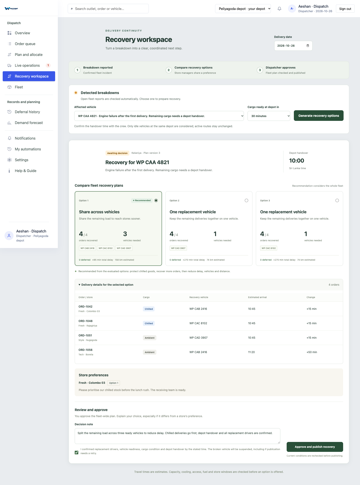
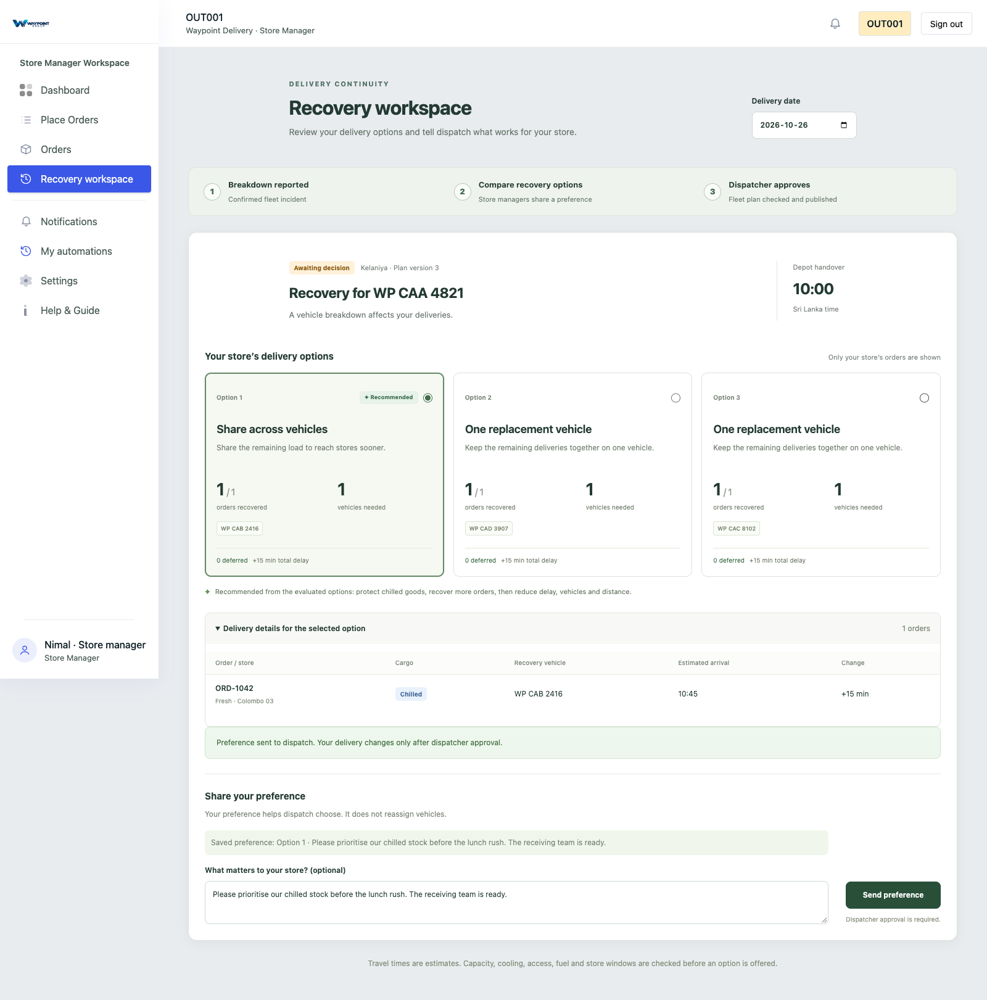
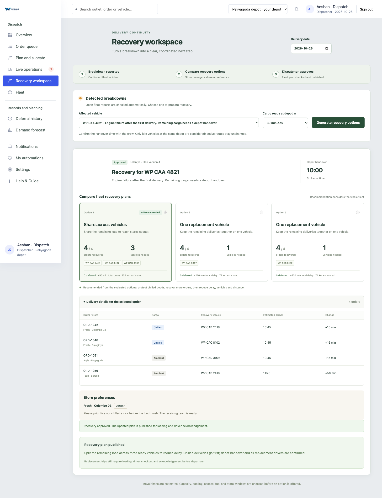
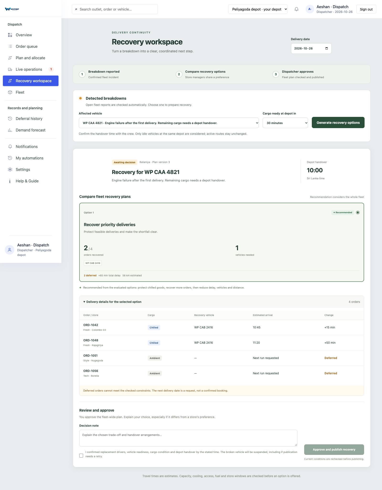
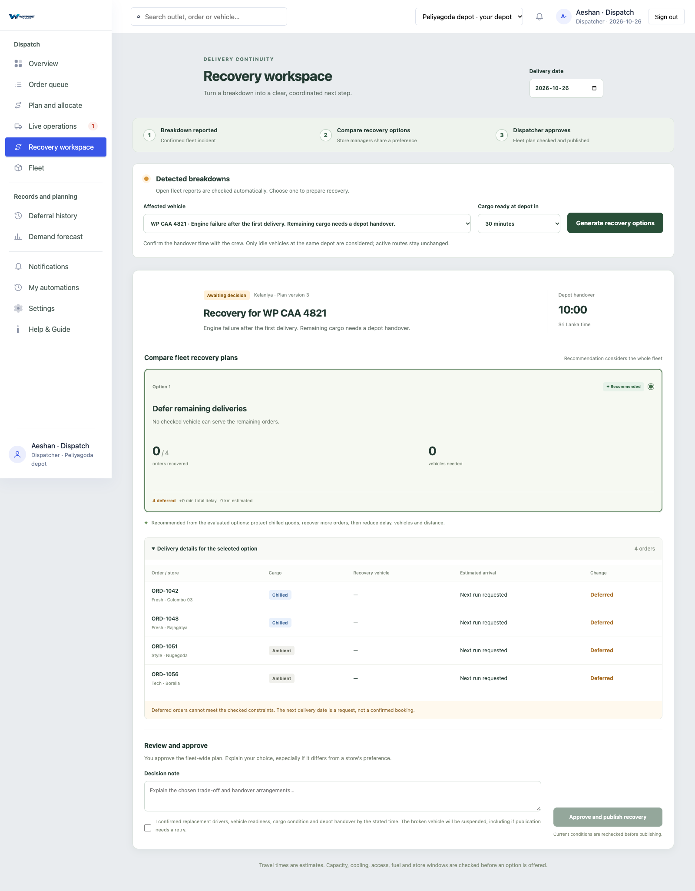
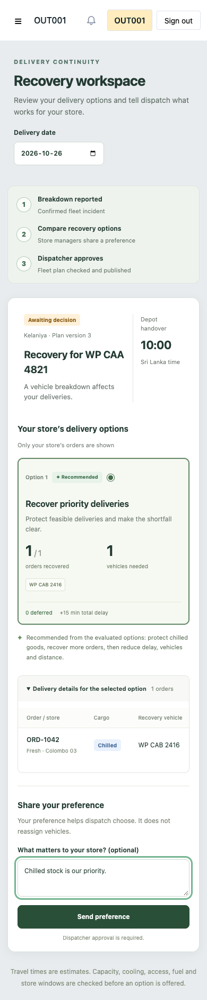

# Disruption recovery workspace

A reported vehicle breakdown can leave several stores waiting for the same load. The recovery workspace compares feasible alternatives, lets affected store managers state a preference, and gives dispatch the final fleet-wide decision.

## Use it

1. Publish a delivery plan and report an open `breakdown` incident for an allocated vehicle on that date.
2. Open **Dispatcher → Recovery workspace**. Open breakdown reports refresh every 30 seconds while the page is open. Choose the report and a realistic cargo-ready time at its home depot.
3. Generate options. Store managers see the relevant case under **Recovery workspace**, with only their own orders and local totals. They choose an option and can add an operational note. This does not move vehicles.
4. Dispatch compares options and store preferences, records its decision, and confirms driver readiness, vehicle readiness, cargo condition and depot handover. Approval rechecks current conditions before publishing.
5. Replacement trips continue through normal loading, checkout and acknowledgement. Publication does not dispatch a vehicle automatically. Deferred orders request the following delivery date; they are not automatically booked on it.

## Deterministic planner

No LLM, model service or API key is used. The Go planner tries each idle replacement vehicle, an earliest-arrival split across the available vehicles, and a consolidation strategy. Identical assignments are deduplicated and the best three are shown.

The recommendation is the best **evaluated** candidate, not a claim of mathematical optimality. Ranking is lexicographic:

1. Fewer chilled orders deferred.
2. Fewer total orders deferred.
3. Less summed delay relative to the previous planned service times.
4. Fewer vehicles, then shorter estimated distance, then a stable candidate identifier.

Checks cover load weight and volume, refrigeration, van-only access, depot compatibility, fleet availability, fuel including the return journey, and store service windows. Completed/terminal deliveries, including partial and failed delivery outcomes, are excluded from recovery. Missing progress or necessary data fails closed.

The handover is at the broken vehicle's home depot. A replacement must have no trip assigned in that day's plan, even if its earlier trip appears completed. This conservative first version does **not** insert cargo into active routes, calculate roadside transfers, reserve drivers automatically, or detect breakdowns from raw GPS. Reports are the detection input, and dispatch explicitly starts candidate generation. Travel estimates use the existing district estimator and its documented fallback. Fuel reserves recorded consumption plus all other confirmed bookings; this can conservatively double-count past bookings.

## Persistence and concurrency

- Analyses, actor-attributed store preferences and dispatcher approval receipts are persisted in PostgreSQL. Creating a new analysis supersedes earlier pending analyses for the same incident. Preferences never silently transfer to a changed candidate set.
- Options expire after 15 minutes or at handover, whichever comes first. The UI counts from server time using a monotonic browser clock; the server always enforces expiry.
- Approval compares the plan version and a canonical snapshot of orders, allocations, trips, vehicles, availability, fuel, travel estimates and source delivery progress. It regenerates the candidate instead of accepting client-authored assignments.
- Fleet-service marks the source in workshop. Delivery-service then durably suspends the old trip/order pairs. Its database trigger serializes suspension with arrival/completion updates, including offline sync. If completion wins the race, recovery must be regenerated; if suspension wins, the late event cannot complete the old stop. Replacement trip stops remain writable.
- Source workshop/suspension are deliberate, idempotent cross-service effects. They remain in force if publication fails; the UI states this before approval. Retry the same approval, or regenerate if inputs changed. Original stops are preserved for audit; this feature does not automatically close the original driver's run or clear old offline work.
- Allocations, explicit deferrals, the new publication/version and the approval receipt commit in one planning transaction. Brief table locks also serialize legacy planning writers that do not take per-plan locks. A second snapshot check inside that transaction detects changed allocations, and target trips must still be absent.
- Retrying an approved candidate returns its recorded publication. A different candidate conflicts. External fleet availability is rechecked, not distributed-transactionally reserved; later fleet changes remain operational events requiring a new recovery decision. The approval record is durable even if the best-effort audit event cannot be delivered.

## API and rollout

The OpenAPI contracts document the request bodies and responses. New routes:

| Route | Access / purpose |
| --- | --- |
| `GET /planning/recovery?date=YYYY-MM-DD` | Dispatcher or own-store read; includes `serverNow` |
| `POST /planning/recovery` | Dispatcher generates a persisted analysis |
| `PUT /planning/recovery/{caseId}/preference` | Store manager, authorized outlet only |
| `POST /planning/recovery/{caseId}/approve` | Dispatcher publishes the selected candidate |
| `POST /delivery/internal/recovery/suspend` | Planning machine client only |

Apply migrations **0079** and **0080**, grant `deliveries:recover-internal` to the planning machine client in the identity provider, then deploy delivery-service, planning-service and web. Do not grant that scope to human roles. Existing `fleet:update` permission remains necessary. Local dev OIDC accepts the requested scope; production must provision it explicitly.

## Verified examples and screenshots

The planner examples use synthetic orders, vehicles and a fixed Sri Lanka handover time of 10:00. Browser screenshots render the actual React pages and layouts with the **real Go example outputs**. Browser network writes are simulated in the development harness; PostgreSQL integration tests separately exercise real persistence, authorization, stale-state rejection, transaction rollback and delivery suspension. These are not screenshots of production deliveries.

| Scenario | Recommended result |
| --- | --- |
| Four orders, three idle rescue vans | Recover 4/4 using 3 vehicles; 95 total delay minutes; 158 estimated km |
| Four orders, one van with 400 kg capacity | Recover the 2 chilled orders; defer the other 2; 65 total delay minutes |
| No idle rescue vehicle | Explicitly defer all 4; no invented capacity or ETA |













## Reproduce locally

From the repository root, with Go, Docker and the web dependencies installed:

```sh
go test ./services/planning-service/... ./services/delivery-service/...
cd apps/web
npm test
npm run build
```

For the synthetic UI demonstration (no credentials or production services):

```sh
mkdir -p /tmp/recovery-examples
RECOVERY_EXAMPLE_DIR=/tmp/recovery-examples go test -v ./services/planning-service/internal/recovery -run TestRecoveryExamples -count=1
RECOVERY_EXAMPLE_DIR=/tmp/recovery-examples node apps/web/scripts/recovery-preview.mjs
```

Open `http://127.0.0.1:4321/__preview?role=dispatch&scenario=full`. Switch `role` to `store`; choose `scenario=partial` or `scenario=no-capacity`. Add `&stale=1` to demonstrate rejection of an obsolete approval. This harness binds to loopback only, runs outside the production app, uses a fixed fixture clock and never connects to live services.

The optional `apps/web/scripts/recovery-browser-check.mjs` checks both roles, preference submission, the approval gate, published results, partial/no-capacity states, stale rejection, device-clock independence and mobile overflow, then regenerates the six screenshots. It requires Playwright (resolve it via `PLAYWRIGHT_MODULE` if installed outside this project) and a browser (`CHROME_PATH` can select an existing Chrome binary). Run it with the preview server running.
